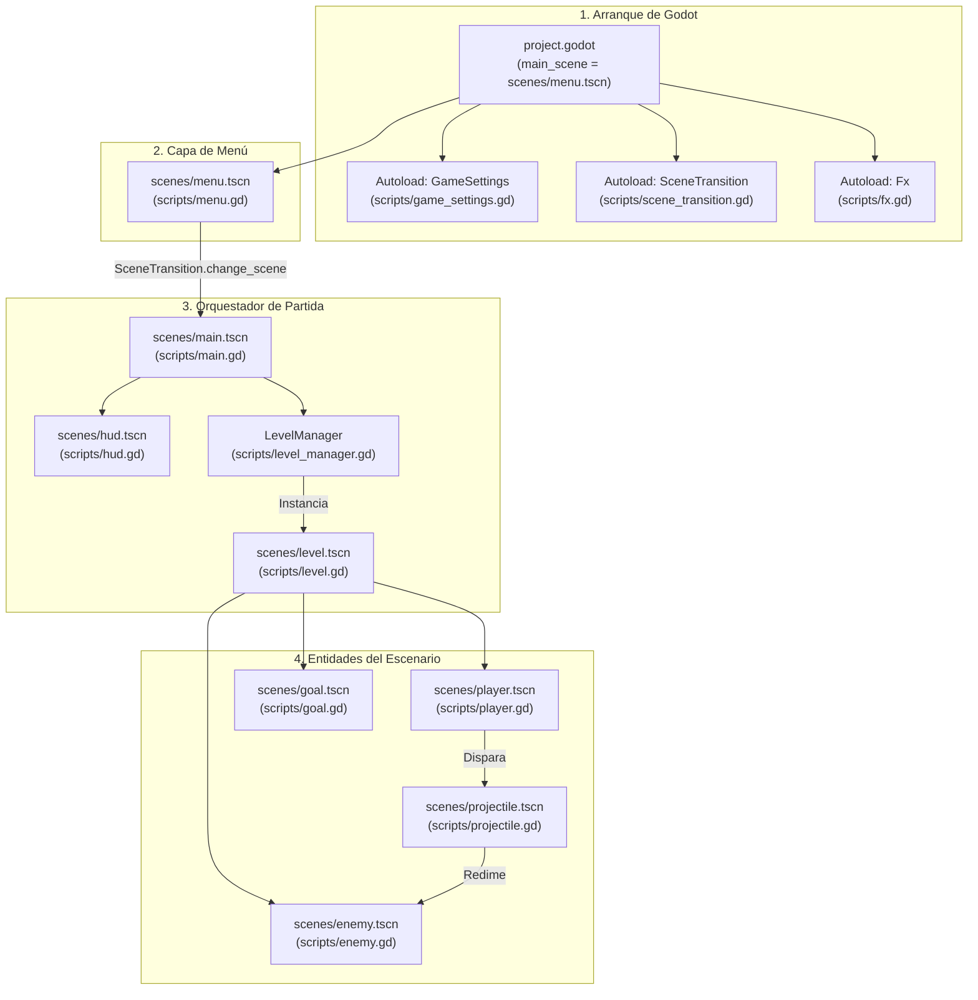

# 🤖 AGENTS.md — Guía Técnica Maestra para Agentes de IA y Desarrolladores

> **Proyecto:** Campeones de los Valores  
> **Motor:** Godot Engine 4.7+ (Renderer: `gl_compatibility`)  
> **Ámbito:** Videojuego educativo 2D en perspectiva 3/4 (estilo RPG retro) y visor arquitectónico BIM/CAD 3D  
> **Plantel de Referencia:** CEMSaD 22 ENTHAVI — Colegio de Bachilleres del Estado de México (COBAEM)  
> **Escala Unificada:** $1\text{ metro lineal} = 40\text{ píxeles}$ ($1\text{ px} = 2.5\text{ cm}$, $1\text{ baldosa } 40\times 40\text{ px} = 1.00\text{ m}^2$)

---

## 🎯 1. Propósito de este Documento

Este archivo es la **fuente de verdad técnica** para agentes de inteligencia artificial y desarrolladores. Explica:
1. Cómo está estructurado y cómo opera el sistema de ejecución de **Campeones de los Valores**.
2. La responsabilidad exacta de cada archivo del repositorio.
3. El protocolo paso a paso para diagnosticar y reparar cualquier error o regresión.
4. Las invariantes de diseño que ningún agente debe romper bajo ninguna circunstancia.

---

## ⚙️ 2. Arquitectura del Sistema y Flujo de Ejecución

El proyecto está diseñado bajo una arquitectura modular desacoplada en Godot Engine 4 con tres capas principales:



### 🔄 Ciclo de Vida de una Partida

1. **Inicialización de Autoloads:**
   - [`GameSettings`](scripts/game_settings.gd): Inicializa el reproductor `_music` con volumen persistente, carga la dificultad por defecto (`Difficulty.NORMAL`) y reproduce `music_menu.wav`.
   - [`SceneTransition`](scripts/scene_transition.gd): Instancia en `layer = 100` el lienzo con [`pixel_transition.gdshader`](shaders/pixel_transition.gdshader) para fundidos entre escenas.
   - [`Fx`](scripts/fx.gd): Registra el procesador de sacudida sísmica de cámara (`shake`), congelamiento de impacto (`hitstop`) y gestor de partículas (`burst`).

2. **Menú de Inicio (`scenes/menu.tscn`):**
   - El jugador selecciona dificultad (`Fácil`, `Normal`, `Difícil`) modificando `GameSettings.difficulty`.
   - Al pulsar Jugar, `SceneTransition.change_scene("res://scenes/main.tscn")` oculta la pantalla con rombos pixel-art y carga el controlador principal.

3. **Carga y Progresión Modular (`scenes/main.tscn`):**
   - `main.gd` invoca `LevelManager.get_all_levels()`.
   - `load_level(index)` libera el escenario previo con `queue_free()`, instancia `level.tscn` y le pasa la configuración del diccionario (dimensiones, texturas, colisiones, spawns y enemigos).
   - `hud.gd` actualiza corazones, título del edificio y configura la barra de progreso en base a la distancia vectorial real entre `player_spawn` y `goal_position`.

4. **Dinámica de Combate y Redención:**
   - El héroe se mueve libremente en 8 direcciones con ordenamiento `y_sort_enabled = true`.
   - Al pulsar o mantener <kbd>Espacio</kbd>, el jugador dispara un proyectil de virtud (`projectile.gd`).
   - Al impactar a un antivalor (`enemy.gd`), no hay destrucción violenta: el enemigo emite sonido dulce, lanza partículas resplandecientes, proclama su virtud flotante (*¡Amabilidad!*, *¡Respeto!*, *¡Empatía!*) y se oculta temporalmente antes de regenerarse pacíficamente.
   - Al llegar a la meta (`goal.gd`), el héroe celebra, se emite fanfarria y se avanza al siguiente edificio del plantel CEMSaD 22.

---

## 📁 3. Catálogo Exhaustivo de Archivos y Responsabilidades

Si encuentras un error o necesitas implementar una función, consulta esta tabla para ubicar exactamente el archivo responsable:

| Archivo | Tipo / Lenguaje | Responsabilidad Principal | Métodos / Clases Clave |
| :--- | :--- | :--- | :--- |
| [`project.godot`](project.godot) | Configuración Godot | Configuración global: escena de inicio (`menu.tscn`), resolución 800×450, filtros pixel-snap y lista de Autoloads. | Secciones `[autoload]`, `[display]`, `[rendering]` |
| [`scripts/game_settings.gd`](scripts/game_settings.gd) | Autoload GDScript | Singleton de balance: dificultad (vidas, velocidad de enemigos, cadencia) y música persistente con fundido cruzado. | `PRESETS`, `get_param()`, `play_menu_music()`, `duck_music()` |
| [`scripts/scene_transition.gd`](scripts/scene_transition.gd) | Autoload GDScript | Transiciones visuales cinematográficas mediante shader para cambio de niveles o recarga sin pantallas negras. | `change_scene()`, `reload_scene()`, `_run()`, `_reveal()` |
| [`scripts/fx.gd`](scripts/fx.gd) | Autoload GDScript | Efectos de sensación táctil ("game feel"): temblor de cámara con snap al píxel, hitstop, textos flotantes y partículas. | `shake()`, `hitstop()`, `floating_text()`, `burst()` |
| [`scripts/level_manager.gd`](scripts/level_manager.gd) | GDScript (`RefCounted`) | Catálogo oficial de los 6 escenarios a escala real del plantel CEMSaD 22 ENTHAVI. Detecta nuevos PNGs en `escenarios/`. | `get_default_levels()`, `get_all_levels()`, `_create_auto_level()` |
| [`scripts/level.gd`](scripts/level.gd) | GDScript (`Level`) | Controlador del escenario activo. Carga la textura, crea paredes limítrofes, cajas de colisión e instancia entidades. | `setup_level()`, `_build_boundary_walls()`, `_build_obstacles()` |
| [`scripts/player.gd`](scripts/player.gd) | GDScript (`Player`) | Héroe jugable en perspectiva 3/4. Movimiento 8D con inercia, balanceo de pasos, disparo continuo, retroceso y vidas. | `perform_attack()`, `spawn_projectile()`, `take_damage()`, `celebrate()` |
| [`scripts/enemy.gd`](scripts/enemy.gd) | GDScript (`Enemy`) | Inteligencia artificial de los antivalores. Persecución por distancia al cuadrado, patrullaje, impacto y redención. | `_update_ai()`, `hit_by_attack()`, `respawn()`, `TYPE_DATA` |
| [`scripts/projectile.gd`](scripts/projectile.gd) | GDScript (`Projectile`) | Proyectil de virtudes. Trayectoria cardinal, rotación según vector de avance y detección de impacto con enemigos. | `_physics_process()`, `_on_area_entered()` |
| [`scripts/goal.gd`](scripts/goal.gd) | GDScript (`Goal`) | Portal / salida hacia la siguiente zona escolar. Dispara efectos de victoria y señal de avance. | `trigger()`, `_on_body_entered()` |
| [`scripts/main.gd`](scripts/main.gd) | GDScript | Controlador general de la campaña escolar. Maneja carga de niveles, progreso métrico hacia la meta y fin de juego. | `load_level()`, `_on_level_completed()`, `_on_player_died()` |
| [`scripts/menu.gd`](scripts/menu.gd) | GDScript | Controlador del menú inicial. Selección de dificultad, animaciones elásticas de botones y fondo con scroll. | `_select_difficulty()`, `_refresh_difficulty()`, `_start_game()` |
| [`scripts/hud.gd`](scripts/hud.gd) | GDScript (`HUD`) | Interfaz gráfica de usuario. Renderizado de vidas (corazones), barra de avance métrico y modales interactivos. | `update_hearts()`, `update_progress()`, `set_paused()`, `show_victory()` |
| [`scripts/mobile_controls.gd`](scripts/mobile_controls.gd) | GDScript (`MobileControls`) | Controles táctiles virtuales para móvil/Android: joystick analógico 8D, botón de Virtud y pausa flotante. | `_update_joystick()`, `_apply_input_axis()`, `_reset_joystick()` |
| [`scenes/mobile_controls.tscn`](scenes/mobile_controls.tscn) | Escena Godot | Capa visual y táctil de controles móviles para celulares, tabletas y pantallas táctiles. | Nodo `Control` con dibujo vectorial |
| [`scripts/ui_juice.gd`](scripts/ui_juice.gd) | GDScript (`UiJuice`) | Utilidad estática para dotar a los botones de microanimaciones elásticas (hover, focus, click) y SFX. | `attach_button()`, `_scale_to()` |
| [`shaders/pixel_transition.gdshader`](shaders/pixel_transition.gdshader) | GLSL Shader | Shader de cortinilla de rombos pixel-art con tamaño de celda ajustable y efecto reversible de barrido. | `fragment()`, parámetros `progress`, `reverse`, `pixel_size` |
| [`scenes/*.tscn`](scenes/) | Escenas Godot | Nodos empaquetados: jerarquía visual y de colisiones de `menu`, `main`, `level`, `player`, `enemy`, `goal`, `hud`. | Estructura de nodos del motor |
| [`escenarios/*.png`](escenarios/) | Texturas PNG | Los 6 mapas oficiales dibujados en pixel art a escala real ($1\text{ m} = 40\text{ px}$) del plantel CEMSaD 22. | Mapas de acceso, aulas, plaza cívica, cancha, etc. |
| [`tools/generate_scenarios.py`](tools/generate_scenarios.py) | Script Python (Pillow) | Generador determinista de los 6 mapas de escenarios con cotas arquitectónicas, adoquines, pasto y edificios. | Función `main()`, base de datos de colores `PAL` |
| [`tools/generate_music.py`](tools/generate_music.py) | Script Python (WAV) | Sintetizador procedural de música chiptune suave (`music_menu.wav` y `music_game.wav`) sin dependencias. | Generación matemática de ondas cuadradas/triangulares |
| [`tools/test_game.gd`](tools/test_game.gd) | Suite Headless GDScript | Test automatizado de integridad: valida carga de niveles, colisiones, spawns y metas libres de bloqueos. | `_init()`, aserciones de consistencia |
| [`tools/build_video.py`](tools/build_video.py) | Script Python (Remotion MCP) | Generador de video interactivo para Remotion MCP y exportador a `video_presentacion.html`. | Llamada JSON-RPC a `create_video` |
| [`tools/render_mp4.py`](tools/render_mp4.py) | Script Python (FFmpeg) | Renderizador local de video MP4 a 1080p con audio chiptune sincronizado. | `render_frame()`, tubería rawvideo a FFmpeg |
| [`video_presentacion.html`](video_presentacion.html) | Aplicación Web (Remotion Player) | Reproductor web interactivo del video generado a través del servidor MCP oficial. | Widget Remotion con controles de reproducción |
| [`video_presentacion.mp4`](video_presentacion.mp4) | Video H.264 / AAC | Archivo de video Full HD (1920×1080 @ 30 FPS, 20s) listo para reproducir localmente. | Video institucional del proyecto |
| [`assets/video_preview.png`](assets/video_preview.png) | Imagen PNG | Miniatura y banner interactivo del video de presentación con botón de reproducción. | Portada y enlace audiovisual en `README.md` |
| [`plano_3d.html`](plano_3d.html) | Aplicación WebGL (Three.js) | Maqueta 3D arquitectónica interactiva con 3 cámaras (RPG 3/4, peatonal, aérea), aristas vectoriales y cotas. | Renderizado BIM del plantel completo |
| [`planos_interactivos.html`](planos_interactivos.html) | Aplicación HTML5/Canvas/SVG | Sistema CAD 2D de alta precisión con cálculo de áreas en $\text{m}^2/\text{cm}^2$ y 52 fotos reales de campo. | Fichas de edificios del CEMSaD 22 |
| [`requirements.txt`](requirements.txt) | Dependencias PIP | Declaración de librerías Python (`Pillow`) para ejecutar `generate_scenarios.py`. | `pip install -r requirements.txt` |
| [`README.md`](README.md) | Documentación Markdown | Guía pública del proyecto: presentación, manual de juego, tabla de controles, escenarios y comandos. | Presentación general para usuarios |
| [`AGENTS.md`](AGENTS.md) | Especificación Técnica | Este documento: arquitectura interna, guía de reparación para agentes y reglas de código. | Guía para agentes de IA |

---

## 🛠️ 4. Guía de Diagnóstico y Reparación de Errores (Troubleshooting Matrix)

Si se produce un error o un fallo en los tests automatizados, sigue este protocolo específico:

### 🔴 Error 1: "Spawn del jugador o meta atrapados dentro de un obstáculo"
- **Síntoma:** El jugador no puede moverse al iniciar el nivel o la prueba `test_game.gd` falla con un mensaje como:  
  `Spawn del jugador (X, Y) está dentro del obstáculo Rect2(...) en Escenario N`.
- **Causa:** En [`scripts/level_manager.gd`](scripts/level_manager.gd), las coordenadas de `player_spawn` o `goal_position` coinciden con alguna de las cajas de colisión de `obstacles: [Rect2(...)]`.
- **Cómo reparar:**
  1. Abre [`scripts/level_manager.gd`](scripts/level_manager.gd) en el nivel correspondiente.
  2. Ajusta las coordenadas `Vector2(X, Y)` del spawn o de la meta para colocarlas en una zona despejada de pasillo o patio.
  3. Ejecuta `godot --headless -s tools/test_game.gd` para verificar que ninguna caja interfiera.

---

### 🔴 Error 2: "Los enemigos no persiguen al jugador o consumen demasiada CPU"
- **Síntoma:** Los antivalores se quedan quietos o causan tirones de rendimiento (*frame drops*).
- **Causa:** En [`scripts/enemy.gd`](scripts/enemy.gd), el cálculo de rango de visión está calculando raíces cuadradas continuas o `_detection_range_sq` no está inicializado.
- **Cómo reparar:**
  1. Verifica que en `setup_type()` se calcule `_detection_range_sq = detection_range * detection_range`.
  2. Verifica que en `_update_ai()` se compare `global_position.distance_squared_to(player.global_position) <= _detection_range_sq`.
  3. Asegúrate de que `player` esté asignado en `Level.setup_level()`.

---

### 🔴 Error 3: "Superposición visual errónea (el personaje se dibuja detrás del suelo o sobre techos)"
- **Síntoma:** Anomalías en el orden de profundidad visual al caminar cerca de muros, bancas u otros personajes.
- **Causa:** Algún nodo contenedor tiene desactivada la propiedad `y_sort_enabled`.
- **Cómo reparar:**
  1. Revisa [`scripts/level.gd`](scripts/level.gd): `entities.y_sort_enabled = true` y `enemies_container.y_sort_enabled = true`.
  2. Revisa [`scripts/player.gd`](scripts/player.gd), [`scripts/enemy.gd`](scripts/enemy.gd) y [`scripts/goal.gd`](scripts/goal.gd): todos deben ejecutar `y_sort_enabled = true` en su función `_ready()`.
  3. Comprueba que el punto de pivote (`offset` o posición de los pies) del sprite esté ubicado en la base del personaje (eje Y inferior).

---

### 🔴 Error 4: "La barra de progreso del HUD no avanza o salta erráticamente"
- **Síntoma:** El icono del corredor no se mueve o salta de golpe a 100%.
- **Causa:** En [`scripts/main.gd`](scripts/main.gd), el cálculo del progreso está basado únicamente en el eje horizontal `X` en lugar de la distancia euclidiana 2D real (los escenarios 1 a 6 tienen metas en direcciones norte, sur, este y oeste).
- **Cómo reparar:**
  1. En `load_level()`, verificar que `_cached_total_dist = maxf(1.0, p_spawn.distance_to(g_pos))`.
  2. En `_process()`, verificar que la distancia recorrida se obtenga con:
     ```gdscript
     var remaining_dist := active_level.player.position.distance_to(_cached_goal_pos)
     var current_dist := clampf(_cached_total_dist - remaining_dist, 0.0, _cached_total_dist)
     hud.update_progress(current_dist, _cached_total_dist)
     ```

---

### 🔴 Error 5: "La música se corta de golpe o suena distorsionada"
- **Síntoma:** Silencio al cambiar de nivel o ruidos secos en transiciones.
- **Causa:** El nodo de audio fue instanciado dentro de la escena del nivel en vez del singleton persistente [`GameSettings`](scripts/game_settings.gd).
- **Cómo reparar:**
  1. Toda reproducción musical debe realizarse a través de `GameSettings.play_game_music()` o `GameSettings.play_menu_music()`.
  2. Para pausar o reducir volumen en menús modales, usa `GameSettings.duck_music(true/false)`.
  3. Si los archivos WAV sufren cambios, regenera la banda sonora ejecutando:
     ```bash
     python3 tools/generate_music.py
     ```

---

### 🔴 Error 6: "Fallo al cargar escenarios generados externamente"
- **Síntoma:** El juego carga una pantalla gris con dimensiones por defecto (1200×800) en lugar del mapa.
- **Causa:** El archivo `.png` en `escenarios/` fue creado recientemente y Godot aún no genera su archivo `.import`, o la ruta está mal escrita.
- **Cómo reparar:**
  1. En [`scripts/level.gd`](scripts/level.gd), se incluye una vía de carga directa mediante `Image.load_from_file()` como respaldo de `ResourceLoader.load()`.
  2. Regenera los escenarios con `python3 tools/generate_scenarios.py`.
  3. Inicia Godot brevemente para que indexe los nuevos assets o ejecuta los tests headless.

---

## 📐 5. Invariantes Técnicas y Reglas Obligatorias para Agentes

Al modificar código, crear niveles o refactorizar, **debes cumplir estrictamente estas 7 reglas**:

1. **Escala Arquitectónica Sagrada:**
   $$\mathbf{1\text{ metro} = 40\text{ píxeles}} \quad (\mathbf{1\text{ píxel} = 2.5\text{ cm}}, \quad \mathbf{1\text{ baldosa} = 1.00\text{ m}^2})$$
   Nunca cambies arbitrariamente las dimensiones de los escenarios ni el tamaño de colisiones sin mantener la escala de $40\text{ px/m}$.

2. **Perspectiva 3/4 sin Gravedad de Plataformas:**
   El movimiento del personaje se realiza sobre el plano bidimensional $(X, Y)$ donde el eje $Y$ representa profundidad espacial (norte/sur), no altura de salto. `default_gravity` debe permanecer en `0.0` en `project.godot`.

3. **Optimización de IA (Prohibido `sqrt` en Bucles de Física):**
   Cualquier comparación de proximidad o detección en `enemy.gd` debe utilizar `distance_squared_to()` contrastado con radios precalculados al cuadrado (`_detection_range_sq`). Nunca uses `distance_to()` en `_physics_process()`.

4. **Renderer GL Compatibility:**
   El motor está configurado exclusivamente en modo `gl_compatibility` para asegurar que funcione en computadoras de escuelas de escasos recursos y navegadores web. No utilices funciones que requieran Vulkan o Forward+.

5. **Filosofía de Redención Educativa (No Violencia):**
   Los enemigos nunca mueren, explotan de forma sangrienta ni son eliminados permanentemente. Siempre proclaman un valor formativo (*¡Amabilidad!*, *¡Respeto!*, *¡Empatía!*) y reaparecen pacíficamente tras un temporizador (`respawn_delay`).

6. **Liberación de Memoria Garantizada:**
   Al cambiar de nivel en `main.gd`, todos los nodos del nivel anterior deben ser liberados con `queue_free()`. Nunca acumules escenas huérfanas en el árbol.

7. **Comentarios Limpios y Claros:**
   Conserva docstrings concisos (`##`) y comentarios directos que expliquen el *por qué* técnico de cada decisión, evitando textos confusos o redundantes.

---

## 🧪 6. Comandos de Verificación Rápida para Agentes

Antes de dar por concluida cualquier modificación en el repositorio, ejecuta esta secuencia de comprobación:

```bash
# 1. Validar y regenerar la banda sonora sin errores sintácticos
python3 tools/generate_music.py

# 2. Validar y regenerar los 6 escenarios a escala real
python3 tools/generate_scenarios.py

# 3. Correr la suite de pruebas automatizadas en Godot (si godot está en PATH)
godot --headless -s tools/test_game.gd

# 4. Comprobar que no queden archivos temporales no deseados
git status --short
```

---

*Documento mantenido para la interoperabilidad de agentes de inteligencia artificial y la comunidad educativa de CEMSaD 22 ENTHAVI.*
