<div align="center">

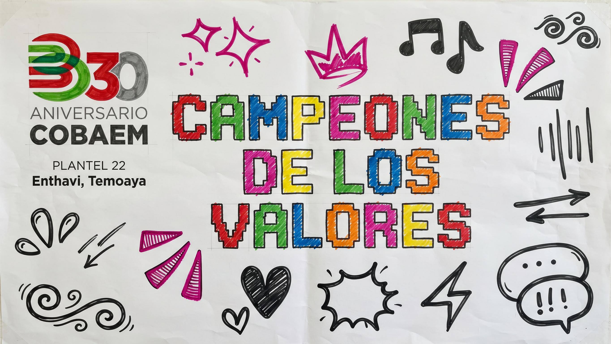

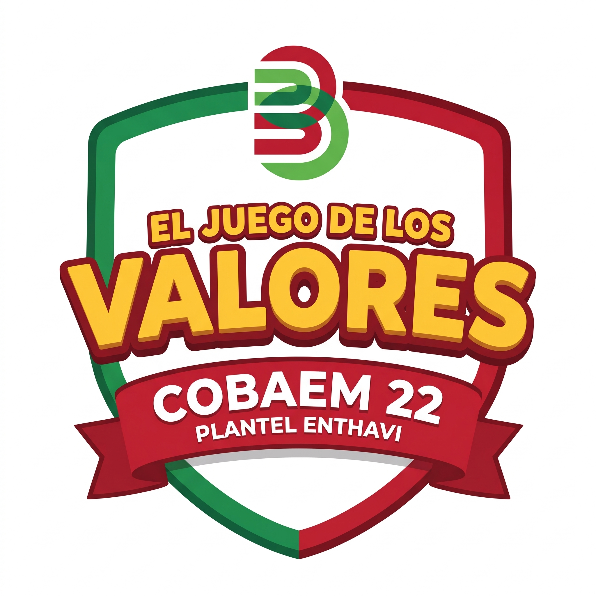

# 🏆 Campeones de los Valores
### *CEMSaD 22 ENTHAVI — Colegio de Bachilleres del Estado de México (COBAEM)*

**Videojuego educativo de aventura y acción retro en perspectiva 3/4 desarrollado en Godot Engine 4.**  
Ambientado a **escala arquitectónica real** ($1\text{ m} = 40\text{ px}$) dentro de las instalaciones del plantel, diseñado para transformar antivalores (*Grosería*, *Acoso*, *Bullying*) en virtudes humanas (*Amabilidad*, *Respeto*, *Empatía*).

<p>
  <a href="https://godotengine.org/"></a>
  <a href="https://docs.godotengine.org/en/stable/tutorials/rendering/"></a>
  <a href="planos/plano_3d.html"></a>
</p>
<p>
  
  
  <a href="https://cobaem.edomex.gob.mx/"></a>
  <a href="LICENSE"></a>
</p>

<br/>

[⚡ Inicio Rápido](#-inicio-rápido) •
[🎬 Video](#-video-de-presentación) •
[🗺️ Escenarios](#️-los-6-escenarios-a-escala-real) •
[🎮 Jugabilidad](#-jugabilidad-y-controles) •
[🎓 Personajes y Jefes](#-comunidad-escolar-y-bestiario) •
[📐 Planos 3D / CAD](#-sistema-cad-2d-y-maqueta-3d-interactiva) •
[🏗️ Desarrollo](#️-arquitectura-y-desarrollo)

</div>

---

## ✨ De un Vistazo

<table>
  <tr>
    <td width="50%" valign="top">
      <h3>🎓 Enfoque Educativo (Cero Violencia)</h3>
      No hay destrucción violenta: cada disparo de virtud representa diálogo y asertividad. Los antivalores y jefes se <strong>redimen pacíficamente</strong>, proclamando valores y sumando esperanza a la comunidad escolar.
    </td>
    <td width="50%" valign="top">
      <h3>📐 Plantel Real a Escala Exacta</h3>
      Levantado con planos oficiales y 52 fotografías de campo bajo una escala estricta de <strong>1 metro = 40 píxeles</strong> (1 baldosa = 1 m²), con 6 zonas exteriores, 6 salones interiores y visor BIM 3D.
    </td>
  </tr>
  <tr>
    <td width="50%" valign="top">
      <h3>🎮 Acción 3/4, Salones y Danmaku</h3>
      Combina exploración 8D con <em>Y-Sorting</em>, Modo Historia con cinemáticas, rescate de aliados con IA (<code>AllyBrain</code>), salones interiores y un clímax estilo <strong>Danmaku Touhou</strong> con micro-hitbox y <em>Graze</em>.
    </td>
    <td width="50%" valign="top">
      <h3>📱 Multiplataforma y Ligero</h3>
      Motor <code>GL Compatibility</code> compatible con PCs escolares (Windows/Linux), Android (controles táctiles dinámicos con <em>Safe Area</em>) y Web/PWA, manteniendo la VRAM por debajo de 150 MB.
    </td>
  </tr>
</table>

---

## 🎬 Video de Presentación

https://github.com/user-attachments/assets/75b3ccd4-ab32-4d3e-8b7b-bba197a8a0dc

> **Opciones de reproducción local:**
> - 🌐 **Reproductor Web Interactivo (Remotion):** [`assets/video/video_presentacion.html`](assets/video/video_presentacion.html) *(play, pausa, línea de tiempo y pantalla completa en tu navegador)*.
> - 📹 **Video MP4 Full HD:** [`assets/video/video_presentacion.mp4`](assets/video/video_presentacion.mp4) *(1920×1080 @ 30 FPS con banda sonora chiptune `music_game.wav`)*.

---

## ⚡ Inicio Rápido

### 📋 Requisitos

| Componente | Versión Recomendada | Uso |
| :--- | :--- | :--- |
| **Godot Engine** | `4.7.x` *(compatible 4.3+)* | Versión estándar (`GL Compatibility`, .NET no requerido). |
| **Python** *(Opcional)* | `3.10+` | Regenerar música chiptune o levantar servidor local de planos. |
| **Navegador Web** | Chrome, Firefox, Edge o Safari | Visualizar la maqueta 3D WebGL y los planos CAD 2D. |

### 🚀 Ejecutar desde Terminal

```bash
# 1. Clonar el repositorio
git clone https://github.com/Kineyo/valores-cobaem22.git
cd valores-cobaem22

# 2. Iniciar directamente con Godot Engine 4
godot --path . scenes/menu.tscn

# Alternativa si usas Flatpak en Linux:
flatpak run org.godotengine.Godot --path . scenes/menu.tscn
```

<details>
<summary><strong>🖥️ ¿Prefieres abrirlo desde el Editor Visual de Godot?</strong></summary>

1. Abre **Godot Engine 4** y haz clic en **Importar** (`Import`).
2. Selecciona el archivo `project.godot` dentro de la carpeta clonada.
3. Pulsa **Importar y Editar** y presiona <kbd>F5</kbd> (▶ **Ejecutar Proyecto**).

</details>

> [!TIP]
> Desde el menú principal puedes alternar dificultad al instante con <kbd>1</kbd>, <kbd>2</kbd> o <kbd>3</kbd>, y cambiar de personaje (uniforme con pantalón o falda COBAEM) con <kbd>Q</kbd> / <kbd>E</kbd>.

---

## 🎯 Propósito y Visión Educativa

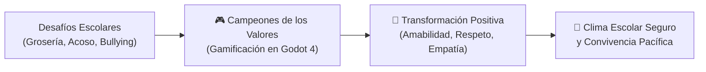

1. **Resolución Constructiva de Conflictos:** Desarticula conductas agresivas mediante diálogo simbólico y asertividad.
2. **Apropiación del Espacio Escolar:** Recorrer aulas, laboratorios, canchas y plazas fieles a su plantel fortalece el sentido de pertenencia.
3. **Refuerzo Positivo Inmediato:** Cada redención muestra mensajes formativos y recupera esperanza junto a las y los compañeros.

---

## 🗺️ Los 6 Escenarios a Escala Real

Todo el plantel **CEMSaD 22 ENTHAVI** respeta la escala arquitectónica unificada:

$$\mathbf{1\text{ m} = 40\text{ px}} \quad \Longleftrightarrow \quad \mathbf{1\text{ px} = 2.5\text{ cm}} \quad \Longleftrightarrow \quad \mathbf{1\text{ baldosa } (40\times 40\text{ px}) = 1.00\text{ m}^2}$$

<table>
  <tr>
    <td width="50%" align="center">
      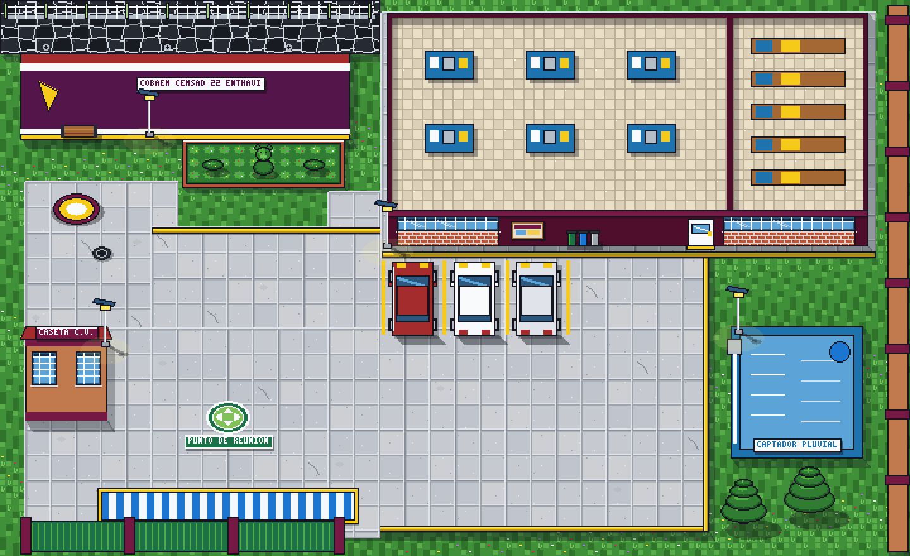
      <br/><strong>1. Acceso, Caseta C.V. y Edificio D</strong><br/>
      <sub><code>1440×880 px</code> · <code>36.0 × 22.0 m</code> (792 m²)</sub>
    </td>
    <td width="50%" align="center">
      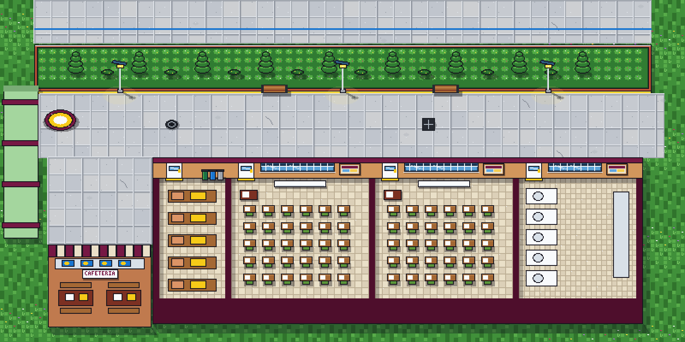
      <br/><strong>2. Edificio A — Cafetería y Aulas 1–2</strong><br/>
      <sub><code>1600×800 px</code> · <code>40.0 × 20.0 m</code> (800 m²)</sub>
    </td>
  </tr>
  <tr>
    <td width="50%" align="center">
      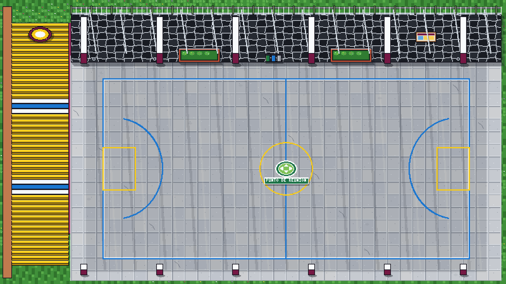
      <br/><strong>3. Plaza Cívica Techada y Escalinata</strong><br/>
      <sub><code>1600×900 px</code> · <code>40.0 × 22.5 m</code> (900 m²)</sub>
    </td>
    <td width="50%" align="center">
      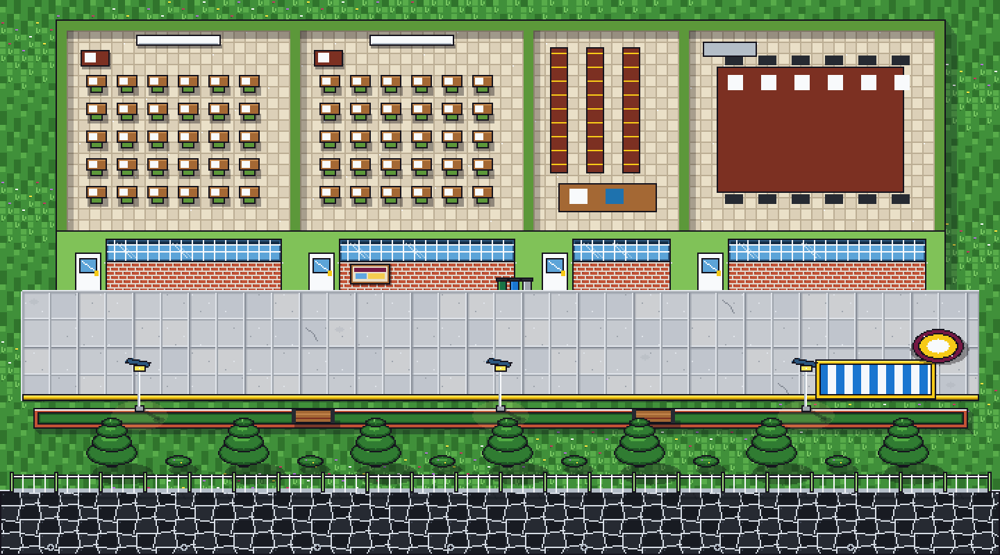
      <br/><strong>4. Terraza Superior (+4m) y Edificio B</strong><br/>
      <sub><code>1440×800 px</code> · <code>36.0 × 20.0 m</code> (720 m²)</sub>
    </td>
  </tr>
  <tr>
    <td width="50%" align="center">
      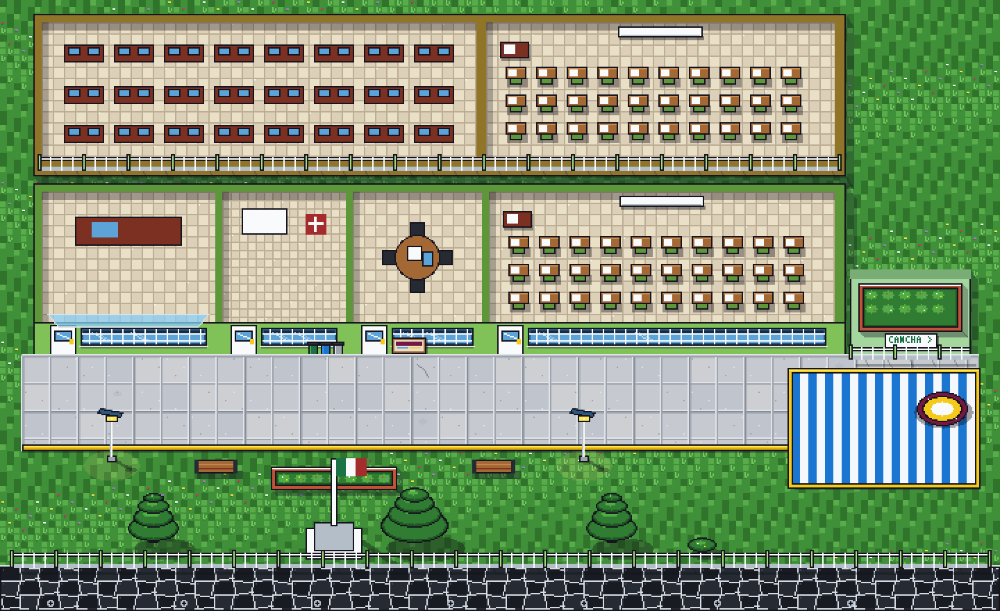
      <br/><strong>5. Edificio C — Cómputo y Dirección</strong><br/>
      <sub><code>1440×880 px</code> · <code>36.0 × 22.0 m</code> (792 m²)</sub>
    </td>
    <td width="50%" align="center">
      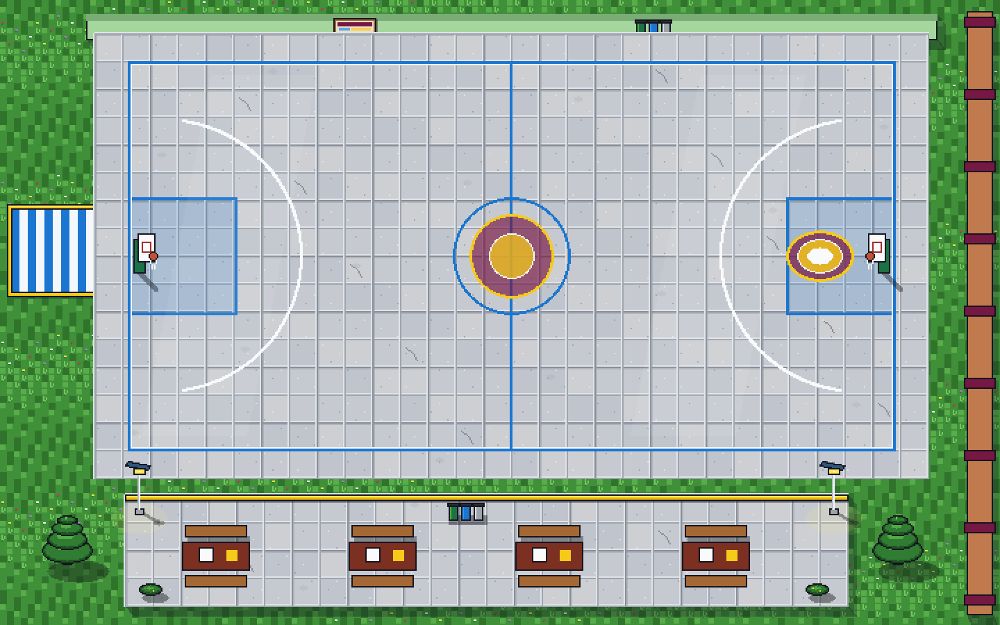
      <br/><strong>6. Cancha Polideportiva y Podio Final</strong><br/>
      <sub><code>1440×900 px</code> · <code>36.0 × 22.5 m</code> (810 m²)</sub>
    </td>
  </tr>
</table>

<details>
<summary><strong>📍 Ver desglose arquitectónico detallado de los 6 escenarios</strong></summary>

1. **Acceso, Caseta C.V. y Edificio D (`nivel_1_acceso_laboratorio.png`):** Plaza de bienvenida, Muro COBAEM con el Colibrí del Estado de México, Jardinera con Osito Topiario, Caseta de Vigilancia (`7.5 m²`), estacionamiento en batería, Captador de Agua Pluvial (`25 m²`) y Laboratorios de Usos Múltiples (`183 m²`).
2. **Edificio A — Cafetería y Aulas 1–2 (`nivel_2_edificio_a_cafeteria.png`):** Edificio A (`339.19 m²`) con Cafetería (`43.4 m²`), Almacén (`26.6 m²`), Aulas 1 y 2 (`56 m²` c/u), sanitarios y andador norte con columnas guinda y pinos en espiral.
3. **Plaza Cívica Techada y Escalinata (`nivel_3_plaza_civica_escalinata.png`):** Explanada techada con arco techo blanco a `9.5 m` (`748 m²`), muro de piedra braza (`4.00 m` de desnivel), lona conmemorativa y Escalinata Monumental en "S" (`81 m²`).
4. **Terraza Superior (+4.00 m) y Edificio B (`nivel_4_edificio_b.png`):** Meseta superior con Edificio B (`312.85 m²`), Aulas 3 y 4 (`57.6 m²` c/u), Biblioteca Escolar (`37.44 m²`), Sala de Maestros (`56.16 m²`) y vista panorámica del domo.
5. **Edificio C de Dos Niveles (`nivel_5_edificio_c_computo.png`):** Estructura de dos plantas (`625.70 m²`): Taller de Informática y Cómputo (`115.2 m²`), Aulas 5 y 6, Dirección General, Orientación Educativa, Enfermería y explanada del Asta Bandera.
6. **Cancha de Usos Múltiples y Podio (`nivel_6_cancha_usos_multiples.png`):** Cancha polideportiva (`540 m²`), área arbolada con bancas de concreto, barda perimetral oriente y el Gran Podio Dorado de la Copa de los Valores.

</details>

---

## 🎮 Jugabilidad y Controles

### 📖 Modos de Juego

| Modo | Experiencia | Cinemáticas | Objetivo |
| :--- | :--- | :---: | :--- |
| **📖 Modo Historia** | Narrativa pedagógica situada en el CEMSaD 22 y el valle de Temoaya (Prólogo, 6 Actos y Epílogo). | ✅ Sí | Superar los 6 actos, redimir a los jefes mayores y liberar a la comunidad. |
| **🕹️ Modo Arcade** | Acción directa sin pausas narrativas, ideal para torneos rápidos en aulas de cómputo. | ❌ No | Completar cuotas y jefes en cadena buscando la máxima puntuación. |

<details>
<summary><strong>🕹️ Mapeo Universal de Controles (Teclado, Ratón, Gamepad y Móvil Táctil v2.0)</strong></summary>

| Acción | Teclado (PC) | Ratón / Gamepad | Móvil (Táctil v2.0) | Descripción |
| :--- | :---: | :---: | :---: | :--- |
| **Moverse (8D)** | <kbd>W</kbd><kbd>A</kbd><kbd>S</kbd><kbd>D</kbd> / <kbd>Flechas</kbd> | Stick Izq. / D-Pad | **Joystick Izquierdo** | Desplazamiento analógico fluido 8D con muescas cardinales. |
| **Modo Enfoque** | <kbd>Shift</kbd> | <kbd>L1</kbd> / <kbd>LB</kbd> | Arrastre preciso | Reduce velocidad al 52% e ilumina el núcleo vital Touhou (5.5 px). |
| **Disparo de Virtud** | <kbd>Espacio</kbd> | Clic Izq. / <kbd>A</kbd> / <kbd>R1</kbd> | **Joystick Der. `VIRTUD`** | Dispara *Pulso Guinda* o *Destello Guinda* en 360°. |
| **Pulso de Empatía** | <kbd>E</kbd> | <kbd>X</kbd> | **Botón `PULSO`** | Disipa proyectiles cercanos y ralentiza antivalores (10s CD). |
| **Usar Ítem Equipado** | <kbd>Q</kbd> / <kbd>F</kbd> | <kbd>Y</kbd> | **Botón `ÍTEM`** / Slot | Activa el ítem equipado (ej. estrella **Esperanza** de 15s). |
| **Apuntado 360°** | <kbd>I</kbd><kbd>J</kbd><kbd>K</kbd><kbd>L</kbd> | Cursor / Stick Der. | Arrastre Stick Der. | Orienta la dirección del proyectil de virtud. |
| **Pausa / Pantalla Completa** | <kbd>Esc</kbd> / <kbd>P</kbd> · <kbd>F11</kbd> | <kbd>Start</kbd> | **Botón `⏸`** | Pausa sin cortar la música / alterna pantalla completa en PC. |
| **Reiniciar / Táctil PC** | <kbd>R</kbd> · <kbd>F1</kbd> | Modal | Modal | Reinicia el nivel / muestra u oculta controles táctiles en PC. |

</details>

<details>
<summary><strong>🌟 Mecánicas Clave, HUD, Dificultad y Pantalla de Carga Institucional</strong></summary>

#### Ciclo de Juego
```text
Movimiento 8D (Y-Sort) ──► Disparo de Virtudes ──► Cuota de Antivalores (máx. 2 respawns)
                                                               │
Meta Desbloqueada + Alumnos Felices (+1 ♥) ◄── Redención ◄── Aparición del Jefe Final
```

- **Sistema de Aliados (`AllyBrain`):** Cada alumno rescatado conserva su ataque distintivo y se une en la Cancha frente a **Titanor**.
- **Inventario Único & Estrella "Esperanza" (15s):** Al activarla, destruye/bloquea clones, disipa la niebla oscura y deja vulnerable al jefe bajo un aura dorada.
- **Pantalla de Carga Asíncrona (`scenes/loading_screen.tscn`):** Carga en hilo secundario (`ResourceLoader.load_threaded_request`) con escudos oficiales COBAEM (`assets/logos/`), telemetría de escala real y 9 citas formativas (incluyendo sabiduría otomí *K'öte m'ui* y náhuatl *Tlamatiliztli*).

#### Balance por Dificultad (`GameSettings`)

| Parámetro | Fácil 🟢 | Normal 🟡 | Difícil 🔴 |
| :--- | :---: | :---: | :---: |
| **Vidas Iniciales** | **5 ♥** | **3 ♥** | **2 ♥** |
| **Velocidad Enemigos** | `0.75×` | `1.00×` | `1.40×` |
| **Cadencia de Disparo** | `0.22 s` | `0.35 s` | `0.55 s` |
| **Escala de Proyectiles** | `1.6×` | `1.3×` | `1.0×` |
| **Perfil Sugerido** | Primaria / Nuevo ingreso | Secundaria y Preparatoria | Desafío Arcade avanzado |

</details>

---

## 🎓 Comunidad Escolar y Bestiario

Los escenarios cobran vida con **alumnos del CEMSaD 22** en uniforme oficial COBAEM. Al redimir los antivalores de su zona, pasan de `SAD` a `HAPPY`, restauran **+1 Corazón de Esperanza** al acercarte y luchan a tu lado:

| Retrato | Alumno | Semestre / Zona | Habilidad Aliada (`AllyBrain`) |
| :---: | :--- | :--- | :--- |
| 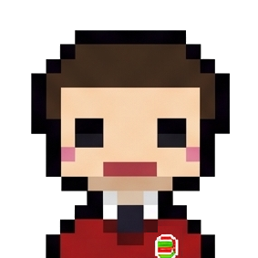 | **Mateo Hernández** | 1.º — Laboratorio (Edif. D) | **Triple Reacción** · Anima a preguntar sin pena |
| 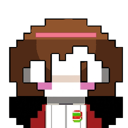 | **María López** | 2.º — Cafetería (Edif. A) | **Escudo Firme** · Limpia proyectiles hostiles |
| 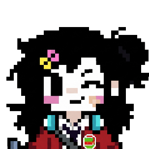 | **Valeria Morales** | 3.º — Plaza Cívica | **Pulso Estéreo** · Doble onda curva de inclusión |
| 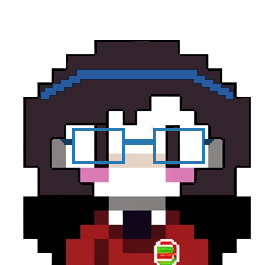 | **Fernanda Ortiz** | 4.º — Biblioteca (Edif. B) | **Nota al Margen** · Disparo guiado contra rumores |
| 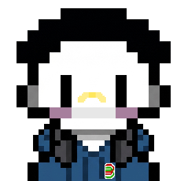 | **Diego Ramírez** | 5.º — Cómputo (Edif. C) | **Señal Abierta** · Onda tecnológica protectora |
| 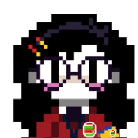 | **Sofía Valdés** | 5.º — Dirección (Edif. C) | **Turno Abierto** · Acelera la respuesta del grupo |
| 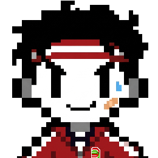 | **Alejandro Cruz** | 6.º — Cancha Deportiva | **Pase de Rebote** · Invita al *Fair Play* |

<details>
<summary><strong>👹 Bestiario de Antivalores Menores y los 7 Jefes Finales</strong></summary>

#### Antivalores de Patrullaje
| Antivalor | Rasgo | Comportamiento | Virtud Liberada | Puntos |
| :--- | :---: | :--- | :---: | :---: |
| **Grosería** | 🔴 Rojo | Impulsivo, da brincos y arremete a radio medio. | **Amabilidad** | `+100` |
| **Acoso** | 🟠 Ámbar | Vigila a gran distancia, rodea obstáculos y persigue sin soltar. | **Respeto** | `+150` |
| **Bullying** | 🟣 Morado | Pesado y territorial, embestida veloz en perímetros clave. | **Empatía** | `+250` |

#### Jefes Finales (Antivalores Mayores)
| Nivel | Jefe Final | Salud (F / N / D) | Patrones Principales | Virtud de Redención |
| :---: | :--- | :---: | :--- | :--- |
| **1** | **Apatyx** *(Sombra de la Apatía)* | `16 / 32 / 65 ♥` | Vórtice Espiral, Ráfaga Ciclónica, Niebla Apatética | Entusiasmo y Curiosidad |
| **2** | **Desperdicius** *(Troll del Desperdicio)* | `20 / 40 / 80 ♥` | Lluvia de Desechos, Pisotón de Basura | Cuidado Ambiental |
| **3** | **Superbus** *(Sombra de la Intolerancia)* | `24 / 48 / 100 ♥` | Onda de Rechazo, Ráfaga de Prejuicios | Tolerancia y Dignidad Otomí |
| **4** | **Murmullus** *(Espectro del Ciberacoso)* | `28 / 56 / 120 ♥` | Cadenas de Rumores, Falla Espectral | Empatía Digital y Honestidad |
| **5** | **Plagiatrix** *(Titán del Plagio)* | `32 / 64 / 140 ♥` | Copia Espejo, Barrera de Atajos | Integridad Académica |
| **6** | **Titanor** *(Coloso del Bullying)* | `75 / 180 / 450 ♥` | **Danmaku Touhou 4 Fases** (Ruletas y Espirales) | Fraternidad y Fair Play |
| **Aula** | **Maestro Desinterés** *(Salones 1–6)* | `25 / 55 / 120 ♥` | Mirada Indiferente, Burocracia Inmóvil | Compromiso y Escucha Docente |

</details>

<details>
<summary><strong>🌸 Sistema Danmaku Touhou (Titanor) y 🏫 Salones Interiores (Maestro Desinterés)</strong></summary>

#### 🌸 Clímax Danmaku Touhou contra Titanor
- **4 Fases con Cartas de Hechizo:** *Ruleta Danmaku Giratoria*, *Doble Espiral de Opresión*, *Ruleta Kaleidoscópica Cruzada* y *Último Hechizo*.
- **Micro-Hitbox de 5.5 px:** En cortinas de balas, solo el núcleo vital en el pecho recibe daño. Mantén <kbd>Shift</kbd> (Modo Enfoque) para moverte al 52% de velocidad con retícula visible.
- **Rozadura (*Graze*):** Esquivar proyectiles al ras genera chispas turquesa sin daño; cada **35 rozaduras** recuperas **+1 ♥**.
- **Desafío de Resistencia en Difícil:** Con `450 HP` y cadencia de `0.40 s`, más 3 transiciones de Cartas de Hechizo (`4 s` c/u), la batalla exige un mínimo de **192 segundos (> 3 min 12 s)** de ejecución continua.

#### 🏫 Salones de Clases Interiores
Cada edificio cuenta con un salón interior donde varios antivalores rodean a un estudiante mientras el **Maestro Desinterés** —símbolo de la inacción adulta ante el bullying— permanece de espaldas junto al pizarrón. Al redimir a los agresores y al docente, este recupera su calidez humana y asume su compromiso activo de cuidado escolar.

</details>

---

## 📐 Sistema CAD 2D y Maqueta 3D Interactiva

Además del videojuego, el repositorio incluye herramientas web de planimetría arquitectónica del plantel:

| Herramienta | Archivo | Stack | Qué incluye |
| :--- | :--- | :--- | :--- |
| **Maqueta BIM/CAD 3D** | [`planos/plano_3d.html`](planos/plano_3d.html) | `Three.js` · `OrbitControls` · `Tween.js` | 3 cámaras cinemáticas (RPG 3/4, Peatonal y Dron), aristas vectoriales, mobiliario 3D y etiquetas por aula. |
| **Planos Vectoriales 2D** | [`planos/planos_interactivos.html`](planos/planos_interactivos.html) | `HTML5 Canvas` · `SVG` | Cotas en cm/m, cálculo automático de áreas ($\text{m}^2/\text{cm}^2$), capas y galería de 52 fotos reales. |

```bash
# Levantar servidor web local para abrir los visores con texturas:
python3 -m http.server 8000
# -> Maqueta 3D:    http://localhost:8000/planos/plano_3d.html
# -> Planos CAD 2D: http://localhost:8000/planos/planos_interactivos.html
```

---

## 🏗️ Arquitectura y Desarrollo

Todo el código está modularizado en Godot Engine 4 (`gl_compatibility`) con pruebas automatizadas headless y presets multiplataforma.

<details>
<summary><strong>📱🖥️ Arquitectura Multiplataforma y Responsividad</strong></summary>

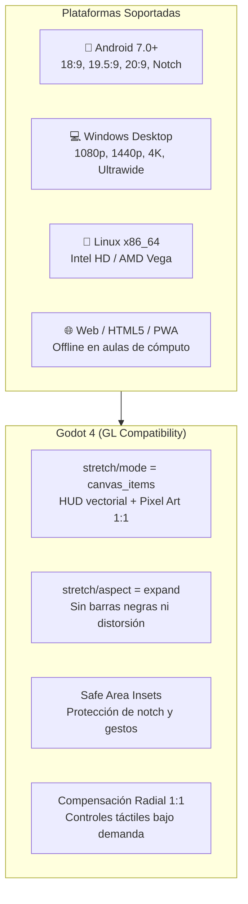

</details>

<details>
<summary><strong>🧩 Diagrama de Componentes y Árbol de Archivos</strong></summary>

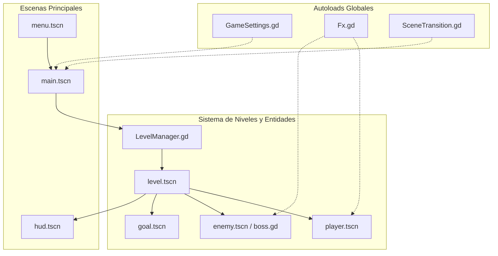

```text
valores-cobaem22/
├── assets/          # Audio WAV, fondos, sprites de personajes, retratos PNG, logos y video
├── escenarios/      # 6 mapas exteriores (1m = 40px) + 6 salones interiores (escenarios/salones/)
├── planos/          # Maqueta 3D (plano_3d.html), CAD 2D (planos_interactivos.html) y PDFs
├── scenes/          # Escenas Godot (.tscn): menu, main, level, player, enemy, hud, salones, etc.
├── scripts/         # Lógica GDScript (.gd): jefes, Danmaku, AllyBrain, minijuegos, certificados PDF
├── shaders/         # pixel_transition.gdshader (cortinilla pixel-art con marca de agua COBAEM)
├── themes/          # Estilos UI y fuentes retro
├── tools/           # generate_music.py (chiptune) y test_game.gd (suite headless)
├── AGENTS.md        # Guía técnica de arquitectura y diagnóstico para desarrolladores e IA
└── project.godot    # Configuración maestra de Godot 4
```

</details>

<details>
<summary><strong>💻 Comandos Útiles de Terminal (Tests, Audio, Exportación)</strong></summary>

```bash
# 🧪 Ejecutar suite de pruebas automatizadas (headless)
godot --headless -s tools/test_game.gd

# 🎨 Reimportar texturas y mapas editados
godot --headless --import

# 🎵 Regenerar banda sonora chiptune (music_menu.wav y music_game.wav)
python3 tools/generate_music.py

# 📦 Exportar binarios (Linux, Windows y Web)
mkdir -p build/linux build/windows build/web
godot --headless --export-release "Linux/X11" build/linux/campeones_valores.x86_64
godot --headless --export-release "Windows Desktop" build/windows/campeones_valores.exe
godot --headless --export-release "Web" build/web/index.html
```

</details>

<details>
<summary><strong>🚀 Optimizaciones, Auditoría v2 y Guía de Modding</strong></summary>

- **Rendimiento:** `GL Compatibility` (OpenGL 3.3 / WebGL 2.0), `snap_2d_transforms_to_pixel`, detección de IA por distancia al cuadrado (`distance_squared_to`), descarga de niveles con `queue_free()` (< 150 MB VRAM) y audio procedural ligero.
- **Auditoría v2:** Validado bajo 7 dictámenes especializados (Arquitectura Multiplataforma, Peritaje BIM/CAD, Pedagogía y Ética, Controles Móviles, Escritorio, Motor Godot 4 y UI/UX).
- **Añadir un escenario nuevo:** Coloca tu PNG a escala `1 m = 40 px` en `escenarios/`, regístralo en `get_default_levels()` dentro de [`scripts/level_manager.gd`](scripts/level_manager.gd) y valida con `godot --headless -s tools/test_game.gd`. Consulta [`AGENTS.md`](AGENTS.md) para la guía técnica completa.

</details>

---

## 💬 Aviso del Autor

> Este juego no está dedicado a ser jugado comercialmente; es más bien un proyecto pequeño hecho con cariño para simbolizar a nuestra institución.  
> **¡Que lo disfruten y se diviertan, este juego tiene demasiado esfuerzo por detrás! :)**

<div align="center">
  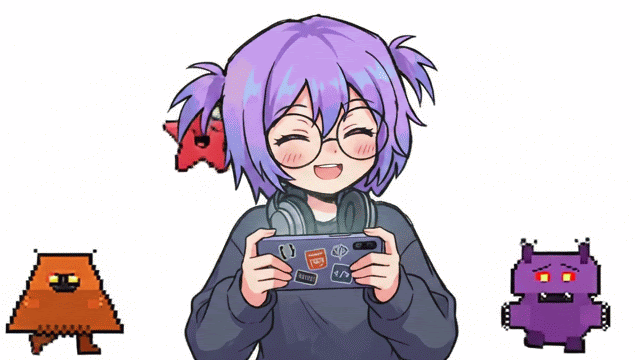
</div>

---

## 🤝 Contribución, 📜 Licencia y 🏛️ Reconocimientos

### 🤝 Cómo Contribuir
1. Haz un **Fork** del repositorio y crea una rama (`git checkout -b feature/mi-mejora`).
2. Respeta las convenciones de GDScript y la escala arquitectónica (`1 m = 40 px`).
3. Valida con `godot --headless -s tools/test_game.gd` y abre tu **Pull Request**.

### 📜 Licencia
Distribuido bajo **GNU General Public License v3.0 ([`LICENSE`](LICENSE))**, garantizando que el código permanezca libre y abierto para la comunidad educativa. Los nombres, escudos y emblemas institucionales pertenecen al **COBAEM** y al **Plantel CEMSaD 22 ENTHAVI**.

### 🏛️ Reconocimientos Institucionales

> 🌟 **Reconocimiento Especial**  
> A la maestra **Lic. Guadalupe Larisa Zarza Velázquez**, docente de Informática en el **Colegio de Bachilleres del Estado de México — CEMSaD Plantel 22 ENTHAVI**. Gracias a su dedicación y enseñanza diaria en informática y programación fue posible hacer realidad este proyecto.

- **Colegio de Bachilleres del Estado de México (COBAEM)** y comunidad del **Plantel CEMSaD 22 ENTHAVI** (directivos, docentes, personal administrativo y alumnado).
- Al equipo de **Godot Engine** y a la comunidad de software libre.

---

<div align="center">
  <em>Desarrollado con dedicación cívica para las juventudes que construyen una convivencia escolar pacífica y solidaria.</em><br/>
  <strong>🏆 Campeones de los Valores — CEMSaD 22 ENTHAVI</strong>
</div>
