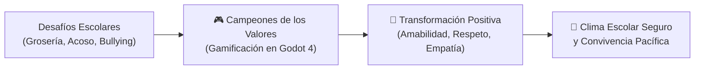
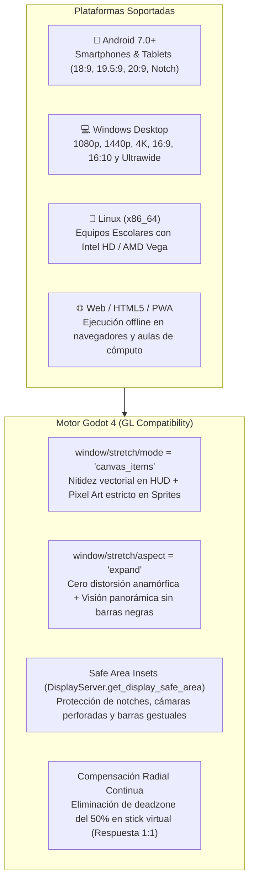
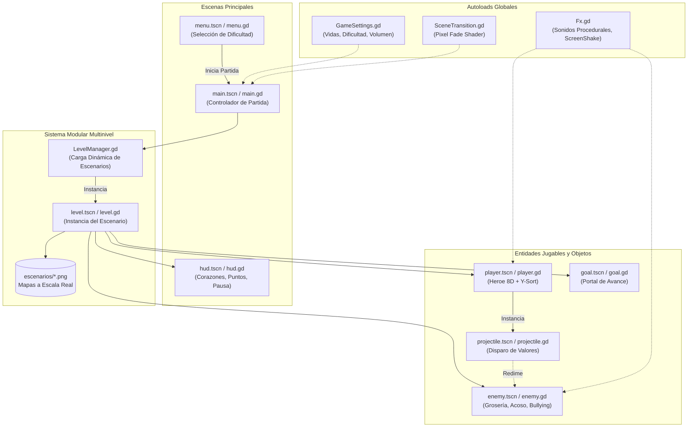

# 🏆 Campeones de los Valores — CEMSaD 22 ENTHAVI

<div align="center">

```text
 ██████╗ █████╗ ███╗   ███╗██████╗ ███████╗ ██████╗ ███╗   ██╗███████╗███████╗
██╔════╝██╔══██╗████╗ ████║██╔══██╗██╔════╝██╔═══██╗████╗  ██║██╔════╝██╔════╝
██║     ███████║██╔████╔██║██████╔╝█████╗  ██║   ██║██╔██╗ ██║█████╗  ███████╗
██║     ██╔══██║██║╚██╔╝██║██╔═══╝ ██╔══╝  ██║   ██║██║╚██╗██║██╔══╝  ╚════██║
╚██████╗██║  ██║██║ ╚═╝ ██║██║     ███████╗╚██████╔╝██║ ╚████║███████╗███████║
 ╚═════╝╚═╝  ╚═╝╚═╝     ╚═╝╚═╝     ╚══════╝ ╚═════╝ ╚═╝  ╚═══╝╚══════╝╚══════╝
        — D E   L O S   V A L O R E S  •  C E M S a D   2 2   E N T H A V I —
```

[](https://godotengine.org/)
[](https://docs.godotengine.org/en/stable/tutorials/rendering/)
[](https://github.com/Kineyo/valores-cobaem22)
[](https://github.com/Kineyo/valores-cobaem22)
[](plano_3d.html)
[](https://cobaem.edomex.gob.mx/)
[](LICENSE)

<br/>

**Videojuego educativo de aventura y acción retro en perspectiva 3/4 desarrollado en Godot Engine 4.**  
Una experiencia lúdica ambientada a **escala arquitectónica real** dentro de las instalaciones del plantel **CEMSaD 22 ENTHAVI (COBAEM)**, diseñada para promover virtudes humanas esenciales (*Amabilidad*, *Respeto*, *Empatía*) y superar conductas nocivas (*Grosería*, *Acoso*, *Bullying*).

[⚡ Guía Rápida](#-guía-rápida-de-inicio) • [🎬 Video](#-video-de-presentación-del-proyecto) • [🎮 Controles](#-manual-del-jugador-y-controles) • [🗺️ Escenarios](#️-guía-de-los-6-escenarios-escolares-a-escala-real) • [📐 Planos 3D / CAD](#-sistema-cad-y-maqueta-3d-interactiva) • [💻 Comandos Shell](#-shells-y-comandos-de-terminal) • [🏗️ Arquitectura](#️-arquitectura-de-software-y-estructura-del-código)

<br/>

---

</div>

## 📑 Tabla de Contenidos

- [⚡ Guía Rápida de Inicio](#-guía-rápida-de-inicio)
- [🎬 Video de Presentación del Proyecto](#-video-de-presentación-del-proyecto)
- [🎯 Propósito y Visión Educativa](#-propósito-y-visión-educativa)
- [🎮 Manual del Jugador y Controles](#-manual-del-jugador-y-controles)
- [🏛️ Pantalla de Carga Institucional y Transiciones](#️-pantalla-de-carga-institucional-y-transiciones)
- [📱🖥️ Arquitectura Multiplataforma y Responsividad](#️-arquitectura-multiplataforma-y-responsividad)
- [🌟 Mecánicas de Juego y Sistema de Valores](#-mecánicas-de-juego-y-sistema-de-valores)
- [👹 Bestiario de Antivalores y Redención](#-bestiario-de-antivalores-y-redención)
- [⚙️ Modos de Dificultad y Balance](#️-modos-de-dificultad-y-balance)
- [🗺️ Guía de los 6 Escenarios Escolares a Escala Real](#️-guía-de-los-6-escenarios-escolares-a-escala-real)
- [📐 Sistema CAD y Maqueta 3D Interactiva](#-sistema-cad-y-maqueta-3d-interactiva)
- [📚 Informes Especializados de Auditoría y Dictamen v2](#-informes-especializados-de-auditoría-y-dictamen-v2)
- [💻 Shells y Comandos de Terminal](#-shells-y-comandos-de-terminal)
- [🏗️ Arquitectura de Software y Estructura del Código](#️-arquitectura-de-software-y-estructura-del-código)
- [🚀 Optimizaciones Técnicas y Rendimiento](#-optimizaciones-técnicas-y-rendimiento)
- [🛠️ Guía para Desarrolladores y Modding](#️-guía-para-desarrolladores-y-modding)
- [🤝 Contribución y Código Abierto](#-contribución-y-código-abierto)
- [📜 Licencia y Reconocimientos](#-licencia-y-reconocimientos)

---

## ⚡ Guía Rápida de Inicio

Ejecuta el proyecto en tu entorno local en menos de dos minutos siguiendo estos sencillos pasos:

### 📋 Requisitos Previos

| Componente | Versión Recomendada | Notas |
| :--- | :--- | :--- |
| **Godot Engine** | `4.7.x` (compatible con 4.3+) | Descargar versión estándar (GL Compatibility / .NET no requerido). |
| **Python** | `3.10+` *(Opcional)* | Necesario únicamente para regenerar la música o los mapas procedimentales. |
| **Navegador Web** | Chrome, Firefox, Edge o Safari | Compatible con WebGL para visualizar las maquetas 3D y planos interactivos. |

---

### 🚀 Inicio Inmediato (Shell)

Abre una terminal en tu sistema y ejecuta:

```bash
# 1. Clonar el repositorio
git clone https://github.com/Kineyo/valores-cobaem22.git
cd valores-cobaem22

# 2. (Opcional) Instalar dependencias Python para herramientas de generación
pip install -r requirements.txt

# 3. Abrir e iniciar directamente con Godot Engine 4 (ejecutable en PATH)
godot --path . scenes/menu.tscn

# O bien, si tienes Godot instalado mediante Flatpak en Linux:
flatpak run org.godotengine.Godot --path . scenes/menu.tscn
```

### 🖥️ Inicio desde el Editor Visual de Godot

1. Inicia **Godot Engine 4**.
2. En el Administrador de Proyectos, haz clic en el botón **Importar** (`Import`).
3. Localiza y selecciona el archivo `project.godot` dentro del directorio clonado.
4. Presiona **Importar y Editar**.
5. Presiona la tecla <kbd>F5</kbd> (o el botón **Ejecutar Proyecto ▶** en la esquina superior derecha) para comenzar a jugar.

> [!TIP]
> Puedes cambiar el modo de dificultad antes de iniciar tu partida directamente en el menú de inicio presionando las teclas <kbd>1</kbd>, <kbd>2</kbd> o <kbd>3</kbd>.

---

## 🎬 Video de Presentación del Proyecto

https://github.com/user-attachments/assets/75b3ccd4-ab32-4d3e-8b7b-bba197a8a0dc

El repositorio incluye una presentación audiovisual oficial que resume la misión educativa, los 6 escenarios reales y los nuevos controles táctiles:

* 🌐 **Reproductor Web Interactivo Remotion:** [`video_presentacion.html`](video_presentacion.html)  
  *Abre este archivo en tu navegador web para ver la animación interactiva con el reproductor oficial de Remotion (play, pausa, barra de tiempo y pantalla completa).*
* 📹 **Archivo de Video Físico MP4:** [`video_presentacion.mp4`](video_presentacion.mp4)  
  *Video Full HD (1920×1080 @ 30 FPS, 1.4 MB) con banda sonora chiptune sincronizada (`music_game.wav`). Compatible con reproductores de video locales y dispositivos móviles.*
* 🛠️ **Scripts de Generación:**
  * [`tools/build_video.py`](tools/build_video.py): Generador de código Remotion y llamada al servidor MCP.
  * [`tools/render_mp4.py`](tools/render_mp4.py): Renderizador de frames y ensamble de audio con FFmpeg.

---

## 🎯 Propósito y Visión Educativa

**Campeones de los Valores** nace con la misión de transformar la enseñanza de la convivencia cívica y socioemocional en una experiencia interactiva atractiva para la comunidad estudiantil del **Colegio de Bachilleres del Estado de México (COBAEM)**, tomando como escenario el plantel **CEMSaD 22 ENTHAVI**.



### 💡 Pilares Formativos del Proyecto

1. **Resolución Constructiva de Conflictos:** El personaje no aniquila ni destruye a sus adversarios; los impactos de energía positiva representan actos de diálogo y asertividad que desarticulan conductas agresivas y las convierten en virtudes.
2. **Apropiación del Espacio Educativo:** Al recorrer salones, laboratorios, canchas y plazas cívicas que reproducen exactamente su escuela a escala métrica, las y los estudiantes desarrollan un vínculo de pertenencia y cuidado hacia su infraestructura.
3. **Refuerzo Positivo Inmediato:** Cada antivalor superado despliega frases constructivas (*¡Amabilidad!*, *¡Respeto!*, *¡Empatía!*) acompañadas de retroalimentación sonora y visual.

---

## 🎮 Manual del Jugador y Controles

El juego cuenta con un esquema de control arcade responsivo diseñado para teclado, ratón, mandos gamepad y pantallas táctiles móviles, permitiendo desplazarse con fluidez en 8 direcciones y defender pacíficamente el ambiente escolar.

### 🕹️ Mapeo Universal de Teclado, Ratón, Mando y Pantalla Táctil

| Acción | Tecla Principal (PC) | Ratón & Gamepad | Control Móvil (Android / Táctil v2.0) | Descripción |
| :--- | :---: | :---: | :---: | :--- |
| **Moverse (8 Direcciones)** | <kbd>W</kbd> <kbd>A</kbd> <kbd>S</kbd> <kbd>D</kbd> / <kbd>Flechas</kbd> | Stick Izquierdo / D-Pad | **Joystick Dinámico Izquierdo** | Desplazamiento analógico fluido 8D con muescas cardinales y guías en reposo. |
| **Disparo de Virtud** | <kbd>Espacio</kbd> | Clic Izquierdo / Botón <kbd>A</kbd> / <kbd>R1</kbd> | **Joystick Dinámico Derecho "VIRTUD"** | Emite haces de luz en 360° con halo guinda/oro y flecha de puntería. |
| **Apuntado Cardinal / 360°** | <kbd>I</kbd> <kbd>J</kbd> <kbd>K</kbd> <kbd>L</kbd> | Cursor del Ratón / Stick Der. | Arrastre de Joystick Derecho | Orienta la dirección del proyectil de virtud hacia los antivalores. |
| **Pausar / Reanudar** | <kbd>Escape</kbd> / <kbd>P</kbd> | Botón <kbd>Start</kbd> | **Botón `⏸`** (Superior Derecho) | Abre el modal de pausa institucional sin interrumpir la música de fondo. |
| **Pantalla Completa (Toggle)** | <kbd>F11</kbd> / <kbd>Alt + Enter</kbd> | — | Automático en Móviles | Alterna instantáneamente entre modo ventana y pantalla completa en PC. |
| **Reiniciar Nivel** | <kbd>R</kbd> | Botón en Modal | Botón en Pantalla Modal | Reinicia la posición y estado del nivel en curso. |
| **Alternar Controles Táctiles** | <kbd>F1</kbd> | — | Automático por hardware | Muestra u oculta manualmente la superposición de controles táctiles en PC. |
| **Selección de Dificultad** | <kbd>1</kbd> / <kbd>2</kbd> / <kbd>3</kbd> | D-Pad <kbd>←</kbd> / <kbd>→</kbd> | Toque en botones de dificultad | Configura el balance de juego directamente desde el menú principal. |

---

## 🏛️ Pantalla de Carga Institucional y Transiciones

El juego integra una nueva **Pantalla de Carga Asíncrona (`scenes/loading_screen.tscn`)** y un sistema de transiciones con identidad del **Colegio de Bachilleres del Estado de México (COBAEM)**:

- **Escudo y Banners Oficiales:** Renderizado en alta fidelidad de los emblemas institucionales ubicados en `assets/logos/` (`cobaem-logo.png` y `logo_cobaem.png`).
- **Carga en Hilo Secundario:** Implementado mediante `ResourceLoader.load_threaded_request()`, asegurando una transición fluida sin congelamientos de fotogramas al instanciar mapas grandes.
- **Barra de Progreso y Telemetría Escolar:** Visualización del porcentaje exacto acompañado de mensajes dinámicos de preparación de baldosas a escala real ($1\text{ m} = 40\text{ px}$).
- **Carrusel Didáctico de Valores:** Rotación de 9 citas formativas sobre convivencia armónica, filosofía universal (Mandela, Rogers) y sabiduría ancestral otomí de Temoaya (*K'öte m'ui* - Respeto Comunitario) y náhuatl (*Tlamatiliztli* - Sabiduría Recta).
- **Transiciones Cinematográficas:** La cortinilla de rombos pixel-art (`shaders/pixel_transition.gdshader`) incorpora una marca de agua suave del escudo COBAEM en el punto medio del fundido para erradicar cualquier corte brusco de pantalla.

---

## 📱🖥️ Arquitectura Multiplataforma y Responsividad

Diseñado para ejecutarse con excelencia tanto en computadoras de escritorio y laptops escolares como en teléfonos inteligentes y tabletas de estudiantes y docentes:



### 🌟 Pilares Técnicos de la Responsividad Universal:
1. **Cero Distorsión de Aspecto:** Los sprites se dibujan siempre con relación de aspecto $1:1$ mediante `snap_2d_transforms_to_pixel = true`.
2. **Blindaje de Safe Area en Móviles:** La barra de corazones, el progreso de la meta y el botón de pausa se ajustan automáticamente a los márgenes seguros reportados por el sistema operativo, impidiendo que queden ocultos tras la muesca de la cámara.
3. **Desacoplamiento Inteligente de Dispositivos:** Si el juego se abre en una PC sin pantalla táctil, los joysticks virtuales permanecen invisibles para no ensuciar la pantalla; en cuanto se detecta un toque de hardware en una pantalla táctil o dispositivo móvil, los controles se activan con opacidad en reposo (`resting_alpha = 0.18`) y se expanden dinámicamente al apoyar los pulgares.
4. **Exportación Llave en Mano:** Incluye presets listos para compilar en Linux (`.x86_64`), Windows (`.exe`), Android (`.apk` con keystore de depuración autofirmado incluido) y Web (`index.html` PWA monohilo para compatibilidad universal).

---

### 📺 Elementos del HUD (Interfaz en Pantalla)

```text
┌────────────────────────────────────────────────────────────────────────┐
│  ♥ ♥ ♥ ♥ ♥   [ NIVEL 1/6: ACCESO Y LABORATORIO ]     PUNTOS: 001250    │
└────────────────────────────────────────────────────────────────────────┘
```

- **Contador de Vidas (Corazones):** Muestra los puntos de salud restantes del héroe escolar.
- **Identificador de Escenario:** Muestra el edificio o área del plantel que estás recorriendo en tiempo real.
- **Puntuación de Virtud:** Sumatoria de puntos obtenidos al redimir antivalores y avanzar de zona.
- **Meta Luminosa (Portal de Salida):** Indica el acceso peatonal hacia el siguiente sector del plantel escolar.

---

## 🌟 Mecánicas de Juego y Sistema de Valores

```
    ┌────────────────────────┐
    │  Movimiento 8D (Y-Sort) │ ──► Desplazamiento suave con polvo de pisadas
    └───────────┬────────────┘
                │
    ┌───────────▼────────────┐
    │  Disparo de Virtudes   │ ──► Proyectil radiante con estela de partículas
    └───────────┬────────────┘
                │
    ┌───────────▼────────────┐
    │ Impacto en Antivalor   │ ──► Sacudida de pantalla (Screen Shake) + SFX
    └───────────┬────────────┘
                │
    ┌───────────▼────────────┐
    │  Redención & Virtud    │ ──► Proclama flotante + Liberación de la zona
    └────────────────────────┘
```

- **Perspectiva 3/4 con Y-Sorting:** Todos los elementos gráficos (jugador, enemigos, bancas, árboles, automóviles y columnas) organizan dinámicamente su capa de renderizado según su coordenada vertical `Y`, logrando una sensación de profundidad volumétrica limpia.
- **Proyectiles de Energía Positiva:** El ataque del jugador emite orbes resplandecientes que viajan en línea recta. Mantener presionada la barra espaciadora activa el fuego continuo según la cadencia permitida por el nivel de dificultad.
- **Feedback Audiovisual Jugoso (Juice):**
  - Sacudida procedural de cámara (*screen shake*) al acertar impactos o recibir daño.
  - Efectos de partículas pixel art generados dinámicamente en código (`fx.gd`).
  - Animaciones de *squash & stretch* reactivas en el personaje y los enemigos.

---

## 👹 Bestiario de Antivalores y Redención

Cada enemigo representa una conducta disruptiva escolar con características de inteligencia artificial y desplazamiento propias:

| Antivalor | Color Distintivo | Comportamiento & IA | Rango / Velocidad | Virtud Liberada | Recompensa |
| :---: | :---: | :--- | :---: | :---: | :---: |
| **Grosería** | 🔴 Rojo Carmesí | Enemigo impulsivo e inquieto. Da pequeños brincos erráticos y arremete con agresividad al detectar al jugador. | Radio medio / Rápido | **¡Amabilidad!** | `+100 pts` |
| **Acoso** | 🟠 Naranja Ámbar | Sombra persistente que vigila a gran distancia. Rodea obstáculos y persigue constantemente al jugador sin perderlo de vista. | Radio amplio / Medio | **¡Respeto!** | `+150 pts` |
| **Bullying** | 🟣 Morado Intenso | Adversario pesado y blindado. Patrulla perímetros clave y ejecuta embestidas directas cuando el jugador invade su territorio. | Radio corto / Embestida veloz | **¡Empatía!** | `+250 pts` |

> [!NOTE]
> Al impactar a un antivalor, este no desaparece de forma violenta: se ilumina en tonos dorados, exhibe una animación de alivio y proclama en pantalla el valor que lo redime, sumando puntos al casillero de virtudes del jugador.

---

## ⚙️ Modos de Dificultad y Balance

El juego se adapta tanto a audiencias infantiles como a jugadores experimentados mediante tres perfiles configurables gestionados por el singleton global `GameSettings`:

| Parámetro de Ajuste | Modo Fácil 🟢 | Modo Normal 🟡 | Modo Difícil 🔴 |
| :--- | :---: | :---: | :---: |
| **Vidas Iniciales** | **5 ♥** | **3 ♥** | **2 ♥** |
| **Velocidad de Enemigos** | **75%** *(0.75×)* | **100%** *(1.00×)* | **140%** *(1.40×)* |
| **Cadencia de Disparo** | **0.22 s** *(Frecuente)* | **0.35 s** *(Equilibrada)* | **0.55 s** *(Táctica)* |
| **Escala de Proyectiles** | **1.6×** *(Área amplia)* | **1.3×** *(Media)* | **1.0×** *(Precisa)* |
| **Perfil Sugerido** | Nuevos estudiantes / Primaria | Secundaria y Preparatoria | Desafío Arcade avanzado |

---

## 🗺️ Guía de los 6 Escenarios Escolares a Escala Real

Los escenarios fueron levantados con base en los planos arquitectónicos oficiales y 52 fotografías de campo del plantel **CEMSaD 22 ENTHAVI (COBAEM)**. Todo el entorno respeta una **escala unificada y rigurosa**:

$$\mathbf{1\text{ metro lineal} = 40\text{ píxeles}} \quad \Longleftrightarrow \quad \mathbf{1\text{ píxel} = 2.5\text{ cm}} \quad \Longleftrightarrow \quad \mathbf{1\text{ baldosa (tile) } 40\times 40\text{ px} = 1.00\text{ m}^2}$$

```
  [1] ACCESO & LAB ──► [2] EDIF. A & CAFETERÍA ──► [3] PLAZA CÍVICA TECHADA
                                                                │
  [6] CANCHA DEPORTIVA ◄── [5] EDIF. C (CÓMPUTO) ◄── [4] EDIF. B (BIBLIOTECA)
```

---

### 📍 Desglose de Zonas del Plantel

#### 1. Escenario 1/6: Plaza de Acceso, Caseta C.V. y Edificio D (Laboratorios)
- **Archivo:** `res://escenarios/nivel_1_acceso_laboratorio.png`
- **Dimensiones:** `1440 × 880 px` | **Escala Real:** `36.0 × 22.0 m` (`792 m²`)
- **Espacios:** Plaza de bienvenida con pavimento institucional, Muro COBAEM con el Colibrí del Estado de México, Jardinera con Osito Topiario podado, Caseta de Vigilancia C.V. (`7.5 m²`), cajones de estacionamiento en batería, Captador de Agua Pluvial (`25 m²`) y Edificio D de Laboratorios de Usos Múltiples (`183 m²`).

#### 2. Escenario 2/6: Edificio A — Cafetería y Aulas 1-2
- **Archivo:** `res://escenarios/nivel_2_edificio_a_cafeteria.png`
- **Dimensiones:** `1600 × 800 px` | **Escala Real:** `40.0 × 20.0 m` (`800 m²`)
- **Espacios:** Edificio A completo (`339.19 m²`) con Cafetería escolar (`43.4 m²`), Almacén de insumos (`26.6 m²`), Aula 1 y Aula 2 (`56 m²` c/u), módulos sanitarios para mujeres y hombres, y andador norte con columnas guinda y pinos podados en espiral.

#### 3. Escenario 3/6: Plaza Cívica Techada y Escalinata Monumental Poniente
- **Archivo:** `res://escenarios/nivel_3_plaza_civica_escalinata.png`
- **Dimensiones:** `1600 × 900 px` | **Escala Real:** `40.0 × 22.5 m` (`900 m²`)
- **Espacios:** Gran explanada cívica techada con arco techo blanco a `9.5 m` de altura (`748 m²`), muro de contención norte de piedra braza (`4.00 m` de desnivel), lona institucional conmemorativa y la emblemática Escalinata Monumental Poniente en "S" (`81 m²`) pintada en amarillo tráfico con alfardas guinda.

#### 4. Escenario 4/6: Terraza Superior (+4.00 m) y Edificio B
- **Archivo:** `res://escenarios/nivel_4_edificio_b.png`
- **Dimensiones:** `1440 × 800 px` | **Escala Real:** `36.0 × 20.0 m` (`720 m²`)
- **Espacios:** Meseta superior del plantel (`+4.00 m` sobre nivel de plaza) con el Edificio B (`312.85 m²`), albergando las Aulas 3 y 4 (`57.6 m²` c/u), la Biblioteca Escolar (`37.44 m²`), la Sala de Maestros (`56.16 m²`), faldón de ladrillo rojo aparente y vista panorámica del domo blanco.

#### 5. Escenario 5/6: Edificio C de Dos Niveles (Cómputo y Dirección)
- **Archivo:** `res://escenarios/nivel_5_edificio_c_computo.png`
- **Dimensiones:** `1440 × 880 px` | **Escala Real:** `36.0 × 22.0 m` (`792 m²`)
- **Espacios:** Estructura de dos plantas (`625.70 m²`). Planta Alta: Taller de Informática y Cómputo (`115.2 m²` con trabes mostaza y mesas caoba) y Aula 6. Planta Baja: Dirección General del Plantel, Orientación Educativa, Enfermería, Aula 5 y explanada del Asta Bandera.

#### 6. Escenario 6/6: Cancha de Usos Múltiples y Gran Podio de Campeones
- **Archivo:** `res://escenarios/nivel_6_cancha_usos_multiples.png`
- **Dimensiones:** `1440 × 900 px` | **Escala Real:** `36.0 × 22.5 m` (`810 m²`)
- **Espacios:** Cancha reglamentaria polideportiva (`540 m²`, pintura deportiva azul/amarilla, porterías con tableros de basquetbol verdes), área arbolada de convivencia escolar con bancas de concreto, barda perimetral oriente y el Gran Podio Dorado de la Copa de los Valores.

---

## 📐 Sistema CAD y Maqueta 3D Interactiva

Además del videojuego en Godot 4, el repositorio incluye un **sistema de documentación arquitectónica de alta fidelidad** listo para abrirse en cualquier navegador web:

| Recurso | Archivo | Tecnologías | Características Principales |
| :--- | :--- | :--- | :--- |
| **Maqueta 3D Interactiva** | [`plano_3d.html`](plano_3d.html) | `Three.js`, `OrbitControls`, `Tween.js` | Visualizador BIM/CAD 3D con 3 poses de cámara cinemáticas (RPG 3/4 isométrica, Peatonal baja y Aérea/Dron), aristas vectoriales nítidas, mobiliario tridimensional y etiquetas flotantes de cada aula. |
| **Planos CAD Vectoriales 2D** | [`planos_interactivos.html`](planos_interactivos.html) | `HTML5 Canvas`, `SVG`, `JetBrains Mono` | Planimetría interactiva con cotas precisas en centímetros y metros, cálculo automático de perímetro, diagonal y áreas en $\text{m}^2$ y $\text{cm}^2$, capas de dibujo y galería fotográfica de campo. |

### 🌐 Cómo visualizar los planos y la maqueta 3D

Para una experiencia óptima con texturas e interactividad, inicia un servidor HTTP local ligero con Python:

```bash
# Iniciar servidor web en el puerto 8000
python3 -m http.server 8000

# Abrir en el navegador:
# -> Maqueta 3D:     http://localhost:8000/plano_3d.html
# -> Planos CAD 2D:  http://localhost:8000/planos_interactivos.html
```

---

## 📚 Informes Especializados de Auditoría y Dictamen v2

El proyecto cuenta con una batería de dictámenes exhaustivos elaborados por 7 agentes y especialistas técnicos, pedagógicos y arquitectónicos en noviembre de 2026, alojados en la carpeta [`reports/`](reports/):

| Documento de Auditoría | Especialista / Área | Enfoque Principal y Contenido |
| :--- | :--- | :--- |
| 📁 [`reports/multiplatform_architecture_report.md`](reports/multiplatform_architecture_report.md) | **Arquitecto Multiplataforma** | Matriz de resoluciones (18:9, 19.5:9, 20:9 móvil vs 16:9, 16:10 ultrawide PC), Safe Area insets, perfiles de exportación APK/AAB/Linux/Web y DisplayServer. |
| 📁 [`reports/plans_and_scenarios_audit.md`](reports/plans_and_scenarios_audit.md) | **Perito en BIM / CAD Escolar** | Auditoría pericial 1m = 40px, cálculo de áreas de envolvente (Edif. A, B, C, D: $1,460.81\text{ m}^2$, Predio: $4,462\text{ m}^2$) y cotejo con el plano oficial. |
| 📁 [`reports/pedagogical_impact_and_values_audit.md`](reports/pedagogical_impact_and_values_audit.md) | **Doctor en Pedagogía y Ética** | Análisis de impacto en bachillerato (COBAEM / NEM), no violencia activa, recepción con padres de familia, y banco de 25 frases formativas y sabiduría Otomí de Temoaya. |
| 📁 [`reports/mobile_touch_system_report.md`](reports/mobile_touch_system_report.md) | **Especialista en Controles Móviles** | Diagnóstico del bug de doble toque (`emulate_mouse_from_touch`), aislamiento multitáctil, compensación radial continua y guías en reposo. |
| 📁 [`reports/desktop_experience_report.md`](reports/desktop_experience_report.md) | **Especialista en PC de Escritorio** | Mapeo de gamepad D-Pad, apuntado con ratón, atajos F11/Alt+Enter, optimización en gráficos integrados Intel HD y prevención de interferencias touch en laptops. |
| 📁 [`reports/godot_engine_audit.md`](reports/godot_engine_audit.md) | **Auditor de Motor Godot 4 (Core)** | Resolución de fugas ObjectDB en AudioStreamWAV al salir, coherencia de capas de colisión 2D, condición de carrera en hitstop y suite de pruebas físicas. |
| 📁 [`reports/frontend_ui_ux_report.md`](reports/frontend_ui_ux_report.md) | **Diseñador Líder UI/UX** | Diseño de la nueva Pantalla de Carga, integración de logos institucionales (`assets/logos/`), telemetría de carga y carrusel de valores. |
| 📁 [`reformas_v2.md`](reformas_v2.md) | **Dictamen General de Reformas** | Hoja de ruta completa de los 20 hallazgos resueltos y verificados de Nivel Rojo a Verde. |

---

## 💻 Shells y Comandos de Terminal

Colección de scripts y atajos de terminal listos para ejecutar durante el desarrollo, pruebas y despliegue del proyecto:

### 🕹️ Ejecución del Videojuego

```bash
# Ejecutar el juego directamente desde el menú principal
godot --path . scenes/menu.tscn

# Iniciar directamente un nivel específico para pruebas (por ejemplo, el Nivel 3)
godot --path . scenes/main.tscn

# Ejecutar en ventana con resolución personalizada (1280x720)
godot --path . --resolution 1280x720 scenes/menu.tscn
```

### 🧪 Suite de Pruebas Automatizadas (Headless)

El proyecto incluye un script de validación que revisa automáticamente la integridad de los 6 escenarios, límites de colisión, spawns del jugador y metas sin abrir la interfaz gráfica:

```bash
# Ejecutar tests de integridad de niveles y colisiones
godot --headless -s tools/test_game.gd
```

### 🎨 Generación Procedimental de Escenarios

Los 6 escenarios Pixel Art en escala $1\text{ m} = 40\text{ px}$ se construyen de forma determinista mediante Pillow:

```bash
# Regenerar todos los mapas de escenarios en la carpeta escenarios/
python3 tools/generate_scenarios.py
```

### 🎵 Generación de la Banda Sonora Chiptune

Sintetiza de forma procedural los temas de audio en formato WAV puro sin dependencias externas:

```bash
# Sintetiza music_menu.wav y music_game.wav en assets/audio/
python3 tools/generate_music.py
```

### 📦 Exportación de Binarios (Compilación)

```bash
# Exportar para Linux x86_64
mkdir -p build/linux
godot --headless --export-release "Linux/X11" build/linux/campeones_valores.x86_64

# Exportar para Windows x86_64
mkdir -p build/windows
godot --headless --export-release "Windows Desktop" build/windows/campeones_valores.exe

# Exportar para Web (HTML5 / WebGL)
mkdir -p build/web
godot --headless --export-release "Web" build/web/index.html
```

---

## 🏗️ Arquitectura de Software y Estructura del Código

El videojuego está construido siguiendo los patrones de diseño orientados a nodos y escenas de **Godot Engine 4**:

### 🧩 Diagrama de Componentes y Flujo de Juego



---

### 📂 Estructura del Árbol de Archivos

```text
campeones-de-los-valores/
├── assets/
│   ├── audio/                  # Loops musicales (.wav) y efectos de sonido
│   ├── background/             # Texturas y fondos de menú
│   ├── planos/                 # 52 Fotografías reales y levantamientos del plantel
│   └── sprites/                # Sprites pixel art (personaje, enemigos, corazones, meta)
├── escenarios/                 # Los 6 mapas a escala real (1m = 40px) en PNG
│   ├── LEEME_ESCENARIOS.md     # Documentación técnica de cotas y dimensiones por escenario
│   ├── nivel_1_acceso_laboratorio.png
│   ├── nivel_2_edificio_a_cafeteria.png
│   ├── nivel_3_plaza_civica_escalinata.png
│   ├── nivel_4_edificio_b.png
│   ├── nivel_5_edificio_c_computo.png
│   └── nivel_6_cancha_usos_multiples.png
├── scenes/                     # Escenas empaquetadas (.tscn)
│   ├── enemy.tscn              # Nodo de antivalor con máquina de estados y colisiones
│   ├── goal.tscn               # Zona de meta con partículas luminosas y detección
│   ├── hud.tscn                # Capa de interfaz gráfica (CanvasLayer)
│   ├── level.tscn              # Contenedor modular de escenario
│   ├── main.tscn               # Orquestador del ciclo de vida del juego
│   ├── menu.tscn               # Menú de título y selección de dificultad
│   ├── player.tscn             # Personaje jugable en perspectiva 3/4
│   └── projectile.tscn         # Disparo de valores y virtudes
├── scripts/                    # Lógica de programación en GDScript (.gd)
│   ├── enemy.gd                # Inteligencia artificial, patrullaje y estados de redención
│   ├── fx.gd                   # Singleton de efectos, sonido procedural y screen shake
│   ├── game_settings.gd        # Singleton de configuración persistente y balance
│   ├── goal.gd                 # Controlador de transición al completar nivel
│   ├── hud.gd                  # Actualización de vidas, puntos y menú de pausa
│   ├── level.gd                # Construcción dinámica de límites, obstáculos y spawns
│   ├── level_manager.gd        # Catálogo centralizado de los 6 escenarios del plantel
│   ├── main.gd                 # Progresión de niveles, condiciones de victoria y game over
│   ├── menu.gd                 # Animaciones de entrada e interacción del menú
│   ├── player.gd               # Movimiento 8D, física, cadencia de disparo y vidas
│   ├── projectile.gd           # Movimiento del proyectil y colisión con antivalores
│   ├── scene_transition.gd     # Singleton de fundido entre escenas con shader retro
│   └── ui_juice.gd             # Utilidades de animación elástica y tweening
├── shaders/
│   └── pixel_transition.gdshader # Shader de cortinilla de píxeles para cambios de nivel
├── themes/                     # Estilos visuales de UI y fuentes retro
├── tools/                      # Herramientas de automatización en Python y GDScript
│   ├── generate_music.py       # Sintetizador procedural de temas chiptune
│   ├── generate_scenarios.py   # Generador procedural de los 6 mapas a escala real
│   └── test_game.gd            # Script de pruebas automatizadas en modo headless
├── plano_3d.html               # Maqueta arquitectónica interactiva 3D (Three.js BIM/CAD)
├── planos_interactivos.html    # Sistema CAD 2D de planos interactivos vectoriales
├── icon.svg                    # Emblema heráldico vectorial del juego
├── icon.png                    # Icono rasterizado para el lanzador
├── project.godot               # Archivo maestro de configuración de Godot Engine 4
├── requirements.txt            # Dependencias Python (Pillow) para herramientas
├── LICENSE                     # Licencia de código abierto MIT
├── AGENTS.md                   # Guía técnica para agentes de IA y resolución de errores
└── README.md                   # Esta guía integral del proyecto
```

---

## 🚀 Optimizaciones Técnicas y Rendimiento

El proyecto está diseñado desde los cimientos para ejecutarse de manera fluida tanto en computadoras de escritorio modernas como en equipos escolares de bajos recursos técnicos o navegadores web:

- **Motor de Renderizado GL Compatibility:** Configurado con perfiles de OpenGL 3.3 / WebGL 2.0 que garantizan compatibilidad universal sin requerir GPUs dedicadas con soporte Vulkan.
- **Pixel Snap 2D Nativo:** Activación de `snap_2d_transforms_to_pixel` y `snap_2d_vertices_to_pixel` en `project.godot`. Los sprites se alinean con exactitud matemática al píxel display, eliminando vibraciones, desgarros visuales o desenfoques en pantalla.
- **Optimización de IA sin Raíces Cuadradas:** El cálculo de detección y proximidad de los enemigos emplea distancias al cuadrado (`Vector2.distance_squared_to`) en lugar de distancias euclidianas convencionales, evitando llamadas continuas a `sqrt()` en cada ciclo de física (`_physics_process`).
- **Carga Modular de Memoria:** Cada nivel se carga y descarga de manera individual con `queue_free()`. La memoria de vídeo (VRAM) se mantiene estable por debajo de los 150 MB durante toda la sesión.
- **Generación Matemática de Audio:** Las pistas de música y efectos de audio están comprimidos en frecuencias óptimas que no añaden pesadas librerías de terceros.

---

## 🛠️ Guía para Desarrolladores y Modding

¿Deseas personalizar el juego o añadir nuevos escenarios? El diseño modular de `LevelManager` te permite expandir la experiencia fácilmente:

### ➕ Añadir un Nuevo Escenario

1. **Crear la Imagen del Mapa:** Diseña una imagen `.png` o `.webp` (utilizando la escala `1 m = 40 px`) y colócala en `res://escenarios/mi_nuevo_escenario.png`.
2. **Registrar el Escenario en `LevelManager`:** Abre [scripts/level_manager.gd](scripts/level_manager.gd) y añade un nuevo bloque en `get_default_levels()`:

```gdscript
{
    "id": 7,
    "title": "Escenario 7: Nueva Zona Escolar",
    "scenario_image": "res://escenarios/mi_nuevo_escenario.png",
    "real_dimensions_m": Vector2(30.0, 20.0),
    "player_spawn": Vector2(100, 400),
    "goal_position": Vector2(1100, 400),
    "goal_label": "Hacia el Auditorio ->",
    "enemies": [
        { "type": Enemy.Type.GROSERIA, "pos": Vector2(400, 350) },
        { "type": Enemy.Type.ACOSO, "pos": Vector2(750, 420) },
        { "type": Enemy.Type.BULLYING, "pos": Vector2(900, 380) },
    ],
    "obstacles": [
        Rect2(0, 0, 1200, 60), # Barda perimetral superior
    ]
}
```

3. **Verificar:** Ejecuta las pruebas automatizadas con `godot --headless -s tools/test_game.gd` para confirmar que las coordenadas de spawn y meta son válidas y libres de colisiones.

---

## 🤝 Contribución y Código Abierto

¡Las contribuciones de la comunidad estudiantil, docentes y desarrolladores son sumamente bienvenidas! Para participar:

1. Realiza un **Fork** de este repositorio.
2. Crea una rama para tu característica o corrección:
   ```bash
   git checkout -b feature/nueva-mecanica
   ```
3. Realiza tus cambios asegurando respetar la convención de estilo de GDScript y la escala arquitectónica ($1\text{ m} = 40\text{ px}$).
4. Ejecuta la suite de validación:
   ```bash
   godot --headless -s tools/test_game.gd
   ```
5. Haz commit con mensajes descriptivos:
   ```bash
   git commit -m "feat: agregar nuevo minijuego de dialogo asertivo"
   ```
6. Envía tu rama a tu fork y abre un **Pull Request** detallado.

---

## 📜 Licencia y Reconocimientos

Este proyecto está distribuido bajo la licencia de código abierto **MIT**. Consulta el archivo `LICENSE` para conocer más detalles sobre el uso libre, modificación y distribución con fines educativos.

### 🏛️ Reconocimientos Institucionales

> 
> - **Un especial reconocimiento** Para la maestra **Lic. Guadalupe Larisa Zarza  Velazquez**; Maestra de Informatica en el **Colegio De Bachilleres Del Estado De Mexico Centro De Educacion Media Superior Plantel 22 Enthavi**.

> 

- **Colegio de Bachilleres del Estado de México (COBAEM)**.
- **Plantel CEMSaD 22 ENTHAVI**, directivos, personal docente, administrativo y comunidad estudiantil, por su inspiración y compromiso cotidiano con la vivencia de los valores escolares.
- Al equipo de desarrollo de **Godot Engine** y la comunidad de software libre por proveer herramientas de creación tecnológica accesibles para la juventud.

<div align="center">

---

*Desarrollado con dedicación cívica para las juventudes que construyen una convivencia escolar pacífica y solidaria.*  
**¡Sé un Campeón de los Valores! 🏆**

</div>
