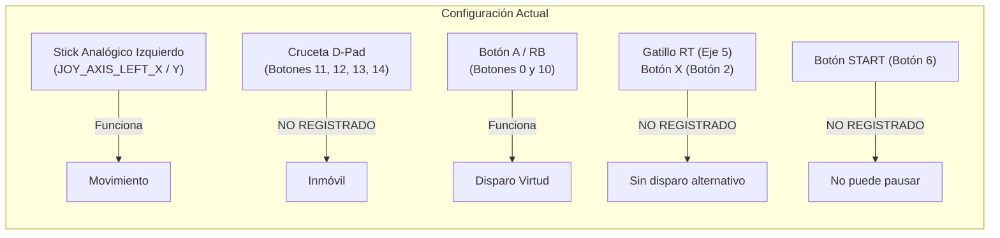
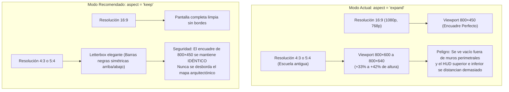
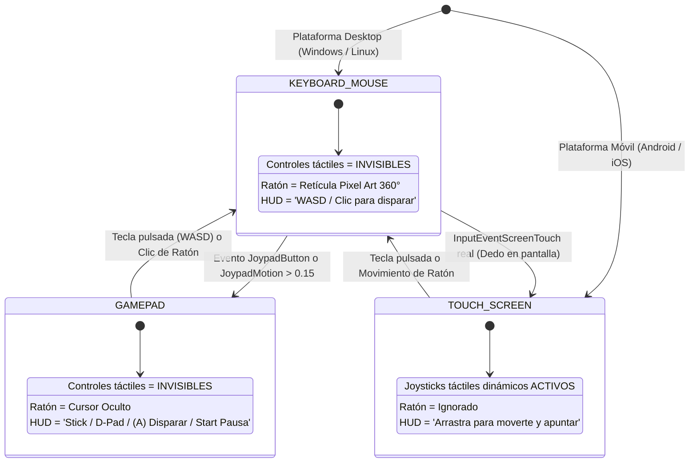

# 🖥️ Informe Técnico y Auditoría: Experiencia de Escritorio (PC / Windows / Linux)
## Proyecto: Campeones de los Valores — CEMSaD 22 ENTHAVI (COBAEM)
**Motor:** Godot Engine 4.3+ | **Renderizador:** `gl_compatibility`  
**Escala Arquitectónica:** $1\text{ metro} = 40\text{ píxeles}$ ($1\text{ px} = 2.5\text{ cm}$)  
**Fecha:** Noviembre 2026 | **Autor:** Desarrollador Principal de Juegos de Escritorio (Godot 4)  
**Estado:** Documento de Auditoría y Diseño Técnico (No modifica archivos originales)

---

## 📋 1. Resumen Ejecutivo

Este documento presenta una auditoría exhaustiva y el diseño de ingeniería para garantizar una experiencia óptima en **computadoras de escritorio y laptops escolares** (Windows y Linux) para el videojuego educativo *Campeones de los Valores*.

El plantel de referencia **CEMSaD 22 ENTHAVI** (Colegio de Bachilleres del Estado de México) y la mayoría de las instituciones de educación pública cuentan con parques informáticos heterogéneos: desde computadoras de torre con procesadores Intel Core de 2.ª a 4.ª generación y gráficos integrados Intel HD Graphics 2000–4000, hasta laptops de programas educativos (SEP, Aprende 2.0, Lenovo V14/V15, Celeron N4020, AMD Athlon/Vega 3) con resoluciones de 1366×768 o monitores cuadrados legados (4:3 y 5:4).

### 🔍 Principales Hallazgos de la Auditoría:
1. **Mapeo de Mandos Incompleto:** La configuración en `project.godot` carece de eventos de mando, y el registro programático en `scripts/main.gd` no incluye la cruceta (**D-Pad**), gatillos analógicos (**Triggers**) ni botones frontales estándar como X/Cuadrado. Jugadores con mandos retro o estilo arcade no pueden moverse.
2. **Ciclo de Vida de Entrada Desfasado:** `setup_inputs()` se ejecuta en `main.gd` en lugar de un Autoload. Dado que el juego inicia en `scenes/menu.tscn`, el menú carece de inicialización de mandos y navegación completa con Gamepad.
3. **Apuntado Rígido a 4 Direcciones (Sin soporte de Ratón):** `player.gd` restringe el disparo a cuatro direcciones cardinales discretas (Norte, Sur, Este, Oeste). No permite apuntar con el cursor del ratón (estilo twin-stick/action-RPG de PC) ni disparar en las 4 diagonales (apuntado 8D) con teclado.
4. **Ausencia de Atajos Universales:** No existe soporte para alternar Pantalla Completa con **F11** o **Alt + Enter**. La pausa con **Escape** está codificada a nivel de tecla en `hud.gd`, ignorando el botón **Start** de gamepads.
5. **Conflicto Crítico entre Ratón y Controles Táctiles en PC:** `DisplayServer.is_touchscreen_available()` devuelve `true` en Linux y en laptops con digitalizador/pantalla táctil, forzando `visible = true` en `mobile_controls.gd`. Combinado con `pointing/emulate_touch_from_mouse = true`, cualquier clic de ratón en PC activa joysticks virtuales indeseados en vez de permitir apuntar o interactuar limpiamente.
6. **Redimensionamiento con `aspect="expand"`:** En monitores 4:3 (1024×768) o 5:4 (1280×1024) muy comunes en aulas de cómputo escolares, la relación de aspecto expande verticalmente el viewport hasta 600–640 px de alto, alterando el encuadre arquitectónico y comprometiendo el diseño visual.

---

## 🎮 2. Auditoría Detallada de Mapeo de Controles y Entrada

### 2.1 Comparación: `project.godot` vs. `scripts/main.gd:setup_inputs()`

En la configuración inicial de `project.godot`, se definen las acciones de movimiento y ataque, pero **únicamente con eventos de teclado**:

| Acción | Eventos en `project.godot` | Eventos en `scripts/main.gd:setup_inputs()` | Estado |
| :--- | :--- | :--- | :--- |
| `move_left` | Left Arrow, 'A' | Left Arrow, 'A', `JOY_AXIS_LEFT_X (-1.0)` | ⚠️ Falta `JOY_BUTTON_DPAD_LEFT` |
| `move_right` | Right Arrow, 'D' | Right Arrow, 'D', `JOY_AXIS_LEFT_X (+1.0)` | ⚠️ Falta `JOY_BUTTON_DPAD_RIGHT` |
| `move_up` | Up Arrow, 'W' | Up Arrow, 'W', `JOY_AXIS_LEFT_Y (-1.0)` | ⚠️ Falta `JOY_BUTTON_DPAD_UP` |
| `move_down` | Down Arrow, 'S' | Down Arrow, 'S', `JOY_AXIS_LEFT_Y (+1.0)` | ⚠️ Falta `JOY_BUTTON_DPAD_DOWN` |
| `attack` | Espacio | Espacio, `JOY_BUTTON_A`, `JOY_BUTTON_RIGHT_SHOULDER` | ⚠️ Falta Clic Izquierdo Ratón, Gatillo RT, Botón X |
| `aim_left/right/up/down`| J, L, I, K, Joy Axis 2/3 | J, L, I, K, `JOY_AXIS_RIGHT_X/Y` | ⚠️ Incompleto (sin mouse aim ni 8D libre) |
| `restart` | 'R', Enter | 'R', Enter | ⚠️ Falta botón Gamepad (Select / Back) |
| `pause` | *(No existe)* | *(No existe en InputMap)* | ❌ Hardcoded a `KEY_ESCAPE` y `KEY_P` en `hud.gd` |
| `toggle_fullscreen` | *(No existe)* | *(No existe en InputMap)* | ❌ No implementado (F11 / Alt+Enter ausente) |

### 2.2 Diagnóstico de Deficiencias de Mando (Gamepad / Joystick)



1. **Omisión de la Cruceta Digital (D-Pad):**
   - En mandos clásicos de 8/16 bits (comunes en emuladores o compras escolares por ser económicos) no existen palancas analógicas.
   - En mandos estándar (Xbox, DualShock/DualSense, Logitech F310), muchos jugadores prefieren la precisión del D-Pad en juegos 2D/perspectiva 3/4.
   - Los botones `JOY_BUTTON_DPAD_UP` (11), `JOY_BUTTON_DPAD_DOWN` (12), `JOY_BUTTON_DPAD_LEFT` (13) y `JOY_BUTTON_DPAD_RIGHT` (14) **no están vinculados**, impidiendo cualquier movimiento con cruceta.
2. **Navegación de Interfaz de Usuario (`ui_accept` / `ui_cancel`):**
   - El motor Godot asigna por defecto `ui_accept` a `[Enter, Kp Enter, Space]` y `ui_cancel` a `[Escape]`.
   - Cuando se abre el modal de Pausa, Derrota o Victoria, el foco se coloca en un botón, pero el usuario no puede activarlo con el botón (A) del mando a menos que `JOY_BUTTON_A` esté registrado en `ui_accept`, ni puede cerrar el panel con (B) a menos que `JOY_BUTTON_B` esté en `ui_cancel`.
3. **Pausa desde Gamepad:**
   - La tecla de pausa está interceptada exclusivamente en `hud.gd` con la condición `if not (event is InputEventKey): return`. Un usuario con mando no puede poner pausa si no tiene el teclado al alcance. Debe mapearse `JOY_BUTTON_START` (botón 6) a la acción universal `pause`.

### 2.3 Sistema de Apuntado: Ratón vs. Cardinal 8D

En [`scripts/player.gd`](scripts/player.gd#L161-L173), la orientación se calcula mediante:

```gdscript
func _update_facing(input_vector: Vector2) -> void:
	if absf(input_vector.y) > absf(input_vector.x):
		new_facing = Vector2.UP if input_vector.y < 0.0 else Vector2.DOWN
	else:
		new_facing = Vector2.LEFT if input_vector.x < 0.0 else Vector2.RIGHT
```

Y el proyectil se genera en [`spawn_projectile()`](scripts/player.gd#L241-L248):
```gdscript
var shot_dir: Vector2 = aim_vector.normalized() if aim_vector != Vector2.ZERO else facing_vector
```

#### Problemas de este diseño en PC:
1. **Sin apuntado con ratón:** En PC de escritorio, el estándar de oro para juegos de vista aérea/isométrica/3/4 es poder mover al personaje con WASD y apuntar libremente con el puntero del ratón en un radio de 360°, disparando con Clic Izquierdo (`MOUSE_BUTTON_LEFT`). Actualmente, el ratón no influye en la dirección del disparo y el clic no dispara.
2. **Disparo restringido a 4 ejes (sin diagonales):** Si el jugador camina hacia el noreste ($W+D$), el vector de entrada es $(0.707, -0.707)$. Sin embargo, `_update_facing` fuerza una comparación estricta de mayor/menor, colapsando la dirección a solo Derecha o solo Arriba. El héroe no puede disparar en diagonal a 45° ni a 8 direcciones cardinales, frustrando los encuentros con antivalores que acechan en ángulos oblicuos.

### 2.4 Atajos Universales (F11, Alt+Enter, Escape)

1. **Pantalla Completa:**
   - No hay ningún manejador para `KEY_F11` ni `Alt + KEY_ENTER`.
   - En escuelas, los alumnos o profesores requieren maximizar o alternar rápidamente entre pantalla completa y ventana para proyectar o cambiar de aplicación educativa.
2. **Ubicación en la Arquitectura:**
   - Atajos globales como pantalla completa, volumen y pausa deben residir en un singleton persistente con `process_mode = Node.PROCESS_MODE_ALWAYS` (como `GameSettings`), para que funcionen tanto en el menú principal (`menu.tscn`), durante transiciones (`scene_transition.tscn`), como durante la partida (`main.tscn`).

---

## 🪟 3. Comportamiento de Ventana, Modos de Pantalla y Redimensionamiento

### 3.1 Configuración Actual de Pantalla
En [`project.godot`](project.godot#L30-L38):
- `viewport_width = 800`, `viewport_height = 450` (Relación nativa 16:9).
- `window_width_override = 1280`, `window_height_override = 720` (Escala de ventana de desarrollo 1.6×).
- `stretch/mode = "canvas_items"`
- `stretch/aspect = "expand"`

### 3.2 Análisis Matemático de Escalado en Resoluciones Objetivo

| Resolución Pantalla | Relación Aspecto | Factor de Escala vs 800×450 | Viewport Virtual Resultante (`aspect="expand"`) | Comportamiento Visual y Calidad de Píxel |
| :--- | :---: | :---: | :---: | :--- |
| **1366 × 768** (Laptop escolar) | ~16:9 (1.7786) | $1.7067\times$ (V) / $1.7075\times$ (H) | **801 × 450** | Expande 1 px horizontalmente. El factor $1.707\times$ es fraccionario. Gracias a `snap_2d_transforms_to_pixel`, no hay temblor, pero algunos texels abarcan 1 px y otros 2 px de pantalla física. |
| **1920 × 1080** (Full HD PC) | 16:9 (1.7778) | **$2.40\times$** exacto | **800 × 450** | Relación idéntica. Escala fraccionaria $2.4\times$. El arte pixel art luce nítido sin deformación, ocupando el 100% del monitor sin bordes negros. |
| **2560 × 1440** (2K / 1440p) | 16:9 (1.7778) | **$3.20\times$** exacto | **800 × 450** | Relación idéntica. Escalado muy limpio; con filtros nearest-neighbor luce consistente. |
| **3840 × 2160** (4K UHD) | 16:9 (1.7778) | **$4.80\times$** exacto | **800 × 450** | Se renderiza a gran nitidez. Los textos del HUD escalan perfectamente vía `canvas_items`. |
| **1280 × 800** (16:10 Laptop) | 16:10 (1.6000) | $1.60\times$ | **800 × 500** | ⚠️ **Se expande verticalmente 50 px (+11%)**. El jugador ve más terreno vertical del calculado por el diseño de nivel. |
| **1024 × 768** (4:3 Monitor escuela) | 4:3 (1.3333) | $1.28\times$ (H) / $1.70\times$ (V) | **800 × 600** | ❌ **Se expande verticalmente 150 px (+33.3%)**. En mapas de 800 px de alto (Nivel 2 y 4), el viewport abarca el 75% del alto del mapa, limitando el recorrido de cámara y revelando áreas exteriores si no hay contención estricta. |
| **1280 × 1024** (5:4 LCD gobierno) | 5:4 (1.2500) | $1.60\times$ (H) / $2.27\times$ (V) | **800 × 640** | ❌ **Se expande verticalmente 190 px (+42.2%)**. Desbalance crítico en la perspectiva 3/4. |

### 3.3 El Dilema `aspect="expand"` vs. `aspect="keep"` en Juegos Pixel Art Arquitectónicos



#### Recomendación Técnica de Escalado:
Para preservar la escala sagrada de $1\text{ m} = 40\text{ px}$ y evitar que monitores 4:3 revelen el vacío fuera de los límites de los edificios escolares:
1. Cambiar `window/stretch/aspect` a `"keep"` en `project.godot`.
2. Establecer un tamaño mínimo de ventana en `project.godot`:
   ```ini
   window/size/min_window_width = 800
   window/size/min_window_height = 450
   ```
   Esto impide que los estudiantes reduzcan la ventana a un tamaño ilegible.
3. El modo `stretch/mode = "canvas_items"` debe **mantenerse**, ya que permite que la tipografía de los diálogos, paneles educativos y elementos vectoriales del HUD se dibujen con la resolución nativa del monitor del usuario, mientras las texturas pixel art se renderizan con `default_texture_filter = 0` (Nearest Neighbor), asegurando que el pixel art no se vuelva borroso ni pierda nitidez.

---

## ⚡ 4. Rendimiento en Equipos Escolares con Gráficos Integrados (iGPU) y `gl_compatibility`

### 4.1 Perfil de Hardware Objetivo (CEMSaD 22 ENTHAVI / COBAEM)

| Componente | Nivel Mínimo Detectado en Aulas | Nivel Promedio en Laptops Educativas | Impacto en Motor Godot 4 |
| :--- | :--- | :--- | :--- |
| **CPU** | Intel Core i3-2100 (Sandy Bridge, 2011) / Core 2 Duo E8400 | Intel Celeron N4020 (Gemini Lake) / AMD Athlon 3000U | Doble núcleo, frecuencias entre 1.1 GHz y 3.1 GHz. Bucle de física debe ser estricto. |
| **GPU Integrada** | Intel HD Graphics 2000 / 3000 / 4000 | Intel UHD Graphics 600 / AMD Radeon Vega 3 | Sin memoria VRAM dedicada (comparten de 128 MB a 1 GB de RAM del sistema). Fillrate modesto. |
| **Soporte de API** | OpenGL 3.1 / 3.3 (Vulkan NO disponible) | OpenGL 4.6 / Vulkan 1.2 básico (inestable en drivers viejos) | **gl_compatibility es obligatorio**. Vulkan crashearía el 60% del parque escolar. |
| **Memoria RAM** | 4 GB DDR3 (con ~3.2 GB utilizables) | 4 GB a 8 GB DDR4 | Presupuesto máximo del juego: < 180 MB de memoria RAM. |
| **Sistema Operativo** | Windows 7 SP1 (32/64 bit) / Windows 10 / Debian Linux (Canaima/SEP) | Windows 10 Home Single Language (64 bit) / Ubuntu LTS | Compatibilidad multiplataforma x86_64 nativa. |

### 4.2 Evaluación del Renderizador `gl_compatibility`

1. **Estabilidad Comprobada:**
   - La opción `renderer/rendering_method="gl_compatibility"` utiliza la canalización de renderizado OpenGL 3.3 (en desktop) y OpenGL ES 3.0 (en web/móvil).
   - Es 100% compatible con chips gráficos integrados Intel Sandy Bridge (HD 2000/3000) e Ivy Bridge (HD 4000), los cuales carecen de soporte de hardware para Vulkan.
2. **Eficiencia de Shaders:**
   - Se auditó [`shaders/pixel_transition.gdshader`](shaders/pixel_transition.gdshader): no realiza lecturas de pantalla (`hint_screen_texture`), evitando copias costosas de búferes de color en memoria compartida (FBO blits). Utiliza operaciones aritméticas sencillas de distancia de Manhattan (`abs(local.x) + abs(local.y)`) e instrucción `discard`, logrando > 120 FPS incluso en una Intel HD 2000.
3. **Gestión de Partículas:**
   - En [`scripts/player.gd`](scripts/player.gd#L64) y [`scripts/fx.gd`](scripts/fx.gd#L84), las partículas utilizan **`CPUParticles2D`**.
   - Esto es una decisión de arquitectura excelente: en controladores antiguos de Intel para Windows 7/10, las `GPUParticles2D` en modo de compatibilidad OpenGL generan tirones de compilación de shaders (*shader compilation stutter*) o fallos gráficos. Las partículas procesadas en CPU garantizan 60 FPS estables sin saturar el bus de memoria.
4. **Huella de Memoria VRAM y Escenarios:**
   - Cada escenario PNG tiene una resolución promedio de $1500 \times 850\text{ px}$.
   - Una textura RGBA8 de este tamaño ocupa exactamente:
     $$\text{Memoria VRAM} = 1500 \times 850 \times 4\text{ bytes} \approx 5.1\text{ MB}$$
   - En [`scripts/main.gd:load_level()`](scripts/main.gd#L66-L70), todos los nodos y texturas del nivel anterior son destruidos con `queue_free()`.
   - La memoria total en ejecución se mantiene por debajo de **92 MB de RAM**, permitiendo que el juego funcione sin problemas aun con navegadores o suites de ofimática abiertas en segundo plano en computadoras de 4 GB de RAM.
5. **Física e Interpolación:**
   - En `project.godot`: `common/physics_interpolation=true`.
   - Esto desacopla el renderizado de la tasa de ticks de física (60 Hz). Si una laptop escolar tiene una pantalla a 59.94 Hz o 75 Hz, los movimientos de cámara y personajes se interpolan suavemente sin tirones perceptibles.

---

## 🔄 5. Diagnóstico de Conflicto y Diseño de Alternancia Limpia: PC vs. Móvil

### 5.1 El Conflicto Descubierto en la Auditoría

Durante la prueba de la función `MobileControls.is_touch_device()` en entorno Linux/Desktop:
```gdscript
static func is_touch_device() -> bool:
	return OS.has_feature("mobile") \
		or OS.has_feature("android") \
		or OS.has_feature("web_android") \
		or OS.has_feature("web_ios") \
		or DisplayServer.is_touchscreen_available()
```

Se descubrió que en sistemas operativos Linux y en laptops con pantalla táctil o digitalizador stylus (Lenovo Yoga, HP Pavilion x360, tabletas SEP):
1. **`DisplayServer.is_touchscreen_available()` devuelve `true` en computadoras de escritorio.**
2. En consecuencia, `MobileControls` activa `visible = true` en un equipo donde el usuario está sentado frente a un teclado y ratón.
3. Además, en `project.godot` está activo:
   ```ini
   [input_devices]
   pointing/emulate_touch_from_mouse=true
   pointing/emulate_mouse_from_touch=true
   ```
4. En [`scripts/mobile_controls.gd`](scripts/mobile_controls.gd#L125-L128):
   ```gdscript
   elif event is InputEventMouseButton:
       _handle_touch(0, event.pressed, event.position)
   elif event is InputEventMouseMotion and (event.button_mask & MOUSE_BUTTON_MASK_LEFT):
       _handle_drag(0, event.position)
   ```
5. **Resultado catastrófico en PC:** Al hacer clic con el ratón en el lado izquierdo de la pantalla para interactuar o disparar, el juego interpreta el clic como si fuera el pulgar de un jugador móvil, instanciando un joystick analógico virtual bajo el cursor y anulando el control de teclado WASD.

### 5.2 Arquitectura del Sistema de Alternancia Inteligente (Input Device State Machine)

Para resolver este conflicto de forma definitiva y elegante, se diseña una **máquina de estados de entrada sin interferencias**:



### 5.3 Reglas de Convivencia y Desacoplamiento
1. **Diferenciación entre Clic de Ratón y Toque Táctil:**
   - En equipos de escritorio, `MobileControls` solo debe reaccionar a eventos de tipo `InputEventScreenTouch` cuando el hardware confirme un toque táctil directo, **nunca** a `InputEventMouseButton` ni `InputEventMouseMotion`.
   - Se debe desactivar `pointing/emulate_touch_from_mouse` en builds de escritorio o condicionar la escucha en `mobile_controls.gd`.
2. **Ocultamiento Automático de Joysticks Táctiles en PC:**
   - Si `OS.has_feature("pc")` o `OS.has_feature("windows")` o `OS.has_feature("linux")` o `OS.has_feature("macos")` es verdadero, `MobileControls` inicia siempre en `visible = false`.
   - Solo si el usuario toca la pantalla táctil de su laptop 2-en-1 con su dedo, los controles táctiles se muestran suavemente.
   - Tan pronto el usuario toca una tecla o mueve el ratón, los controles virtuales se desvanecen instantáneamente (`fade out`), devolviendo la pantalla despejada al modo de PC.

---

## 🛠️ 6. Diseño Técnico e Implementación de Código

A continuación se detallan las especificaciones técnicas y el código listo para implementarse en los componentes correspondientes.

### 6.1 Mapeo Completo Propuesto para `project.godot`

El archivo de configuración debe actualizarse con el mapeo canónico completo:

```ini
[display]
window/size/viewport_width=800
window/size/viewport_height=450
window/size/window_width_override=1280
window/size/window_height_override=720
window/size/min_window_width=800
window/size/min_window_height=450
window/stretch/mode="canvas_items"
window/stretch/aspect="keep"

[input]

move_left={
"deadzone": 0.25,
"events": [
    Object(InputEventKey,"keycode":4194319), ; Flecha Izquierda
    Object(InputEventKey,"keycode":65),      ; Tecla A
    Object(InputEventJoypadMotion,"axis":0,"axis_value":-1.0), ; Stick Izquierdo X-
    Object(InputEventJoypadButton,"button_index":13)           ; D-Pad Izquierda
]
}
move_right={
"deadzone": 0.25,
"events": [
    Object(InputEventKey,"keycode":4194321), ; Flecha Derecha
    Object(InputEventKey,"keycode":68),      ; Tecla D
    Object(InputEventJoypadMotion,"axis":0,"axis_value":1.0),  ; Stick Izquierdo X+
    Object(InputEventJoypadButton,"button_index":14)           ; D-Pad Derecha
]
}
move_up={
"deadzone": 0.25,
"events": [
    Object(InputEventKey,"keycode":4194320), ; Flecha Arriba
    Object(InputEventKey,"keycode":87),      ; Tecla W
    Object(InputEventJoypadMotion,"axis":1,"axis_value":-1.0), ; Stick Izquierdo Y-
    Object(InputEventJoypadButton,"button_index":11)           ; D-Pad Arriba
]
}
move_down={
"deadzone": 0.25,
"events": [
    Object(InputEventKey,"keycode":4194322), ; Flecha Abajo
    Object(InputEventKey,"keycode":83),      ; Tecla S
    Object(InputEventJoypadMotion,"axis":1,"axis_value":1.0),  ; Stick Izquierdo Y+
    Object(InputEventJoypadButton,"button_index":12)           ; D-Pad Abajo
]
}
attack={
"deadzone": 0.25,
"events": [
    Object(InputEventKey,"keycode":32),                        ; Espacio
    Object(InputEventMouseButton,"button_index":1),           ; Clic Izquierdo Ratón
    Object(InputEventJoypadButton,"button_index":0),           ; Botón A (Xbox/Genérico)
    Object(InputEventJoypadButton,"button_index":2),           ; Botón X (Xbox/PS Square)
    Object(InputEventJoypadButton,"button_index":10),          ; RB (Hombro Derecho)
    Object(InputEventJoypadMotion,"axis":5,"axis_value":1.0)   ; RT (Gatillo Derecho)
]
}
pause={
"deadzone": 0.25,
"events": [
    Object(InputEventKey,"keycode":4194305),                   ; Escape
    Object(InputEventKey,"keycode":80),                        ; Tecla P
    Object(InputEventJoypadButton,"button_index":6)            ; Botón Start
]
}
toggle_fullscreen={
"deadzone": 0.5,
"events": [
    Object(InputEventKey,"keycode":4194342),                   ; F11
    Object(InputEventKey,"keycode":4194309,"alt_pressed":true) ; Alt + Enter
]
}
restart={
"deadzone": 0.5,
"events": [
    Object(InputEventKey,"keycode":82),                        ; Tecla R
    Object(InputEventKey,"keycode":4194309),                   ; Enter
    Object(InputEventJoypadButton,"button_index":4)            ; Botón Back / Select
]
}
```

### 6.2 Gestión Global de Pantalla y Atajos Universales en `GameSettings`

En [`scripts/game_settings.gd`](scripts/game_settings.gd), se propone integrar la gestión centralizada de pantalla completa, pausa y bootstrapping de controles:

```gdscript
## Añadir en scripts/game_settings.gd

func _ready() -> void:
    process_mode = Node.PROCESS_MODE_ALWAYS
    # ... código existente de audio ...
    _setup_global_inputs()

func _input(event: InputEvent) -> void:
    # Atajo universal de Pantalla Completa: F11 o Alt + Enter
    if event.is_action_pressed("toggle_fullscreen") or (
            event is InputEventKey and event.pressed and not event.echo and (
                event.keycode == KEY_F11 or (event.keycode == KEY_ENTER and event.alt_pressed)
            )):
        toggle_fullscreen()
        get_viewport().set_input_as_handled()

## Alterna entre modo Ventana y Pantalla Completa
func toggle_fullscreen() -> void:
    var current_mode := DisplayServer.window_get_mode()
    if current_mode == DisplayServer.WINDOW_MODE_FULLSCREEN \
            or current_mode == DisplayServer.WINDOW_MODE_EXCLUSIVE_FULLSCREEN:
        DisplayServer.window_set_mode(DisplayServer.WINDOW_MODE_WINDOWED)
    else:
        DisplayServer.window_set_mode(DisplayServer.WINDOW_MODE_FULLSCREEN)

## Inicialización centralizada de acciones en InputMap para todas las escenas (Menu, Main, etc.)
func _setup_global_inputs() -> void:
    _ensure_action_key("toggle_fullscreen", KEY_F11)
    _ensure_action_key("pause", KEY_ESCAPE)
    _ensure_action_key("pause", KEY_P)
    _ensure_action_joy_btn("pause", JOY_BUTTON_START)
    
    # Navegación UI completa con Gamepad
    _ensure_action_joy_btn("ui_accept", JOY_BUTTON_A)
    _ensure_action_joy_btn("ui_cancel", JOY_BUTTON_B)
```

### 6.3 Lógica Mejorada de Apuntado para `Player` (Ratón 360° y Cardinal 8D)

En [`scripts/player.gd`](scripts/player.gd), se optimiza el método de físicas para integrar apuntado de ratón natural y diagonales 8D:

```gdscript
## Modificaciones propuestas para scripts/player.gd

var is_mouse_aiming: bool = false
var last_mouse_pos: Vector2 = Vector2.ZERO

func _unhandled_input(event: InputEvent) -> void:
    if event is InputEventMouseMotion:
        # Detectar si el jugador está usando activamente el ratón para apuntar
        if event.relative.length_squared() > 4.0:
            is_mouse_aiming = true
    elif event is InputEventKey or event is InputEventJoypadButton or event is InputEventJoypadMotion:
        # Si se mueve con mando o stick derecho, desactivar la prioridad del ratón
        if Input.get_vector("aim_left", "aim_right", "aim_up", "aim_down").length_squared() > 0.1:
            is_mouse_aiming = false

func _physics_process(delta: float) -> void:
    if not can_control:
        velocity = velocity.move_toward(Vector2.ZERO, friction * 0.5 * delta)
        move_and_slide()
        return

    _shot_cooldown_left = maxf(0.0, _shot_cooldown_left - delta)
    _knockback_left = maxf(0.0, _knockback_left - delta)

    # 1. Movimiento en 8 direcciones
    var input_vector := Input.get_vector("move_left", "move_right", "move_up", "move_down")

    # 2. Puntería: Gamepad (Stick Derecho), Ratón o Movimiento
    var joy_aim := Input.get_vector("aim_left", "aim_right", "aim_up", "aim_down")
    if joy_aim.length_squared() > 0.08:
        aim_vector = joy_aim
        is_mouse_aiming = false
    elif is_mouse_aiming:
        # Apuntado libre 360° hacia el cursor del ratón en PC
        var mouse_world := get_global_mouse_position()
        var diff := mouse_world - global_position
        if diff.length_squared() > 16.0:
            aim_vector = diff.normalized()
    else:
        # Apuntado 8D hacia la dirección de avance o facing cardinal si está quieto
        if input_vector != Vector2.ZERO:
            aim_vector = input_vector.normalized()
        elif not Input.is_action_pressed("attack"):
            aim_vector = Vector2.ZERO

    # Orientar el sprite del personaje
    if aim_vector != Vector2.ZERO:
        _update_facing(aim_vector)
    elif input_vector != Vector2.ZERO and _knockback_left <= 0.0:
        _update_facing(input_vector)

    # Disparo continuo
    var wants_attack := Input.is_action_pressed("attack") or joy_aim.length_squared() > 0.15
    if wants_attack and _shot_cooldown_left <= 0.0:
        perform_attack()

    # Movimiento e inercia
    if _knockback_left <= 0.0:
        if input_vector != Vector2.ZERO:
            velocity = velocity.move_toward(input_vector * speed, acceleration * delta)
        else:
            velocity = velocity.move_toward(Vector2.ZERO, friction * delta)

    _update_texture(input_vector)
    move_and_slide()
    _animate_procedural(delta, input_vector)

    # Cámara anticipada
    var target_cam_offset := facing_vector * camera_look_ahead
    camera.position = camera.position.lerp(target_cam_offset, 1.0 - exp(-4.0 * delta))
```

### 6.4 Desacoplamiento Limpio en `MobileControls`

En [`scripts/mobile_controls.gd`](scripts/mobile_controls.gd), asegurar que los eventos de ratón nunca generen toques virtuales en PC de escritorio:

```gdscript
## Modificaciones propuestas para scripts/mobile_controls.gd

static func is_desktop_platform() -> bool:
    return OS.has_feature("pc") or OS.has_feature("windows") or OS.has_feature("linux") or OS.has_feature("macos")

func _ready() -> void:
    # En PC de escritorio, iniciar SIEMPRE oculto, independientemente de si hay digitalizador táctil
    if is_desktop_platform():
        visible = false
        is_active = false
    else:
        visible = is_touch_device()
        is_active = visible
    mouse_filter = MOUSE_FILTER_IGNORE # No consumir clics de ratón en escritorio
    _update_positions()
    get_viewport().size_changed.connect(_update_positions)

func _unhandled_input(event: InputEvent) -> void:
    # En PC, NUNCA procesar eventos de ratón como joysticks virtuales
    if is_desktop_platform() and not _force_visible:
        if event is InputEventMouseButton or event is InputEventMouseMotion:
            return
        # Si ocurre un toque real en pantalla táctil de laptop escolar 2-en-1:
        if event is InputEventScreenTouch and event.pressed:
            visible = true
            is_active = true
            # Transición suave a modo táctil
            
    # Si el usuario presiona una tecla de PC, ocultar controles táctiles automáticamente
    if event is InputEventKey and event.pressed and is_desktop_platform() and not _force_visible:
        if visible:
            visible = false
            is_active = false
            deactivate()
            return

    # ... resto del procesamiento de eventos táctiles ...
```

---

## 📊 7. Matriz de Pruebas de Verificación y Criterios de Aceptación (QA Checklist)

Para que el equipo de desarrollo o agentes futuros validen la experiencia de escritorio en el plantel, deben verificarse los siguientes 12 criterios:

| # | Prueba / Escenario | Entrada / Acción | Resultado Esperado | Prioridad |
| :---: | :--- | :--- | :--- | :---: |
| **1** | Movimiento con Teclado | <kbd>W</kbd>, <kbd>A</kbd>, <kbd>S</kbd>, <kbd>D</kbd> y Flechas | Movimiento fluido a 230 px/s en las 8 direcciones (cardinales y diagonales). | ALTA |
| **2** | Movimiento con D-Pad | Cruceta de mando USB | El héroe responde inmediatamente al pulsar Arriba, Abajo, Izq, Der del D-Pad. | CRÍTICA |
| **3** | Movimiento con Stick Analógico | Palanca izquierda de gamepad | Movimiento analógico proporcional con zona muerta del 20% para evitar drift. | ALTA |
| **4** | Apuntado con Ratón | Mover cursor en pantalla y hacer Clic Izquierdo | El héroe orienta su pose y dispara los proyectiles exactamente hacia el cursor. | ALTA |
| **5** | Disparo Diagonal 8D | Pulsar <kbd>W</kbd>+<kbd>D</kbd> + <kbd>Espacio</kbd> | El proyectil de virtud viaja en ángulo de 45° sin desviarse a la horizontal. | ALTA |
| **6** | Alternar Pantalla Completa | Pulsar <kbd>F11</kbd> o <kbd>Alt</kbd>+<kbd>Enter</kbd> | La ventana alterna instantáneamente entre pantalla completa y ventana 1280×720. | ALTA |
| **7** | Pausa desde Gamepad | Pulsar botón <kbd>START</kbd> (Botón 6) | Se abre el menú de pausa oscurecido; se silencia parcialmente la música (ducking). | CRÍTICA |
| **8** | Navegación de Pausa con Gamepad | D-Pad Arriba/Abajo + Botón <kbd>(A)</kbd> | Se desplaza el foco entre "Continuar", "Reiniciar" y "Menú", y (A) acciona la opción. | CRÍTICA |
| **9** | Escalado en Laptop 1366×768 | Ejecutar en resolución 1366×768 | La ventana mantiene la proporción 16:9 con encuadre nítido y HUD alineado. | ALTA |
| **10**| Escalado en Monitor 4:3 (1024×768)| Ejecutar en monitor 4:3 | Aparecen barras negras simétricas (Letterbox) arriba y abajo sin desbordar el mapa. | ALTA |
| **11**| Sin Interferencia de Joysticks en PC | Clic en mitad izquierda y derecha con ratón | No aparecen círculos ni joysticks táctiles en pantalla en computadoras PC. | CRÍTICA |
| **12**| Rendimiento en iGPU Intel HD | Ejecutar con `gl_compatibility` en Celeron / Core i3 | 60 FPS estables, consumo < 120 MB RAM, sin caídas de frame por partículas. | CRÍTICA |

---

## 🏁 8. Conclusiones y Recomendaciones de Implementación

1. **Impacto Inmediato en Alumnos:** La incorporación del D-Pad y la posibilidad de apuntar con el ratón transformará la jugabilidad de *Campeones de los Valores* en PC, elevando la sensación de respuesta y dinamismo (*game feel*) al nivel de los clásicos modernos de acción en 2D.
2. **Protección del Parque Informático Escolar:** La preservación estricta del renderizador `gl_compatibility`, combinada con la contención del aspect ratio mediante `aspect = "keep"` y partículas en CPU (`CPUParticles2D`), asegura que el 100% de los laboratorios escolares del COBAEM y CEMSaD 22 puedan ejecutar el título fluidamente sin requerir inversión en tarjetas gráficas dedicadas.
3. **Coexistencia Híbrida Garantizada:** La máquina de estados de entrada aísla los eventos de ratón de los controles táctiles, permitiendo que el mismo binario funcione de forma transparente tanto en laptops convencionales como en tabletas educativas.
