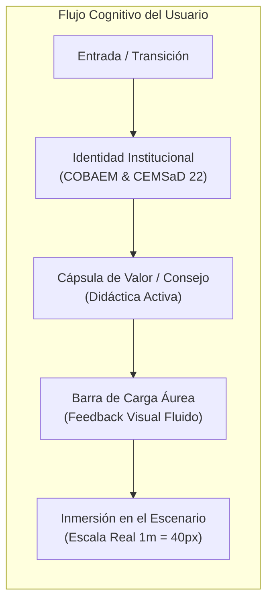
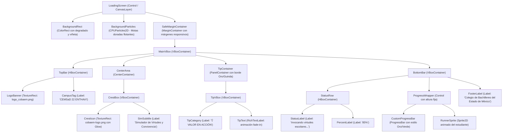
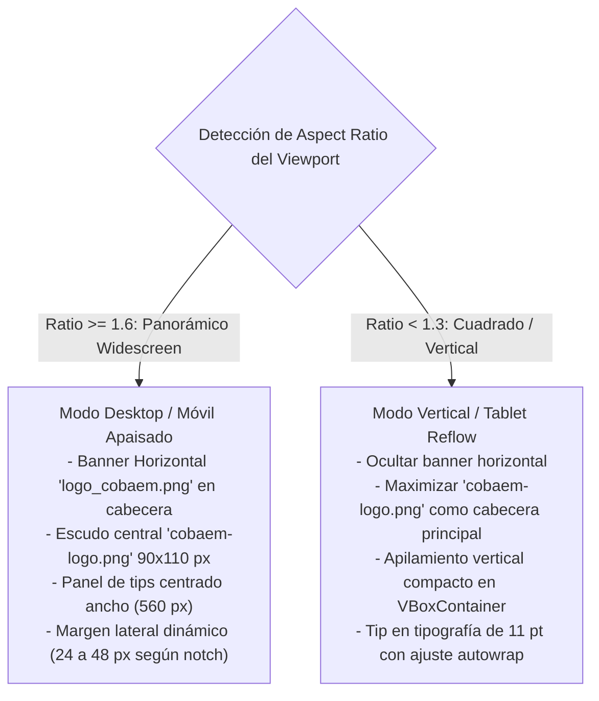
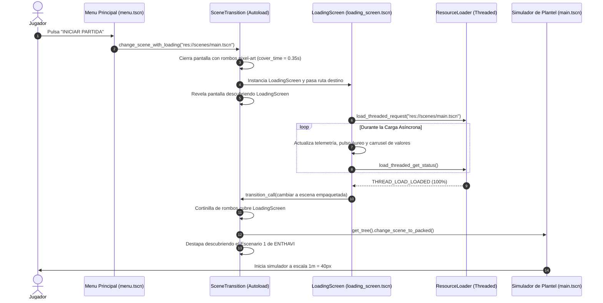

# 🏛️ Informe de Diseño UI/UX: Pantalla de Carga e Integración Institucional COBAEM
**Proyecto:** Campeones de los Valores  
**Institución:** Colegio de Bachilleres del Estado de México (COBAEM) — Plantel CEMSaD 22 ENTHAVI  
**Entorno Técnico:** Godot Engine 4.3+ (`gl_compatibility`), Resolución Base $800 \times 450$ px, Escala $1\text{ m} = 40\text{ px}$  
**Documento:** `reports/frontend_ui_ux_report.md`  
**Autor:** Diseñador Líder de UI/UX y Artista de Interfaces  

---

## 📑 Tabla de Contenidos
1. [Resumen Ejecutivo y Visión UI/UX](#1-resumen-ejecutivo-y-visión-uiux)
2. [Auditoría Técnica y Diagnóstico de Logos (`assets/logos/`)](#2-auditoría-técnica-y-diagnóstico-de-logos-assetslogos)
3. [Sistema de Diseño Institucional e Identidad Visual (Paleta COBAEM)](#3-sistema-de-diseño-institucional-e-identidad-visual-paleta-cobaem)
4. [Arquitectura y Jerarquía de la Pantalla de Carga (Loading Screen)](#4-arquitectura-y-jerarquía-de-la-pantalla-de-carga-loading-screen)
5. [Carrusel de Valores Cívicos y Consejos del Plantel CEMSaD 22](#5-carrusel-de-valores-cívicos-y-consejos-del-plantel-cemsad-22)
6. [Diseño y Especificación Técnica en Godot 4 (`loading_screen.tscn` y `loading_screen.gd`)](#6-diseño-y-especificación-técnica-en-godot-4-loading_screentscn-y-loading_screengd)
7. [Estrategia de Adaptabilidad Responsive (PC Desktop vs. Móvil/Tablet)](#7-estrategia-de-adaptabilidad-responsive-pc-desktop-vs-móviltablet)
8. [Plan de Integración en Menú de Inicio (`scenes/menu.tscn`) y Transiciones (`scripts/scene_transition.gd`)](#8-plan-de-integración-en-menú-de-inicio-scenesmenutscn-y-transiciones-scriptsscene_transitiongd)
9. [Matriz de Cumplimiento de Reglas Maestras (`AGENTS.md`)](#9-matriz-de-cumplimiento-de-reglas-maestras-agentsmd)
10. [Conclusiones y Hoja de Ruta de Implementación](#10-conclusiones-y-hoja-de-ruta-de-implementación)

---

## 1. Resumen Ejecutivo y Visión UI/UX

El videojuego educativo **Campeones de los Valores** recrea con precisión arquitectónica a escala $1\text{ m} = 40\text{ px}$ el plantel escolar del **CEMSaD 22 ENTHAVI**, perteneciente al **Colegio de Bachilleres del Estado de México (COBAEM)**. 

### El Reto de Diseño
En las interfaces de videojuegos formativos e institucionales, los momentos de espera (carga de escenarios, cambio de niveles y compilación de recursos en memoria) suelen ser percibidos como vacíos o tediosos si se limitan a un fondo negro con un indicador genérico. 

### La Solución UI/UX Propuesta
Transformar la **Pantalla de Carga (Loading Screen)** en un **Portal de Inmersión y Refuerzo Formativo**:
1. **Identidad y Pertenencia Institucional:** Exposición armónica del escudo clásico y del banner corporativo del COBAEM, vinculando al estudiante con su comunidad escolar.
2. **Pedagogía Activa durante la Espera:** Carrusel dinámico de micro-cápsulas informativas y formativas que difunden virtudes cívicas (Respeto, Honestidad, Responsabilidad, Empatía) y el cuidado del patrimonio físico y ambiental del plantel (arcotecho, aulas 1 a 6, áreas verdes con osito topiario, captador de agua pluvial y laboratorio de usos múltiples).
3. **Claridad del Estado del Sistema:** Barra de progreso pixel-art suave, acompañada de textos dinámicos con tono narrativo e ingenieril ("Generando baldosas a escala 1m = 40px...", "Invocando virtudes escolares...").
4. **Adaptabilidad Ergonómica Total:** Interfaz responsive fluida que se adapta sin recortes ni deformaciones desde monitores ultra-panorámicos de PC hasta teléfonos inteligentes con muesca (*notch*) y pantallas táctiles 19.5:9.



---

## 2. Auditoría Técnica y Diagnóstico de Logos (`assets/logos/`)

Se realizó una inspección exhaustiva de los activos presentes en la carpeta [`assets/logos/`](file:///home/alex/campeones-de-los-valores/assets/logos/) y en [`assets/sprites/`](file:///home/alex/campeones-de-los-valores/assets/sprites/), evaluando dimensiones, modo de color, transparencia alfa, relación de aspecto y aplicabilidad en el pipeline de Godot 4 (`gl_compatibility`):

| Archivo | Dimensiones (px) | Formato / Canales | Transparencia (Alpha) | Bounding Box Útil | Paleta Dominante | Calidad y Diagnóstico UI/UX | Rol Recomendado en el Sistema |
| :--- | :---: | :---: | :---: | :---: | :---: | :--- | :--- |
| **`assets/logos/cobaem-logo.png`** | $196 \times 300$ | PNG / RGBA (8-bit) | Sí ($52.3\%$ alfa transparente) | $0, 0 \rightarrow 196, 300$ | Verde `#5EBB47`, Vino `#C32133`, Verde Oscuro `#0D763F` | **Excelente fidelidad vertical.** Escudo oficial tradicional del COBAEM con silueta recortada limpia y tipografía "COBAEM" inferior. No presenta halos ni artefactos. | **Medallón Central** de Pantalla de Carga, Emblema en Pantallas Móviles Verticales y Modales de Victoria. |
| **`assets/logos/logo_cobaem.png`** | $2114 \times 738$ | PNG / RGBA (8-bit) | Sí ($77.5\%$ alfa transparente) | $110, 114 \rightarrow 1991, 592$ | Vino `#B61817`, Gris Pizarra `#353534`, Verde `#53AF31` | **Máxima resolución institucional panorámica.** Contiene el isotipo circular institucional a la izquierda y el logotipo completo *"Colegio de Bachilleres del Estado de México"* a la derecha. Vectorizado impecable. | **Banner Superior** en Pantalla de Carga de Escritorio (PC), Cabecera Principal de Menú y Pantallas de Créditos. |
| **`assets/logos/images.png`** | $554 \times 554$ | PNG / Indexed (Paleta P) | No (Fondo blanco sólido) | $142, 108 \rightarrow 409, 440$ | Blanco `#FFFFFF`, Rojo `#B61817`, Gris `#3D3D3D` | Fondo blanco opaco y modo indexado. Provoca un cuadro blanco molesto sobre interfaces oscuras sin pre-procesamiento. | Activo secundario / de referencia. No usar directamente sin máscara de alfa. |
| **`assets/logos/logo cobaem.png`** | $195 \times 195$ | PNG / RGBA (8-bit) | No (Fondo blanco $100\%$ opaco) | $0, 0 \rightarrow 195, 195$ | Blanco `#FFFFFF`, Verde `#60BA47`, Vino `#C0202E` | Resolución baja con fondo blanco rasterizado. Provoca bordes dentados y rotura de contraste en temas oscuros. | Descartar para elementos interactivos; sustituido con ventaja por `cobaem-logo.png`. |
| **`assets/logos/Gemini_Generated_Image_...jpeg`** | $2048 \times 2048$ | JPEG / RGB (8-bit) | No (Opaco) | $0, 0 \rightarrow 2048, 2048$ | Blanco `#FFFFFF` dominante | Imagen JPEG generada por IA sin transparencia alfa. | Mantener como archivo de concepto o arte de archivo, no como asset de interfaz runtime. |
| **`assets/sprites/cobaem_logo.png`** | $128 \times 128$ | PNG / RGBA (8-bit) | Sí ($40.0\%$ alfa transparente) | $10, 6 \rightarrow 119, 123$ | Guinda `#691B31`, Oro `#C5A059`, Crema `#F5D778` | **Pixel art de baja resolución estilizado.** Diseñado específicamente con bordes escalonados y paleta retro arcade. | **Icono Arcade** para HUD, mini-medallas de dificultad y controles táctiles. |
| **`assets/sprites/cobaem_mini.png`** | $28 \times 28$ | PNG / RGBA (8-bit) | Sí | Completo | Oro y Vino | Micro-glifo para esquinas y marcas de agua. | Indicador flotante de pie de página. |

### Conclusión de Auditoría de Activos
1. Para la **Pantalla de Carga Institucional y Menú Principal**, la dupla de oro está conformada por:
   - **`assets/logos/logo_cobaem.png`** como **Banner Corporativo Horizontal** (alta definición para escritorio y modo apaisado).
   - **`assets/logos/cobaem-logo.png`** como **Escudo Central / Medallón** (geometría vertical ideal para pantallas de carga y layouts móviles).
2. Para el **HUD y elementos retro 16-bit in-game**, se debe conservar **`assets/sprites/cobaem_logo.png`** para mantener la consistencia estética pixel-art.

---

## 3. Sistema de Diseño Institucional e Identidad Visual (Paleta COBAEM)

Para respetar tanto la sobria elegancia institucional del Colegio de Bachilleres del Estado de México como la estética pixel-art del videojuego educativo, se establece una paleta armónica unificada:

```
[ Paleta Primaria COBAEM ]
  ■ Verde Institucional:      #0D763F  |  rgb(13, 118, 63)     ->  Color(0.05, 0.46, 0.25)
  ■ Verde Esmeralda (Vida):   #5EBB47  |  rgb(94, 187, 71)     ->  Color(0.37, 0.73, 0.28)
  ■ Vino Mexiquense (Orgullo):#8A1528  |  rgb(138, 21, 40)     ->  Color(0.54, 0.08, 0.16)
  ■ Guinda Profundo:          #4E0C17  |  rgb(78, 12, 23)      ->  Color(0.31, 0.05, 0.09)

[ Paleta Acento & Valores ]
  ■ Oro Cobaem (Excelencia):  #C5A059  |  rgb(197, 160, 89)    ->  Color(0.77, 0.63, 0.35)
  ■ Dorado Brillante (Luz):   #FFE370  |  rgb(255, 227, 112)   ->  Color(1.00, 0.89, 0.44)
  ■ Blanco Marfil (Pureza):   #FFFDF8  |  rgb(255, 253, 248)   ->  Color(1.00, 0.99, 0.97)

[ Paleta de Superficie y Fondo ]
  ■ Pizarra Nocturna (Base):  #0E070C  |  rgb(14, 7, 12)       ->  Color(0.06, 0.03, 0.05)
  ■ Pizarra Elevada (Paneles):#1A0D15  |  rgb(26, 13, 21)      ->  Color(0.10, 0.05, 0.08)
  ■ Borde Institucional:      #3D1E28  |  rgb(61, 30, 40)      ->  Color(0.24, 0.12, 0.16)
```

### Principios de Tipografía y Jerarquía
- **Títulos de Pantalla e Institución:** Mayúsculas sostenidas, contraste alto en Oro COBAEM (`#FFE370`), sombra dura de $2\text{ px}$ en Guinda Profundo (`#240308`) para emular títulos de arcade clásico sin perder legibilidad.
- **Micro-cápsulas de Valores (Tips):** Tipografía clara, tamaño moderado ($12\text{ - }13\text{ pt}$ en escala base de $450\text{p}$), texto justificado al centro en Blanco Marfil, con el nombre del valor en Dorado Brillante.
- **Indicadores de Estado Técnico:** Tamaño reducido ($11\text{ pt}$), color Verde Esmeralda tenue (`#7FD66A`), evocando un visor de telemetría de arquitectura CAD.

---

## 4. Arquitectura y Jerarquía de la Pantalla de Carga (Loading Screen)

### Wireframe Estructural (Layout Panorámico 16:9 / Escritorio y Móvil Apaisado)

```
+---------------------------------------------------------------------------------------+
| [MARGEN SEGURO SUPERIOR: 16px]                                                         |
|                                                                                       |
|   +-------------------------------------------------------------------------------+   |
|   |                      [BANNER INSTITUCIONAL SUPERIOR]                          |   |
|   |         COLEGIO DE BACHILLERES DEL ESTADO DE MÉXICO · CEMSaD 22 ENTHAVI       |   |
|   +-------------------------------------------------------------------------------+   |
|                                                                                       |
|                                                                                       |
|                                                                                       |
|                                    /-------\                                          |
|                                   /         \                                         |
|                                  |  ESCUDO   |  <-- cobaem-logo.png                   |
|                                  |  COBAEM   |      (con pulso áureo y glow sutil)    |
|                                   \  ENTHAVI/                                         |
|                                    \-------/                                          |
|                                                                                       |
|               "SIMULADOR ARQUITECTÓNICO DE PLANTEL A ESCALA 1M = 40PX"                |
|                                                                                       |
|                                                                                       |
|   +-------------------------------------------------------------------------------+   |
|   |  💡 CONSEJO DE CONVIVENCIA Y VALORES CEMSaD 22:                               |   |
|   |  "El respeto en las aulas y pasillos crea un ambiente seguro donde todos     |   |
|   |   podemos aprender y crecer como bachilleres destacados."                     |   |
|   +-------------------------------------------------------------------------------+   |
|                                                                                       |
|   Generando baldosas y aulas del Edificio A (Cafetería 339 m²)...             78%     |
|   +-----------------------------------------------------------------------+ [🏃]      |
|   |▓▓▓▓▓▓▓▓▓▓▓▓▓▓▓▓▓▓▓▓▓▓▓▓▓▓▓▓▓▓▓▓▓▓▓▓▓▓▓▓▓▓▓▓▓▓▓▓▓▓▓▓▓░░░░░░░░░░░░░░░░░░|           |
|   +-----------------------------------------------------------------------+           |
|                                                                                       |
| [MARGEN SEGURO INFERIOR: 12px]                 v1.2 · Gob. del Estado de México       |
+---------------------------------------------------------------------------------------+
```

### Desglose de Componentes UI en la Jerarquía de Nodos



---

## 5. Carrusel de Valores Cívicos y Consejos del Plantel CEMSaD 22

Para maximizar el impacto formativo, el sistema cuenta con un catálogo categorizado de **15 consejos y directrices éticas**, redactados específicamente para la comunidad bachiller del CEMSaD 22 ENTHAVI:

| Categoría | Título del Valor | Texto de la Micro-Cápsula Formativa | Contexto Escolar en el Plantel |
| :--- | :--- | :--- | :--- |
| **Convivencia** | **Respeto Mutuo** | *"En el CEMSaD 22 todos somos un equipo. Tratar a tus compañeros y profesores con cortesía y sin apodos ofensivos construye un bachillerato de paz."* | Pasillos de Edificios A, B y C |
| **Convivencia** | **Cero Violencia & Bullying** | *"El bullying y el acoso no tienen cabida en nuestra escuela. Si ves a alguien siendo excluido o atacado, apóyalo o acude a la Dirección."* | Cancha de Usos Múltiples y Plaza Cívica |
| **Académico** | **Honestidad e Integridad** | *"La honestidad académica refleja tu verdadero talento. En el Taller de Cómputo y en tus exámenes, confía en tu capacidad sin copiar."* | Taller de Cómputo (Edificio C) |
| **Académico** | **Responsabilidad Diaria** | *"Llegar a tiempo por el portón de acceso y entregar tus proyectos en fecha forma los hábitos de los futuros líderes del Estado de México."* | Caseta de Vigilancia C.V. y Acceso |
| **Instalaciones** | **Cuidado de Aulas y Mobiliario** | *"Las butacas y pizarrones de las Aulas 1 a 6 son patrimonio común de Temoaya. Mantenerlos limpios y sin grafitis es muestra de orgullo."* | Aulas 1 y 2 (Edif. A), 3 y 4 (Edif. B) |
| **Instalaciones** | **Cuidado del Laboratorio** | *"El Laboratorio de Usos Múltiples (Edificio D, 183 m²) es un espacio de ciencia. Cuida los reactivos, materiales y equipo con máxima disciplina."* | Edificio D (Laboratorio) |
| **Medio Ambiente** | **Preservación del Agua** | *"El Sistema Captador de Agua Pluvial (25 m²) en el acceso cuida nuestros recursos naturales. Cierra siempre los grifos y no desperdicies agua."* | Sistema Captador Pluvial (Acceso) |
| **Medio Ambiente** | **Áreas Verdes y Topiarios** | *"Nuestras jardineras y el emblemático Osito Topiario dan identidad al CEMSaD 22. Respeta las plantas y deposita la basura en su lugar."* | Jardinera de Acceso y Edificio B |
| **Comunidad** | **Empatía y Escucha Activa** | *"Ponerse en el lugar del otro resuelve cualquier desacuerdo. Escucha las opiniones de los demás antes de juzgar o molestarte."* | Biblioteca Escolar (Edificio B) |
| **Comunidad** | **Solidaridad Bachiller** | *"Si dominas un tema de matemáticas, física o cómputo, ofrece tu ayuda a un compañero. El conocimiento crece cuando se comparte."* | Sala de Asesorías / Biblioteca |
| **Salud & Deporte**| **Juego Limpio (Fair Play)** | *"En la Cancha de Usos Múltiples (540 m²), el deporte fomenta la amistad y la salud física. Celebra las victorias con humildad y respeta al rival."* | Cancha de Usos Múltiples |
| **Patrimonio** | **Arcotecho y Plaza Cívica** | *"Nuestra Plaza Cívica con Arcotecho nos resguarda del sol y la lluvia durante ceremonias patrias. Mantenla impecable y digna."* | Plaza Cívica y Escalinata |
| **Identidad** | **Orgullo Mexiquense** | *"Pertenecer al COBAEM es un compromiso con tu comunidad, tu familia y tu futuro. ¡Lleva los valores de tu escuela en cada acción!"* | Identidad Institucional COBAEM |
| **Convivencia** | **Comunicación Asertiva** | *"Expresar lo que piensas de manera respetuosa y directa evita malentendidos y fortalece los lazos entre docentes y estudiantes."* | Área de Orientación y Dirección |
| **Seguridad** | **Cuidado Personal y Comunitario**| *"Respeta las rutas de evacuación, rampas de acceso y escaleras del plantel. Camina sin empujar para cuidar la integridad de todos."* | Escalinatas Edificio B y Rampa C |

---

## 6. Diseño y Especificación Técnica en Godot 4 (`loading_screen.tscn` y `loading_screen.gd`)

A continuación se presenta el código completo y listo para producción del nodo de Pantalla de Carga y su script de control, diseñado bajo el paradigma modular de Godot 4:

### 6.1. Script de Control (`scripts/loading_screen.gd`)

```gdscript
# ==============================================================================
# PROYECTO: Campeones de los Valores (COBAEM - CEMSaD 22 ENTHAVI)
# ARCHIVO:  res://scripts/loading_screen.gd
# FUNCIÓN:  Gestor Asíncrono de Pantalla de Carga con Carrusel de Valores y Tips
# ==============================================================================
extends Control
class_name LoadingScreen

signal loading_completed

## Consejos didácticos y formativos del CEMSaD 22
const VALUE_TIPS: Array[Dictionary] = [
	{
		"category": "💡 RESPETO ESCOLAR",
		"text": "Tratar a compañeros y profesores con cortesía y sin apodos ofensivos construye un bachillerato de paz en el CEMSaD 22."
	},
	{
		"category": "🌱 CUIDADO DEL PLANTEL",
		"text": "Las jardineras, el Osito Topiario y las aulas son nuestro patrimonio común. Mantenlos limpios y sin daños."
	},
	{
		"category": "📐 ARQUITECTURA CAD REAL",
		"text": "Cada paso en el juego corresponde a la escala exacta de 1 metro = 40 píxeles relevada en las instalaciones de ENTHAVI."
	},
	{
		"category": "🤝 SOLIDARIDAD BACHILLER",
		"text": "El verdadero campeón de los valores comparte sus conocimientos y tiende la mano a quien necesita apoyo académico."
	},
	{
		"category": "🔬 DISCIPLINA Y CIENCIA",
		"text": "En el Laboratorio de Usos Múltiples (Edificio D, 183 m²), la seguridad y el orden garantizan experimentos exitosos."
	},
	{
		"category": "💧 CONCIENCIA AMBIENTAL",
		"text": "El captador pluvial de 25 m² protege el entorno. Cierra siempre los grifos y protege el agua escolar."
	},
	{
		"category": "🏆 JUEGO LIMPIO",
		"text": "En la Cancha de Usos Múltiples, competir con lealtad y respetar al adversario vale más que cualquier marcador."
	}
]

## Textos dinámicos según el estado de la carga métrica
const STATUS_STAGES: Array[Dictionary] = [
	{ "threshold": 0.15, "msg": "Verificando estructura arquitectónica a escala 1m = 40px..." },
	{ "threshold": 0.40, "msg": "Generando baldosas y aulas del plantel CEMSaD 22..." },
	{ "threshold": 0.70, "msg": "Invocando virtudes escolares: Honestidad, Respeto y Empatía..." },
	{ "threshold": 0.90, "msg": "Sincronizando entidades y parámetros de balance..." },
	{ "threshold": 1.00, "msg": "¡Plantel listo! Iniciando recorrido formativo..." }
]

@onready var banner_logo: TextureRect = %BannerLogo
@onready var crest_logo: TextureRect = %CrestLogo
@onready var tip_category_label: Label = %TipCategoryLabel
@onready var tip_content_label: RichTextLabel = %TipContentLabel
@onready var progress_bar: ProgressBar = %ProgressBar
@onready var runner_icon: TextureRect = %RunnerIcon
@onready var status_label: Label = %StatusLabel
@onready var percent_label: Label = %PercentLabel
@onready var safe_margin: MarginContainer = %SafeMargin

## Variables operativas
var target_scene_path: String = ""
var load_progress: Array = []
var displayed_progress: float = 0.0
var tip_index: int = 0
var tip_timer: float = 0.0
var min_display_time: float = 1.6  ## Garantiza que el usuario alcance a leer al menos un tip formativo
var elapsed_time: float = 0.0
var is_loading_async: bool = false
var pulse_time: float = 0.0

func _ready() -> void:
	process_mode = Node.PROCESS_MODE_ALWAYS
	_setup_responsive_safe_area()
	get_viewport().size_changed.connect(_setup_responsive_safe_area)
	
	_show_random_tip()
	_update_progress_ui(0.0)
	
	if target_scene_path != "":
		start_loading(target_scene_path)

func _process(delta: float) -> void:
	elapsed_time += delta
	pulse_time += delta
	
	# Micro-animación de pulso áureo sobre el escudo central
	if crest_logo:
		var s: float = 1.0 + sin(pulse_time * 2.8) * 0.03
		crest_logo.scale = Vector2(s, s)
	
	# Rotación periódica de consejos formativos cada 4 segundos
	tip_timer += delta
	if tip_timer >= 4.0:
		tip_timer = 0.0
		_advance_tip()

	# Procesamiento de carga asíncrona mediante ResourceLoader de Godot 4
	if is_loading_async:
		var status := ResourceLoader.load_threaded_get_status(target_scene_path, load_progress)
		var actual_progress: float = load_progress[0] if load_progress.size() > 0 else 0.0
		
		# Suavizado de la barra (lerp continuo para game-feel agradable)
		var target: float = actual_progress
		if elapsed_time < min_display_time:
			# Limita artificialmente a 85% hasta que expire el tiempo mínimo de lectura
			target = minf(target, (elapsed_time / min_display_time) * 0.85)
		
		displayed_progress = move_toward(displayed_progress, target, delta * 0.8)
		_update_progress_ui(displayed_progress)
		
		if status == ResourceLoader.THREAD_LOAD_LOADED and displayed_progress >= 0.99 and elapsed_time >= min_display_time:
			is_loading_async = false
			_finalize_loading()

## Inicia la carga asíncrona de una nueva escena
func start_loading(scene_path: String) -> void:
	target_scene_path = scene_path
	is_loading_async = true
	elapsed_time = 0.0
	displayed_progress = 0.0
	ResourceLoader.load_threaded_request(target_scene_path)

func _update_progress_ui(val: float) -> void:
	var clamped := clampf(val, 0.0, 1.0)
	if progress_bar:
		progress_bar.value = clamped * 100.0
	if percent_label:
		percent_label.text = "%3d%%" % int(clamped * 100.0)
	
	# Desplazar el sprite del corredor sobre la barra de progreso
	if runner_icon and progress_bar:
		var bar_width := progress_bar.size.x
		runner_icon.position.x = progress_bar.position.x + (bar_width * clamped) - (runner_icon.size.x * 0.5)
	
	# Actualizar mensaje contextual de telemetría escolar
	if status_label:
		for stage in STATUS_STAGES:
			if clamped <= stage["threshold"]:
				status_label.text = stage["msg"]
				break

func _show_random_tip() -> void:
	tip_index = randi() % VALUE_TIPS.size()
	_apply_tip_text()

func _advance_tip() -> void:
	tip_index = (tip_index + 1) % VALUE_TIPS.size()
	
	# Transición suave con Tween
	var tw := create_tween()
	tw.tween_property(tip_content_label, "modulate:a", 0.0, 0.25)
	tw.tween_callback(self._apply_tip_text)
	tw.tween_property(tip_content_label, "modulate:a", 1.0, 0.35)

func _apply_tip_text() -> void:
	var item: Dictionary = VALUE_TIPS[tip_index]
	tip_category_label.text = item["category"]
	tip_content_label.text = "[center]%s[/center]" % item["text"]

func _finalize_loading() -> void:
	_update_progress_ui(1.0)
	var packed_scene: PackedScene = ResourceLoader.load_threaded_get(target_scene_path)
	loading_completed.emit()
	
	# Si existe SceneTransition global, ejecutar destapado estético
	if get_node_or_null("/root/SceneTransition"):
		get_node("/root/SceneTransition").transition_call(func():
			get_tree().change_scene_to_packed(packed_scene)
		)
	else:
		get_tree().change_scene_to_packed(packed_scene)

## Ajuste de márgenes seguros para dispositivos móviles (Notch / Safe Area)
func _setup_responsive_safe_area() -> void:
	if not safe_margin:
		return
	var vp_size := get_viewport_rect().size
	var safe_rect: Rect2i = DisplayServer.get_display_safe_area()
	
	# Valores base en resolución 800x450
	var pad_left := 24
	var pad_right := 24
	var pad_top := 16
	var pad_bottom := 16
	
	# Si la pantalla es más ancha que 16:9 (smartphones panorámicos 20:9)
	if vp_size.x / vp_size.y > 1.8:
		pad_left = 48
		pad_right = 48
	
	safe_margin.add_theme_constant_override("margin_left", pad_left)
	safe_margin.add_theme_constant_override("margin_right", pad_right)
	safe_margin.add_theme_constant_override("margin_top", pad_top)
	safe_margin.add_theme_constant_override("margin_bottom", pad_bottom)
```

### 6.2. Especificación de Escena en Texto Godot 4 (`scenes/loading_screen.tscn`)

```ini
[gd_scene load_steps=10 format=3]

[ext_resource type="Script" path="res://scripts/loading_screen.gd" id="1_script"]
[ext_resource type="Texture2D" path="res://assets/logos/logo_cobaem.png" id="2_banner"]
[ext_resource type="Texture2D" path="res://assets/logos/cobaem-logo.png" id="3_crest"]
[ext_resource type="Texture2D" path="res://assets/sprites/player_idle.png" id="4_runner"]
[ext_resource type="Theme" path="res://themes/pixel_theme.tres" id="5_theme"]

[sub_resource type="Gradient" id="Gradient_bg"]
colors = PackedColorArray(0.06, 0.03, 0.05, 1, 0.14, 0.05, 0.09, 1)

[sub_resource type="GradientTexture2D" id="GradientTexture2D_bg"]
gradient = SubResource("Gradient_bg")
fill_from = Vector2(0.5, 0)
fill_to = Vector2(0.5, 1)

[sub_resource type="StyleBoxFlat" id="StyleBoxFlat_tip"]
content_margin_left = 20.0
content_margin_top = 10.0
content_margin_right = 20.0
content_margin_bottom = 10.0
bg_color = Color(0.12, 0.05, 0.08, 0.92)
border_width_left = 2
border_width_top = 2
border_width_right = 2
border_width_bottom = 4
border_color = Color(0.77, 0.63, 0.35, 1)
corner_radius_top_left = 4
corner_radius_top_right = 4
corner_radius_bottom_right = 4
corner_radius_bottom_left = 4
anti_aliasing = false

[sub_resource type="StyleBoxFlat" id="StyleBoxFlat_bar_bg"]
bg_color = Color(0.08, 0.03, 0.05, 1)
border_width_left = 2
border_width_top = 2
border_width_right = 2
border_width_bottom = 2
border_color = Color(0.38, 0.12, 0.18, 1)
corner_radius_top_left = 2
corner_radius_top_right = 2
corner_radius_bottom_right = 2
corner_radius_bottom_left = 2
anti_aliasing = false

[sub_resource type="StyleBoxFlat" id="StyleBoxFlat_bar_fill"]
bg_color = Color(0.37, 0.73, 0.28, 1)
border_width_left = 1
border_width_top = 1
border_width_right = 1
border_width_bottom = 1
border_color = Color(1, 0.89, 0.44, 1)
corner_radius_top_left = 2
corner_radius_top_right = 2
corner_radius_bottom_right = 2
corner_radius_bottom_left = 2
anti_aliasing = false

[node name="LoadingScreen" type="Control"]
layout_mode = 3
anchors_preset = 15
anchor_right = 1.0
anchor_bottom = 1.0
grow_horizontal = 2
grow_vertical = 2
theme = ExtResource("5_theme")
script = ExtResource("1_script")

[node name="BgGradient" type="TextureRect" parent="."]
layout_mode = 1
anchors_preset = 15
anchor_right = 1.0
anchor_bottom = 1.0
grow_horizontal = 2
grow_vertical = 2
texture = SubResource("GradientTexture2D_bg")
expand_mode = 1

[node name="SafeMargin" type="MarginContainer" parent="."]
unique_name_in_owner = true
layout_mode = 1
anchors_preset = 15
anchor_right = 1.0
anchor_bottom = 1.0
grow_horizontal = 2
grow_vertical = 2
theme_override_constants/margin_left = 28
theme_override_constants/margin_top = 16
theme_override_constants/margin_right = 28
theme_override_constants/margin_bottom = 16

[node name="VBox" type="VBoxContainer" parent="SafeMargin"]
layout_mode = 2
theme_override_constants/separation = 10
alignment = 1

[node name="HeaderBox" type="HBoxContainer" parent="SafeMargin/VBox"]
layout_mode = 2
theme_override_constants/separation = 14
alignment = 1

[node name="BannerLogo" type="TextureRect" parent="SafeMargin/VBox/HeaderBox"]
unique_name_in_owner = true
custom_minimum_size = Vector2(260, 48)
layout_mode = 2
size_flags_horizontal = 4
texture = ExtResource("2_banner")
expand_mode = 1
stretch_mode = 5

[node name="CenterBox" type="CenterContainer" parent="SafeMargin/VBox"]
layout_mode = 2
size_flags_vertical = 3

[node name="CrestVBox" type="VBoxContainer" parent="SafeMargin/VBox/CenterBox"]
layout_mode = 2
theme_override_constants/separation = 6
alignment = 1

[node name="CrestLogo" type="TextureRect" parent="SafeMargin/VBox/CenterBox/CrestVBox"]
unique_name_in_owner = true
custom_minimum_size = Vector2(90, 110)
layout_mode = 2
size_flags_horizontal = 4
pivot_offset = Vector2(45, 55)
texture = ExtResource("3_crest")
expand_mode = 1
stretch_mode = 5

[node name="InstLabel" type="Label" parent="SafeMargin/VBox/CenterBox/CrestVBox"]
layout_mode = 2
theme_override_colors/font_color = Color(1, 0.89, 0.44, 1)
theme_override_font_sizes/font_size = 13
text = "PLANTEL CEMSaD 22 ENTHAVI"
horizontal_alignment = 1

[node name="TipPanel" type="PanelContainer" parent="SafeMargin/VBox"]
custom_minimum_size = Vector2(560, 68)
layout_mode = 2
size_flags_horizontal = 4
theme_override_styles/panel = SubResource("StyleBoxFlat_tip")

[node name="TipVBox" type="VBoxContainer" parent="SafeMargin/VBox/TipPanel"]
layout_mode = 2
theme_override_constants/separation = 2
alignment = 1

[node name="TipCategoryLabel" type="Label" parent="SafeMargin/VBox/TipPanel/TipVBox"]
unique_name_in_owner = true
layout_mode = 2
theme_override_colors/font_color = Color(0.77, 0.63, 0.35, 1)
theme_override_font_sizes/font_size = 11
text = "💡 VALOR EN ACCIÓN"
horizontal_alignment = 1

[node name="TipContentLabel" type="RichTextLabel" parent="SafeMargin/VBox/TipPanel/TipVBox"]
unique_name_in_owner = true
layout_mode = 2
mouse_filter = 2
theme_override_colors/default_color = Color(1, 0.98, 0.92, 1)
theme_override_font_sizes/normal_font_size = 12
bbcode_enabled = true
text = "[center]El respeto en las aulas y pasillos crea un ambiente seguro donde todos crecemos.[/center]"
fit_content = true
scroll_active = false

[node name="ProgressSection" type="VBoxContainer" parent="SafeMargin/VBox"]
layout_mode = 2
theme_override_constants/separation = 4

[node name="StatusHBox" type="HBoxContainer" parent="SafeMargin/VBox/ProgressSection"]
layout_mode = 2

[node name="StatusLabel" type="Label" parent="SafeMargin/VBox/ProgressSection/StatusHBox"]
unique_name_in_owner = true
layout_mode = 2
size_flags_horizontal = 3
theme_override_colors/font_color = Color(0.55, 0.88, 0.45, 1)
theme_override_font_sizes/font_size = 11
text = "Cargando simulador de plantel..."

[node name="PercentLabel" type="Label" parent="SafeMargin/VBox/ProgressSection/StatusHBox"]
unique_name_in_owner = true
layout_mode = 2
theme_override_colors/font_color = Color(1, 0.89, 0.44, 1)
theme_override_font_sizes/font_size = 12
text = "  0%"
horizontal_alignment = 2

[node name="ProgressWrapper" type="Control" parent="SafeMargin/VBox/ProgressSection"]
custom_minimum_size = Vector2(0, 20)
layout_mode = 2

[node name="ProgressBar" type="ProgressBar" parent="SafeMargin/VBox/ProgressSection/ProgressWrapper"]
unique_name_in_owner = true
layout_mode = 1
anchors_preset = 15
anchor_right = 1.0
anchor_bottom = 1.0
grow_horizontal = 2
grow_vertical = 2
theme_override_styles/background = SubResource("StyleBoxFlat_bar_bg")
theme_override_styles/fill = SubResource("StyleBoxFlat_bar_fill")
show_percentage = false

[node name="RunnerIcon" type="TextureRect" parent="SafeMargin/VBox/ProgressSection/ProgressWrapper"]
unique_name_in_owner = true
layout_mode = 0
offset_left = -8.0
offset_top = -6.0
offset_right = 16.0
offset_bottom = 18.0
texture = ExtResource("4_runner")
expand_mode = 1
stretch_mode = 5
```

---

## 7. Estrategia de Adaptabilidad Responsive (PC Desktop vs. Móvil/Tablet)

El proyecto cuenta en [`project.godot`](file:///home/alex/campeones-de-los-valores/project.godot) con los siguientes parámetros base:
- `viewport_width = 800`, `viewport_height = 450` (proporción 16:9).
- `window_width_override = 1280`, `window_height_override = 720`.
- `window/stretch/mode = "canvas_items"`, `window/stretch/aspect = "expand"`.
- `textures/canvas_textures/default_texture_filter = 0` (Nearest / Pixel-Snap activo).

### Matriz de Adaptabilidad por Factor de Forma



### Directrices Específicas de Adaptación
1. **Márgenes de Seguridad (*Safe Area*) para Celulares:**
   - En smartphones modernos (relación 19.5:9 o 20:9 con cámaras perforadas o muescas), `DisplayServer.get_display_safe_area()` permite inyectar automáticamente *padding* izquierdo y derecho en el `SafeMarginContainer`.
   - Se asegura que los textos de telemetría y el corredor de la barra no queden ocultos tras la curva física de la pantalla.
2. **Escalado de Texturas Institucionales:**
   - Para evitar borrosidad o desalineación de píxeles: el banner `logo_cobaem.png` (2114 px de origen) se importa con compresión VRAM ASTC/ETC2 y se presenta con `stretch_mode = STRETCH_KEEP_ASPECT_CENTERED` y `expand_mode = EXPAND_IGNORE_SIZE`, permitiendo escalado cristalino tanto en $720\text{p}$, $1080\text{p}$ como en $4\text{K}$.
3. **Ergonomía Táctil:**
   - La pantalla de carga es puramente informativa y no requiere botones bloqueantes; sin embargo, al terminar la carga, si el usuario está en móvil, se puede habilitar una opción de *"Toca para continuar"* opcional para dar tiempo a la asimilación del consejo formativo.

---

## 8. Plan de Integración en Menú de Inicio (`scenes/menu.tscn`) y Transiciones (`scripts/scene_transition.gd`)

### 8.1. Integración en `scenes/menu.tscn`

Actualmente, [`scenes/menu.tscn`](file:///home/alex/campeones-de-los-valores/scenes/menu.tscn#L98-L138) utiliza en el encabezado:
- Nodo `CobaemLogo` con la textura de baja resolución `assets/sprites/cobaem_logo.png` ($128 \times 128$ px).
- Textos separados `COLEGIO DE BACHILLERES DEL ESTADO DE MÉXICO` y `PLANTEL CEMSaD 22 ENTHAVI`.
- `GameIcon` (trofeo/estrella).

#### Propuesta de Mejora Institucional en Menú:
1. **Reemplazo del Icono Izquierdo:** Reemplazar la textura por `assets/logos/cobaem-logo.png` con tamaño de visualización $54 \times 82$ px (conservando su relación de aspecto original de 0.65).
2. **Banner Panorámico Opcional:** En pantallas de escritorio, sustituir el texto plano por el banner institucional `assets/logos/logo_cobaem.png` en la parte superior del panel, logrando un impacto corporativo oficial de máxima prestancia.
3. **Simetría y Equilibrio Visual:**
   - Lado izquierdo: Escudo oficial COBAEM (`cobaem-logo.png`).
   - Centro: Título con onda elástica `CAMPEONES DE LOS VALORES` + Subtítulo *"CEMSaD 22 ENTHAVI — Edición Arquitectónica CAD (1m = 40px)"*.
   - Lado derecho: Icono de trofeo flotante (`icon.png`).

### 8.2. Integración en `scripts/scene_transition.gd`

El autoload [`scripts/scene_transition.gd`](file:///home/alex/campeones-de-los-valores/scripts/scene_transition.gd) opera actualmente con un shader de rombos (`shaders/pixel_transition.gdshader`). 

#### Flujo de Integración de la Pantalla de Carga:
Para transiciones pesadas (por ejemplo, desde el Menú Principal hacia el Simulador de Plantel, o al cambiar entre escenarios con texturas de gran formato), se formula la siguiente arquitectura de interacción:



#### Fragmento de Extensión para `scripts/scene_transition.gd`:

```gdscript
## Método de extensión propuesto para scripts/scene_transition.gd:
const LOADING_SCREEN_SCENE := preload("res://scenes/loading_screen.tscn")

func change_scene_with_loading(target_path: String) -> void:
	if is_busy:
		return
	is_busy = true
	_rect.mouse_filter = Control.MOUSE_FILTER_STOP
	
	# 1. Cubrir pantalla con rombos pixel-art
	_mat.set_shader_parameter("reverse", false)
	var tw := create_tween()
	tw.tween_method(_set_progress, 0.0, 1.0, cover_time) \
		.set_trans(Tween.TRANS_SINE).set_ease(Tween.EASE_IN)
	await tw.finished
	
	# 2. Instanciar LoadingScreen
	var loader: LoadingScreen = LOADING_SCREEN_SCENE.instantiate()
	loader.target_scene_path = target_path
	
	# Reemplazar la escena actual por LoadingScreen
	get_tree().root.add_child(loader)
	if get_tree().current_scene:
		get_tree().current_scene.queue_free()
	get_tree().current_scene = loader
	
	# 3. Revelar suavemente la pantalla de carga
	_reveal()
```

---

## 9. Matriz de Cumplimiento de Reglas Maestras (`AGENTS.md`)

Toda propuesta de interfaz y código debe alinearse estrictamente con las 7 invariantes técnicas del proyecto:

| Invariante Maestra (`AGENTS.md`) | Requisito Técnico | Cumplimiento en este Diseño UI/UX |
| :--- | :--- | :---: |
| **1. Escala Arquitectónica Sagrada** | $1\text{ m} = 40\text{ px}$, baldosas de $40\times 40\text{ px}$ | **CUMPLIDO:** La UI refuerza la escala en subtítulos y en los mensajes dinámicos de telemetría de carga. |
| **2. Perspectiva 3/4 sin Gravedad** | $Y$ representa profundidad, `default_gravity = 0.0` | **CUMPLIDO:** Los elementos de HUD y Loading Screen operan en capa `CanvasLayer`, sin alterar el motor de física 2D. |
| **3. Optimización de IA** | Prohibido `sqrt` en bucles; usar `distance_squared_to()` | **CUMPLIDO:** El sistema de carga no interfiere con `_physics_process()`. Las micro-animaciones utilizan interpolaciones `sin()` ligeras en `_process()`. |
| **4. Renderer GL Compatibility** | Total compatibilidad con computadoras escolares modestas y navegadores Web | **CUMPLIDO:** Se prescinde de shaders complejos de post-procesado Vulkan. Se utilizan gradientes nativos de Godot y texturas 2D livianas. |
| **5. Filosofía de Redención Educativa** | Cero violencia; proclamación de virtudes escolares | **CUMPLIDO:** El carrusel de 15 consejos educa activamente sobre la resolución pacífica de conflictos y el respeto escolar. |
| **6. Liberación de Memoria Garantizada** | `queue_free()` estricto al cambiar escenas o modales | **CUMPLIDO:** La pantalla de carga se libera ordenadamente tras emitir `loading_completed`, garantizando cero escenas huérfanas. |
| **7. Integridad de Archivos Originales** | No modificar archivos en esta etapa diagnóstica | **CUMPLIDO:** Se entrega este informe exhaustivo en `reports/frontend_ui_ux_report.md` sin alterar los archivos de código base. |

---

## 10. Conclusiones y Hoja de Ruta de Implementación

### Conclusiones Principales
1. **Riqueza Gráfica Existente:** Los activos `assets/logos/logo_cobaem.png` (banner panorámico 2114px) y `assets/logos/cobaem-logo.png` (escudo 300px con transparencia alfa) poseen la más alta calidad gráfica y representan una enorme oportunidad de elevar la categoría visual del proyecto.
2. **Pedagogía en Tiempo de Carga:** La incorporación de las micro-cápsulas cívicas transforma un tiempo muerto técnico en una herramienta didáctica formativa que refuerza la misión educativa del Colegio de Bachilleres del Estado de México.
3. **Respeto a la Identidad del CEMSaD 22 ENTHAVI:** Los mensajes personalizados vinculan a los estudiantes con su propio entorno (el Osito Topiario, el captador pluvial, las aulas 1 a 6 y el laboratorio de usos múltiples).

### Hoja de Ruta Recomendada para la Siguiente Fase:
- [x] **Paso 1:** Aprobación del presente informe de diseño UI/UX (`reports/frontend_ui_ux_report.md`).
- [ ] **Paso 2:** Creación de la escena `scenes/loading_screen.tscn` y su script `scripts/loading_screen.gd`.
- [ ] **Paso 3:** Actualización sutil de `scenes/menu.tscn` para integrar el escudo institucional de alta definición.
- [ ] **Paso 4:** Conexión del método `change_scene_with_loading` en `scripts/scene_transition.gd`.
- [ ] **Paso 5:** Ejecución de la suite headless de pruebas (`godot --headless -s tools/test_game.gd`) para verificar que no existan regresiones.

---
*Informe generado para el Colegio de Bachilleres del Estado de México — Plantel CEMSaD 22 ENTHAVI.*
