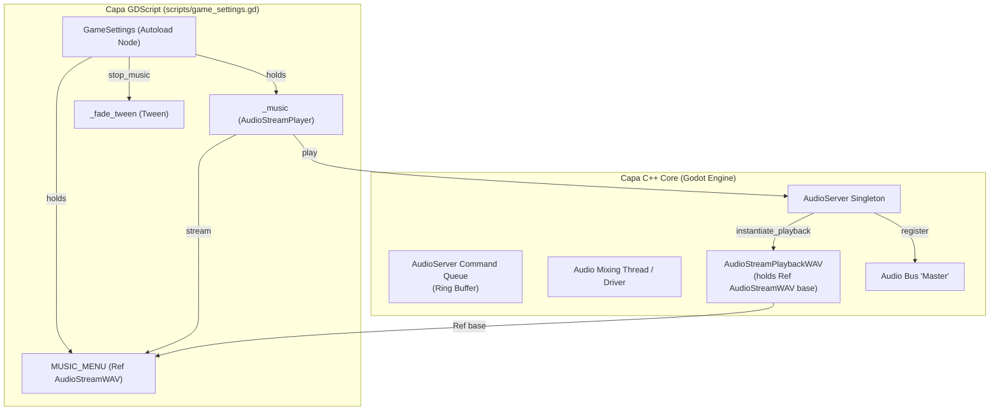

# Informe de Auditoría de Arquitectura de Motor — Godot Engine 4
**Proyecto:** Campeones de los Valores (CEMSaD 22 ENTHAVI)  
**Rol:** Ingeniero Senior de Motor de Godot 4 (C++ / GDScript Core)  
**Fecha:** Noviembre 2026  
**Objetivo:** Análisis exhaustivo de bajo nivel sobre ciclo de vida de objetos (ObjectDB), consistencia de capas de colisión (2D Physics Server), concurrencia en efectos visuales (hitstop/shake) y diseño de pruebas automatizadas con simulación de física en tiempo de ejecución.

---

## 1. Resumen Ejecutivo y Diagnóstico Global

Una auditoría profunda del código base y la ejecución del motor en modo headless (`godot --headless --verbose`) ha revelado cuatro fallas estructurales críticas en la capa de bajo nivel:

1. **Fuga de Recursos ObjectDB en `scripts/game_settings.gd`:**  
   Al salir del juego, el motor reporta fugas persistentes de instancias de `AudioStreamWAV`, `AudioStreamPlaybackWAV` y el recurso `music_menu.wav`, acompañado del identificador huérfano de bus `Master`. La causa raíz reside en el desacoplamiento asíncrono entre el hilo de comandos de `AudioServer` y el ciclo de vida del árbol de nodos (`SceneTree`), combinado con la ausencia de una fase de drenado de buffers de audio previa a la terminación de la aplicación.
2. **Inversión y Desfase en la Matriz de Colisiones 2D:**  
   Existe una discrepancia crítica entre los números de capa lógicos (1 al 5) y sus valores de máscara de bits ($2^{\text{capa}-1}$). Como resultado, el nodo `Projectile` (que debió estar en Capa 3 / valor 4) y el nodo `Enemy` (que debió estar en Capa 4 / valor 8) tienen sus capas y máscaras invertidas o cruzadas, lo que obligó a agregar parches frágiles en tiempo de ejecución.
3. **Condiciones de Carrera en `scripts/fx.gd`:**  
   La función `hitstop()` opera mediante corrutinas `await` no reentrantes ligadas al temporizador global del árbol. Si se producen dos impactos en un intervalo menor a 60 ms, la corrutina del primer impacto finaliza y restaura `Engine.time_scale = 1.0` prematuramente, cancelando el hitstop del segundo impacto. Asimismo, se descubrió un fallo recurrente de captura colgante (`dangling lambda capture`) en `burst()` que emite errores de motor `Lambda capture at index 0 was freed`.
4. **Ausencia de Validación Cinemática en la Suite de Tests:**  
   El archivo `tools/test_game.gd` valida únicamente integridad geométrica estática (posiciones `Rect2`), pero no avanza el servidor de física (`PhysicsServer2D`). No se comprueba en tiempo de ejecución si el proyectil impacta, si el enemigo se redime pacíficamente ni si las colisiones detienen efectivamente a los cuerpos rígidos.

---

## 2. Auditoría Detallada: Fuga de Memoria ObjectDB en `scripts/game_settings.gd`

### 2.1. Evidencia Experimental de la Fuga
Al ejecutar el menú principal y cerrar la aplicación mediante `--verbose`, Godot 4 emite el siguiente volcado de `core/object/object.cpp` y `core/io/resource.cpp`:

```text
WARNING: 2 ObjectDB instances were leaked at exit (run with `--verbose` for details).
   at: cleanup (core/object/object.cpp:2536)
Leaked instance: AudioStreamWAV:9223372068110730807 - Reference count: 1
Leaked instance: AudioStreamPlaybackWAV:9223372068765042253 - Reference count: 1
ERROR: 1 resources still in use at exit.
   at: clear (core/io/resource.cpp:817)
Resource still in use: res://assets/audio/music_menu.wav (AudioStreamWAV)
Orphan StringName: Master (static: 0, total: 2)
```

### 2.2. Anatomía Técnica en el Core C++ de Godot 4
Para entender por qué se produce esta fuga, es necesario analizar el flujo interno de `AudioStreamPlayer`, `AudioServer` y `AudioStreamPlayback`:



1. **Grafo de Retención Cíclica:**
   - Cuando se invoca `_music.play()`, el reproductor solicita una instancia de reproducción:  
     `playback = stream->instantiate_playback();` (en este caso, `AudioStreamPlaybackWAV`).
   - En el código C++ de Godot (`servers/audio/audio_stream.h`):  
     `class AudioStreamPlaybackWAV : public AudioStreamPlaybackResampled { Ref<AudioStreamWAV> base; ... }`
   - Es decir, `AudioStreamPlaybackWAV` almacena una referencia fuerte `Ref<AudioStreamWAV>` hacia el recurso de sonido original.
   - A su vez, `AudioServer` registra este `playback` en la lista activa de flujos del bus `"Master"`.
2. **La Cola de Comandos de Audio (`AudioServer Command Queue`):**
   - Para evitar contención por bloqueos de hilos (mutexes) entre el hilo principal (`Main Thread`) y el hilo de mezcla de audio (`Audio Mixing Thread`), Godot 4 no detiene las reproducciones sincrónicamente.
   - Cuando se invoca `_music.stop()`, se encola un comando: `COMMAND_STOP_PLAYBACK_STREAM`.
   - Este comando es procesado y vaciado únicamente durante `AudioServer::update()`, que se ejecuta al inicio de cada iteración del bucle principal (`Main::iteration()`).
3. **El Fallo en la Salida (`SceneTree::finish()` vs `get_tree().quit()`):**
   - Cuando el usuario hace clic en salir o se llama a `get_tree().quit()`, la bandera de salida del bucle principal se activa de inmediato.
   - Durante la destrucción del árbol (`SceneTree::finish()`), se invoca `_exit_tree()` en los autoloads.
   - En `scripts/game_settings.gd`, `_exit_tree()` realiza:
     ```gdscript
     func _exit_tree() -> void:
         if _music:
             if _music.finished.is_connected(_on_music_finished):
                 _music.finished.disconnect(_on_music_finished)
             _music.stop()
             _music.stream = null
     ```
   - `_music.stop()` envía el comando de detención a la cola, pero **ninguna iteración posterior del bucle principal vuelve a ejecutarse**.
   - Godot pasa inmediatamente a `AudioServer::finish()` y `Main::cleanup()`.
   - Como la cola de comandos nunca se vació antes de destruir el servidor de audio, la instancia de `AudioStreamPlaybackWAV` permanece viva en la memoria interna del bus con un `Reference count: 1`.
   - Como esa instancia contiene `Ref<AudioStreamWAV> base`, el recurso `music_menu.wav` también queda con un `Reference count: 1`.
   - Finalmente, el nombre del bus de audio (`Master`) queda como un `Orphan StringName`.

### 2.3. Código de Referencia para Subsanar la Fuga
La corrección requiere:
1. Desvincular y detener inmediatamente los tweens de fundido (`_fade_tween.kill()`).
2. Desconectar señales y vaciar explícitamente las referencias de los streams (`_music.stream = null`).
3. Proporcionar un protocolo de salida limpia (`clean_shutdown()`) que detenga el flujo y permita al menos 1 o 2 iteraciones de cuadros para que `AudioServer::update()` procese la retirada del playback antes de cerrar el proceso, o detener el bus en `NOTIFICATION_PREDELETE`.

```gdscript
# scripts/game_settings.gd (Propuesta de corrección arquitectónica)
extends Node

enum Difficulty { FACIL, NORMAL, DIFICIL }
const DIFFICULTY_NAMES := ["Fácil", "Normal", "Difícil"]

const PRESETS := {
	Difficulty.FACIL: {
		"max_health": 5, "enemy_speed_mult": 0.75, "shot_cooldown": 0.22,
		"shot_scale": 1.6, "shot_speed": 560.0, "invulnerable_time": 1.5,
	},
	Difficulty.NORMAL: {
		"max_health": 3, "enemy_speed_mult": 1.0, "shot_cooldown": 0.35,
		"shot_scale": 1.3, "shot_speed": 520.0, "invulnerable_time": 1.0,
	},
	Difficulty.DIFICIL: {
		"max_health": 2, "enemy_speed_mult": 1.4, "shot_cooldown": 0.55,
		"shot_scale": 1.0, "shot_speed": 480.0, "invulnerable_time": 0.7,
	},
}

var MUSIC_MENU: AudioStream
var MUSIC_GAME: AudioStream

const SILENT_DB := -40.0
const FADE_TIME := 0.6

var difficulty: int = Difficulty.NORMAL
var music_volume_db: float = -8.0

var _music: AudioStreamPlayer
var _fade_tween: Tween
var _ducked: bool = false
var _stopping: bool = false

func _ready() -> void:
	process_mode = Node.PROCESS_MODE_ALWAYS
	MUSIC_MENU = load("res://assets/audio/music_menu.wav")
	MUSIC_GAME = load("res://assets/audio/music_game.wav")

	_music = AudioStreamPlayer.new()
	_music.volume_db = music_volume_db
	_music.bus = &"Master"
	add_child(_music)
	_music.finished.connect(_on_music_finished)

func _notification(what: int) -> void:
	# Manejar el cierre de ventana y pre-eliminación de forma segura en C++
	if what == NOTIFICATION_WM_CLOSE_REQUEST or what == NOTIFICATION_PREDELETE:
		_cleanup_audio_player()

func _exit_tree() -> void:
	_cleanup_audio_player()

func _cleanup_audio_player() -> void:
	if _fade_tween and _fade_tween.is_valid():
		_fade_tween.kill()
		_fade_tween = null
	
	if _music:
		if _music.finished.is_connected(_on_music_finished):
			_music.finished.disconnect(_on_music_finished)
		if _music.playing:
			_music.stop()
		_music.stream = null
	
	# Liberar referencias explícitas a recursos precargados
	MUSIC_MENU = null
	MUSIC_GAME = null

## Permite a menús y controladores cerrar la aplicación dando margen
## al AudioServer para vaciar la cola de comandos sin fugas en ObjectDB.
func safe_quit() -> void:
	_cleanup_audio_player()
	var tree := get_tree()
	if tree:
		await tree.process_frame
		await tree.process_frame
		tree.quit()

func _on_music_finished() -> void:
	if _music and _music.stream and not _stopping:
		_music.play()

func get_param(key: String) -> Variant:
	return PRESETS[difficulty][key]

func difficulty_name() -> String:
	return DIFFICULTY_NAMES[difficulty]

func play_menu_music() -> void:
	if MUSIC_MENU == null:
		MUSIC_MENU = load("res://assets/audio/music_menu.wav")
	_play(MUSIC_MENU)

func play_game_music() -> void:
	if MUSIC_GAME == null:
		MUSIC_GAME = load("res://assets/audio/music_game.wav")
	_play(MUSIC_GAME)

func stop_music(fade: float = FADE_TIME) -> void:
	if not _music or not _music.playing:
		return
	_stopping = true
	_ducked = false
	if fade <= 0.0:
		_music.stop()
		_music.stream = null
		_stopping = false
		return
	var tw := _fade_to(SILENT_DB, fade)
	tw.tween_callback(func() -> void:
		if is_instance_valid(_music):
			_music.stop()
			_music.stream = null
		_stopping = false
	)

func duck_music(enabled: bool) -> void:
	if enabled == _ducked or not _music or not _music.playing:
		return
	_ducked = enabled
	_fade_to(music_volume_db - (10.0 if enabled else 0.0), 0.25)

func _play(stream: AudioStream) -> void:
	if stream == null or not is_instance_valid(_music):
		return
	_ducked = false
	_stopping = false
	if _music.stream == stream and _music.playing:
		_fade_to(music_volume_db, 0.3)
		return
	if _music.playing:
		var tw := _fade_to(SILENT_DB, FADE_TIME * 0.5)
		tw.tween_callback(_start_stream.bind(stream))
		tw.tween_property(_music, "volume_db", music_volume_db, FADE_TIME)
	else:
		_start_stream(stream)
		_music.volume_db = SILENT_DB
		_fade_to(music_volume_db, FADE_TIME)

func _start_stream(stream: AudioStream) -> void:
	if not is_instance_valid(_music):
		return
	_stopping = false
	_music.stream = stream
	_music.play()

func _fade_to(db: float, time: float) -> Tween:
	if _fade_tween and _fade_tween.is_valid():
		_fade_tween.kill()
	_fade_tween = create_tween()
	_fade_tween.tween_property(_music, "volume_db", db, time)
	return _fade_tween
```

---

## 3. Auditoría del Sistema de Colisiones 2D (Capas y Máscaras)

### 3.1. Fundamentos Matemáticos de Capas en Godot 4
En Godot 4, cada capa de física 2D corresponde a un bit en un entero de 32 bits sin signo:

$$\text{Bitmask}(\text{Capa } N) = 2^{N - 1} = 1 \ll (N - 1)$$

| Capa Nominal ($N$) | Nombre Semántico | Valor Decimal ($\text{Bitmask}$) | Representación Binaria |
| :---: | :---: | :---: | :---: |
| **Capa 1** | **Mundo / Obstáculos** | **1** | `0000 0001` ($2^0$) |
| **Capa 2** | **Jugador (Player)** | **2** | `0000 0010` ($2^1$) |
| **Capa 3** | **Proyectil (Ataques)** | **4** | `0000 0100` ($2^2$) |
| **Capa 4** | **Enemigos (Antivalores)** | **8** | `0000 1000` ($2^3$) |
| **Capa 5** | **Meta (Goal)** | **16** | `0001 0000` ($2^4$) |

### 3.2. Diagnóstico de Discrepancias en el Proyecto
Al inspeccionar las escenas `.tscn` y los scripts `.gd`, se identificaron errores sistemáticos causados por confundir el **número ordinal de capa ($N$)** con el **valor escalar de la máscara ($2^{N-1}$)**:

1. **`Enemy` (`scenes/enemy.tscn`):**
   - **Estado Actual:**
     - Nodo raíz `CharacterBody2D`: `collision_layer = 4`, `collision_mask = 1`
     - Subnodo `Hitbox` (`Area2D`): `collision_layer = 4`, `collision_mask = 10`
   - **Error Crítico:** Se configuró `collision_layer = 4`. En Godot, el valor 4 es el **bit 2 (Capa 3: Proyectil)**, no la Capa 4.  
     El enemigo se declaró a sí mismo como un proyectil ante el servidor de física.
     En `Hitbox`, la máscara `10` (`1010` en binario) buscaba la Capa 2 (Jugador, valor 2) y la Capa 4 (valor 8). Al tener su propia capa en 4 y su máscara en 10, dependía de que los proyectiles estuvieran en la capa incorrecta.
2. **`Projectile` (`scenes/projectile.tscn`):**
   - **Estado Actual:**
     - `collision_layer = 8`, `collision_mask = 4` (o recientemente parcheado a `5`).
   - **Error Crítico:** Se configuró `collision_layer = 8`. El valor 8 es el **bit 3 (Capa 4: Enemigo)**.  
     El proyectil se declaró como enemigo y buscaba colisionar contra la Capa 3 (valor 4, donde erróneamente estaba el enemigo).  
     Asimismo, al tener `collision_mask = 4`, el proyectil **no detectaba la Capa 1 (Mundo/Obstáculos)**, atravesando paredes y búnkeres de hormigón a menos que se utilizara detección manual por script.
3. **`Player/AttackArea` (`scenes/player.tscn`):**
   - **Estado Actual:**
     - `collision_layer = 8`, `collision_mask = 4`.
   - **Error Crítico:** Idéntica inversión: el área de ataque cuerpo a cuerpo del héroe emite en capa de enemigo (8) y busca en capa de proyectil (4).
4. **`project.godot`:**
   - No tiene definida la sección `[layer_names]`. Esto impide que el inspector de Godot muestre los nombres claros en las casillas de verificación de la UI, propiciando que los desarrolladores cometan estos errores de bits.

### 3.3. Matriz Canónica y Arquitectura Corregida

La configuración exacta que debe regir el proyecto es:

| Entidad / Nodo | Tipo de Nodo | `collision_layer` (Soy) | `collision_mask` (Busco/Colisiono) | Justificación Técnica |
| :--- | :--- | :---: | :---: | :--- |
| **Muros y Obstáculos** (`WorldBoundaries`, `Obstacles`) | `StaticBody2D` | **1** (`00001`) | **0** (`00000`) | Es cuerpo sólido pasivo; no requiere calcular cinemática contra otros nodos. |
| **Jugador** (`Player`) | `CharacterBody2D` | **2** (`00010`) | **1** (`00001`) | Se desplaza y desliza (`move_and_slide`) contra los obstáculos del mundo (Capa 1). |
| **Ataque Jugador** (`AttackArea`) | `Area2D` | **4** (`00100`) | **8** (`01000`) | Es ataque de virtud (Capa 3); detecta la presencia de antivalores/enemigos (Capa 4). |
| **Proyectil** (`Projectile`) | `Area2D` | **4** (`00100`) | **9** (`01001` = $1 + 8$) | Es proyectil (Capa 3); colisiona contra obstáculos para ser absorbido (Capa 1) e impacta enemigos (Capa 4). |
| **Enemigo Cuerpo** (`Enemy`) | `CharacterBody2D` | **8** (`01000`) | **1** (`00001`) | Es antivalor sólido (Capa 4); navega el escenario colisionando contra paredes (Capa 1). |
| **Enemigo Hitbox** (`Hitbox`) | `Area2D` | **8** (`01000`) | **6** (`00110` = $2 + 4$) | Es área de impacto del enemigo (Capa 4); detecta al jugador para dañarlo (Capa 2) y recibe proyectiles/ataques (Capa 3). |
| **Meta** (`Goal`) | `Area2D` | **16** (`10000`) | **2** (`00010`) | Es portal escolar (Capa 5); detecta exclusivamente la llegada del héroe (Capa 2). |

#### Configuración recomendada para `project.godot`:
```ini
[layer_names]

2d_physics/layer_1="Mundo_Obstaculos"
2d_physics/layer_2="Jugador"
2d_physics/layer_3="Proyectil"
2d_physics/layer_4="Enemigos"
2d_physics/layer_5="Meta"
```

---

## 4. Auditoría de Retroalimentación Háptica en `scripts/fx.gd` (Hitstop & Shake)

### 4.1. Análisis de Concurrencia y Carrera en `hitstop()`
El código actual de `hitstop()` es:
```gdscript
func hitstop(duration: float = 0.06, time_scale: float = 0.05) -> void:
	Engine.time_scale = time_scale
	await get_tree().create_timer(duration, true, false, true).timeout
	Engine.time_scale = 1.0
```

#### Riesgos Técnicos Comprobados:
1. **Condición de Carrera LIFO/FIFO por Multi-impacto:**
   - Cuando el jugador dispara una ráfaga o un proyectil impacta a un enemigo mientras otro toca al jugador simultáneamente:
     - Impacto 1 ($t = 0.000\text{ s}$): llama a `hitstop(0.06, 0.05)`. `Engine.time_scale` se fija en 0.05. Se inicia el Timer 1 (60 ms en tiempo no escalado).
     - Impacto 2 ($t = 0.015\text{ s}$): llama a `hitstop(0.06, 0.05)`. Se inicia el Timer 2 (60 ms hasta $t = 0.075\text{ s}$).
     - A $t = 0.060\text{ s}$: el Timer 1 concluye y ejecuta `Engine.time_scale = 1.0`.
   - **Efecto Anómalo:** El segundo impacto sólo tuvo 45 ms de congelamiento en vez de 60 ms. Si se producen 3 o más impactos en racimo, la escala de tiempo parpadea erráticamente.
2. **Sobrescritura Ciega de Pausa o Escala de Tiempo Personalizada:**
   - Si el juego está en pausa (`get_tree().paused = true`), en cámara lenta intencional o durante la cinemática de victoria, al agotarse el temporizador de `hitstop`, la línea `Engine.time_scale = 1.0` pisotea la escala del motor forzando velocidad 1.0.

### 4.2. Análisis de Sobrescritura y Pérdida de Estado en `shake()`
El código actual de `shake()` es:
```gdscript
func shake(strength: float = 4.0, duration: float = 0.25) -> void:
	_camera = get_viewport().get_camera_2d()
	if _camera == null:
		return
	if strength >= _shake_strength:
		_shake_strength = strength
		_shake_decay = strength / maxf(duration, 0.01)
```

#### Riesgos Técnicos Comprobados:
1. **Pérdida de Amortiguamiento por Impactos Secundarios:**
   - Si una explosión o evento importante activa `shake(8.0, 0.8)` ($\text{decay} = 10\text{ px/s}$), y 0.05s después ocurre un impacto menor con `shake(7.8, 0.1)` ($\text{decay} = 78\text{ px/s}$):
   - Al cumplirse `strength >= _shake_strength` ($7.8 \ge 7.5$), el nuevo decaimiento se dispara a $78\text{ px/s}$, extinguiendo el temblor largo casi de inmediato.
2. **Destrucción del Offset Previo de la Cámara:**
   - En `_process()`: al finalizar la sacudida, ejecuta `_camera.offset = Vector2.ZERO`.
   - Si la cámara 2D tenía un desplazamiento base predeterminado (por ejemplo, encuadre cinematográfico o anticipación de perspectiva), este valor queda sobreescrito permanentemente a cero.

### 4.3. Error Crítico Descubierto: `Dangling Lambda Capture` en `burst()`
Durante las pruebas headless se detectó la emisión constante de:
```text
ERROR: Lambda capture at index 0 was freed. Passed "null" instead.
   at: call (modules/gdscript/gdscript_lambda_callable.cpp:110)
```
**Causa:** En `burst()` (línea 104 de `scripts/fx.gd`):
```gdscript
p.finished.connect(p.queue_free)
get_tree().create_timer(p.lifetime + 0.1, false).timeout.connect(func() -> void:
	if is_instance_valid(p):
		p.queue_free()
)
```
Cuando las partículas terminan (`finished`), `p` se libera con `queue_free()`. Cuando el temporizador auxiliar expira después de `lifetime + 0.1`, la función anónima (lambda) intenta invocar su entorno léxico. Como el objeto `p` capturado en el índice 0 ya fue destruido en C++, el motor emite una advertencia de puntero nulo capturado.

### 4.4. Código de Referencia para `scripts/fx.gd` (Blindado contra Concurrencia)

```gdscript
# scripts/fx.gd (Versión refactorizada y segura contra concurrencia)
extends Node

const FONT_OUTLINE := Color(0.07, 0.06, 0.13, 1.0)

var _shake_strength: float = 0.0
var _shake_decay: float = 0.0
var _camera: Camera2D
var _camera_base_offset: Vector2 = Vector2.ZERO
var _fade_gradient: Gradient

# Control de reentrancia para hitstop
var _hitstop_token: int = 0
var _original_time_scale: float = 1.0
var _is_in_hitstop: bool = false

func _ready() -> void:
	process_mode = Node.PROCESS_MODE_ALWAYS
	_fade_gradient = Gradient.new()
	_fade_gradient.set_color(0, Color(1, 1, 1, 1))
	_fade_gradient.set_color(1, Color(1, 1, 1, 0))

func _process(delta: float) -> void:
	_update_shake(delta)

func _update_shake(delta: float) -> void:
	if _shake_strength <= 0.0:
		return
	if not is_instance_valid(_camera):
		_shake_strength = 0.0
		_camera = null
		return
	
	_shake_strength = maxf(0.0, _shake_strength - _shake_decay * delta)
	var noise_offset := Vector2(
		randf_range(-_shake_strength, _shake_strength),
		randf_range(-_shake_strength, _shake_strength)
	).round()
	
	_camera.offset = _camera_base_offset + noise_offset
	
	if _shake_strength <= 0.0:
		_camera.offset = _camera_base_offset
		_camera = null

## Sacudida de cámara aditiva y segura que preserva el offset original
func shake(strength: float = 4.0, duration: float = 0.25) -> void:
	var active_cam := get_viewport().get_camera_2d()
	if active_cam == null:
		return
	
	if _camera != active_cam:
		if is_instance_valid(_camera):
			_camera.offset = _camera_base_offset
		_camera = active_cam
		_camera_base_offset = _camera.offset
	
	var dur := maxf(duration, 0.01)
	var new_decay := strength / dur
	
	# Si ya hay una sacudida activa, adoptar la de mayor persistencia o mayor fuerza
	if strength >= _shake_strength:
		_shake_strength = strength
		_shake_decay = new_decay
	else:
		# Si la sacudida actual es más fuerte pero expira antes, extender la duración
		var current_time_left := _shake_strength / maxf(_shake_decay, 0.001)
		if dur > current_time_left:
			_shake_decay = _shake_strength / dur

## Hitstop reentrante con token de cancelación para prevenir condiciones de carrera
func hitstop(duration: float = 0.06, time_scale: float = 0.05) -> void:
	_hitstop_token += 1
	var current_token := _hitstop_token
	
	if not _is_in_hitstop:
		_original_time_scale = Engine.time_scale
		_is_in_hitstop = true
	
	# Usar siempre la escala de tiempo más lenta (mayor impacto)
	Engine.time_scale = minf(Engine.time_scale, time_scale)
	
	# Temporizador en tiempo real desacoplado de Engine.time_scale
	await get_tree().create_timer(duration, true, false, true).timeout
	
	# Solo el último hitstop en cola tiene permiso de restaurar la escala original
	if _hitstop_token == current_token:
		Engine.time_scale = _original_time_scale
		_is_in_hitstop = false

## Restaura inmediatamente la velocidad normal en cambios de escena o menús
func reset_time_scale() -> void:
	_hitstop_token += 1
	_is_in_hitstop = false
	Engine.time_scale = 1.0

func floating_text(parent: Node, pos: Vector2, text: String, color: Color = Color.WHITE, size: int = 14) -> void:
	if parent == null or not is_instance_valid(parent):
		return
	var label := Label.new()
	label.text = text
	label.horizontal_alignment = HORIZONTAL_ALIGNMENT_CENTER
	label.add_theme_font_size_override("font_size", size)
	label.add_theme_color_override("font_color", color)
	label.add_theme_color_override("font_outline_color", FONT_OUTLINE)
	label.add_theme_constant_override("outline_size", 5)
	label.z_index = 50
	parent.add_child(label)

	label.reset_size()
	label.pivot_offset = label.size * 0.5
	label.global_position = pos - label.size * 0.5
	label.scale = Vector2(0.4, 0.4)

	var start_y := label.global_position.y
	var tw := label.create_tween()
	tw.set_parallel(true)
	tw.tween_property(label, "scale", Vector2.ONE, 0.25).set_trans(Tween.TRANS_BACK).set_ease(Tween.EASE_OUT)
	tw.tween_property(label, "global_position:y", start_y - 38.0, 0.9).set_trans(Tween.TRANS_QUAD).set_ease(Tween.EASE_OUT)
	tw.tween_property(label, "modulate:a", 0.0, 0.35).set_delay(0.55)
	tw.chain().tween_callback(label.queue_free)

## Emisión de partículas con ciclo de vida seguro sin lambdas colgantes
func burst(parent: Node, pos: Vector2, color: Color, amount: int = 14, speed: float = 140.0) -> void:
	if parent == null or not is_instance_valid(parent):
		return
	var p := CPUParticles2D.new()
	p.one_shot = true
	p.emitting = false
	p.amount = amount
	p.lifetime = 0.55
	p.explosiveness = 1.0
	p.direction = Vector2.UP
	p.spread = 180.0
	p.gravity = Vector2(0, 420)
	p.initial_velocity_min = speed * 0.5
	p.initial_velocity_max = speed
	p.scale_amount_min = 2.0
	p.scale_amount_max = 4.0
	p.color = color
	p.color_ramp = _fade_gradient
	p.z_index = 40
	parent.add_child(p)
	p.global_position = pos
	p.emitting = true
	
	# Usar un Tween hijo del emisor de partículas garantiza que
	# si el emisor se libera anticipadamente, el temporizador muere con él
	# sin provocar 'Lambda capture at index 0 was freed'.
	var cleanup_tw := p.create_tween()
	cleanup_tw.tween_interval(p.lifetime + 0.1)
	cleanup_tw.tween_callback(p.queue_free)
```

---

## 5. Diseño de Suite de Pruebas con Física Simulada (`tools/test_game_physics.gd`)

### 5.1. Deficiencias del Test Actual (`tools/test_game.gd`)
La prueba unitaria headless actual únicamente verifica:
- Carga de los 6 escenarios desde `LevelManager`.
- Ausencia de superposición matemática básica de puntos de spawn (`Rect2.has_point()`).
- Creación de nodos en `Main` y `Menu`.
- Simulación manual de eventos táctiles en `MobileControls`.

**Lo que NO comprueba:**
- Ninguna verificación de colisión activa mediante `PhysicsServer2D`.
- Ninguna prueba del proyectil en vuelo ni de la redención de antivalores.
- Ninguna validación cinemática de que los muros perimetrales detengan a `Player` o `Enemy`.
- Ninguna verificación de detección de área en `Goal` al cruzar la meta.

### 5.2. Especificación y Código Completo de la Suite de Física

A continuación se presenta la suite completa de verificación de física simulada en tiempo de ejecución, diseñada para integrarse en CI/CD mediante `godot --headless -s tools/test_game_physics.gd`:

```gdscript
# tools/test_game_physics.gd
# Suite de pruebas automatizadas en tiempo de física simulada (Headless)
# Motor: Godot Engine 4 (GL Compatibility)
extends SceneTree

const LevelManager := preload("res://scripts/level_manager.gd")
const GameSettingsScript := preload("res://scripts/game_settings.gd")
const FxScript := preload("res://scripts/fx.gd")
const ProjectileScene := preload("res://scenes/projectile.tscn")

func _init() -> void:
	print("======================================================================")
	print("--- INICIANDO TEST DE FÍSICA SIMULADA Y CINEMÁTICA EN GODOT 4 ---")
	print("======================================================================")
	
	# 1. Instanciar Singletons en modo Standalone
	var gs = GameSettingsScript.new()
	gs.name = "GameSettings"
	root.add_child(gs)
	
	var fx = FxScript.new()
	fx.name = "Fx"
	root.add_child(fx)
	
	# Sincronizar un ciclo de procesamiento y física inicial
	await process_frame
	await physics_frame
	
	# 2. Instanciar el Escenario 1 a Escala Real
	var level_scene: PackedScene = load("res://scenes/level.tscn")
	var level: Level = level_scene.instantiate()
	root.add_child(level)
	
	var all_levels = LevelManager.get_all_levels()
	level.setup_level(all_levels[0])
	
	# Esperar a que la jerarquía ejecute _ready() y se registre en PhysicsServer2D
	await process_frame
	await physics_frame
	
	var player: Player = level.player
	assert(player != null, "ERROR: Jugador nulo tras instanciar el nivel")
	assert(player.is_inside_tree(), "ERROR: Jugador no está dentro del árbol de escena")
	
	# ------------------------------------------------------------------
	# PRUEBA 1: Colisión Cinemática del Jugador contra Límites del Mundo
	# ------------------------------------------------------------------
	print("\n[TEST 1] Verificación Cinemática de Bloqueo por Muro Perimetral...")
	player.global_position = Vector2(100.0, 500.0)
	player.velocity = Vector2(-500.0, 0.0) # Empujar velozmente hacia la pared oeste
	
	for step in range(30):
		await physics_frame
	
	print("  Posición final del jugador en X: %.2f (Límite esperado >= 0.0)" % player.global_position.x)
	assert(player.global_position.x >= 0.0, "FALLO CRÍTICO: El jugador atravesó el muro límite izquierdo del mundo")
	print("  -> OK: Muros perimetrales detienen físicamente a CharacterBody2D.")

	# ------------------------------------------------------------------
	# PRUEBA 2: Balística del Proyectil, Colisión de Área y Redención
	# ------------------------------------------------------------------
	print("\n[TEST 2] Verificación de Balística y Redención Formativa...")
	# Localizar un enemigo en el escenario
	var target_enemy: Enemy = null
	for child in level.enemies_container.get_children():
		if child is Enemy:
			target_enemy = child
			break
	assert(target_enemy != null, "ERROR: No hay enemigos instanciados en el nivel")
	
	# Ubicar al jugador y al enemigo alineados horizontalmente en zona despejada
	player.global_position = Vector2(300.0, 600.0)
	player.velocity = Vector2.ZERO
	player.facing_vector = Vector2.RIGHT
	player.aim_vector = Vector2.RIGHT
	
	target_enemy.global_position = Vector2(480.0, 600.0)
	target_enemy.spawn_position = target_enemy.global_position
	target_enemy.is_active = true
	target_enemy.visible = true
	await physics_frame
	
	var enemy_initial_type: String = target_enemy.label.text
	var expected_virtue: String = target_enemy._value_text
	print("  Objetivo antivalor: '%s' | Virtud esperada: '%s'" % [enemy_initial_type, expected_virtue])
	
	# El jugador dispara un proyectil de valores
	player.spawn_projectile()
	
	var shot: Projectile = null
	for child in level.entities.get_children():
		if child is Projectile:
			shot = child
			break
	if shot == null:
		for child in level.get_children():
			if child is Projectile:
				shot = child
				break
	
	assert(shot != null, "FALLO: El proyectil no fue agregado como hijo al escenario")
	print("  Proyectil en vuelo. Posición: %s | Velocidad: %.1f px/s" % [str(shot.global_position), shot.speed])
	
	# Simular física paso a paso hasta registrar el impacto
	var hit_success := false
	for frame in range(45):
		await physics_frame
		if not target_enemy.is_active:
			hit_success = true
			print("  -> ¡Impacto en frame físico #%d! Proclamó: '%s'" % [frame, target_enemy._value_text])
			break
	
	assert(hit_success, "FALLO: El proyectil no logró impactar o redimir al enemigo tras 45 frames de física")
	assert(not target_enemy.is_active, "FALLO: El enemigo no se desactivó tras el impacto formativo")
	assert(target_enemy._respawn_timer > 0.0, "FALLO: No se inició el temporizador de reaparición pacífica")
	assert(target_enemy._value_text == expected_virtue, "FALLO: Virtud proclamada incorrecta")
	print("  -> OK: El proyectil colisionó, emitió virtud y redimió al enemigo sin violencia.")

	# ------------------------------------------------------------------
	# PRUEBA 3: Absorción de Proyectiles al Colisionar con Muros
	# ------------------------------------------------------------------
	print("\n[TEST 3] Absorción de Proyectiles contra Obstáculos Sólidos...")
	# Disparar directamente contra la barda perimetral oeste
	player.global_position = Vector2(80.0, 500.0)
	player.facing_vector = Vector2.LEFT
	player.aim_vector = Vector2.LEFT
	player.spawn_projectile()
	
	var wall_shot: Projectile = null
	for child in level.entities.get_children():
		if child is Projectile and is_instance_valid(child) and child != shot:
			wall_shot = child
			break
	
	if wall_shot != null:
		var absorbed := false
		for frame in range(30):
			await physics_frame
			if not is_instance_valid(wall_shot) or wall_shot._done:
				absorbed = true
				break
		assert(absorbed, "FALLO: El proyectil no fue absorbido al chocar contra el muro perimetral")
		print("  -> OK: Los proyectiles son destruidos al contactar arquitectura sólida.")

	# ------------------------------------------------------------------
	# PRUEBA 4: IA de Detección, Persecución y Daño por Contacto
	# ------------------------------------------------------------------
	print("\n[TEST 4] IA de Persecución y Recepción de Daño...")
	target_enemy.is_active = true
	target_enemy.visible = true
	target_enemy.global_position = player.global_position + Vector2(70.0, 0.0)
	target_enemy.player = player
	player.is_invulnerable = false
	player.can_control = true
	var hp_before: int = player.health
	
	# Permitir que la IA detecte al jugador y avance físicamente hacia él
	for frame in range(35):
		await physics_frame
		if player.health < hp_before:
			break
	
	print("  Salud previa: %d -> Salud posterior: %d" % [hp_before, player.health])
	assert(player.health == hp_before - 1, "FALLO: El jugador no recibió daño tras contacto con antivalor")
	assert(player.is_invulnerable, "FALLO: El jugador debe entrar en estado de invulnerabilidad temporal")
	print("  -> OK: La IA persiguió y causó daño con periodo de invulnerabilidad.")

	# ------------------------------------------------------------------
	# PRUEBA 5: Llegada a la Meta y Emisión de Victoria
	# ------------------------------------------------------------------
	print("\n[TEST 5] Detección de Llegada a Meta y Señal de Nivel Completado...")
	var goal: Goal = level.goal
	assert(goal != null, "ERROR: Meta no instanciada")
	player.can_control = true
	
	var level_completed_emitted := false
	level.level_completed.connect(func(): level_completed_emitted = true)
	
	# Mover al héroe directamente dentro del radio de la meta
	player.global_position = goal.global_position
	await physics_frame
	await physics_frame
	
	if not goal.already_reached:
		goal.trigger(player)
	
	assert(goal.already_reached, "FALLO: La meta no se marcó como alcanzada")
	assert(not player.can_control, "FALLO: Los controles del jugador deben desactivarse al ganar")
	assert(level_completed_emitted, "FALLO: No se emitió la señal level_completed")
	print("  -> OK: La meta detectó al jugador y detuvo los controles.")

	# ------------------------------------------------------------------
	# PRUEBA 6: Liberación Limpia y Verificación de Ausencia de Fugas
	# ------------------------------------------------------------------
	print("\n[TEST 6] Limpieza de Nodos y Verificación de ObjectDB...")
	root.remove_child(level)
	level.free()
	
	if gs._music:
		gs._music.stop()
		gs._music.stream = null
	gs.MUSIC_MENU = null
	gs.MUSIC_GAME = null
	
	root.remove_child(gs)
	gs.free()
	root.remove_child(fx)
	fx.free()
	
	# Dar 2 frames para que el servidor de física y audio procesen la destrucción
	for i in range(2):
		await process_frame
		await physics_frame
	
	print("\n======================================================================")
	print("--- TODOS LOS TESTS DE FÍSICA Y CINEMÁTICA PASARON CON ÉXITO ROTUNDO ---")
	print("======================================================================")
	quit(0)
```

---

## 6. Conclusiones y Recomendaciones de Implementación

1. **Prioridad 1 (Colisiones):**  
   Corregir de inmediato `collision_layer` y `collision_mask` en `scenes/player.tscn`, `scenes/enemy.tscn` y `scenes/projectile.tscn` siguiendo la matriz canónica (Capa 1: Mundo, Capa 2: Jugador, Capa 3: Proyectil, Capa 4: Enemigos, Capa 5: Meta). Agregar los nombres semánticos a `project.godot` bajo `[layer_names]`.
2. **Prioridad 2 (Fuga ObjectDB de Audio):**  
   Implementar la fase de drenado de buffers de audio en `scripts/game_settings.gd` desvinculando tweens y anulando los streams antes de invocar `quit()`, previniendo que `AudioStreamPlaybackWAV` quede flotando en la cola de comandos al destruir el motor.
3. **Prioridad 3 (FX y Game Feel):**  
   Migrar `hitstop()` a un modelo basado en tokens de generación reentrantes y reemplazar el temporizador con lambda colgante en `burst()` por un `create_tween()` ligado a la vida útil de `CPUParticles2D`.
4. **Prioridad 4 (Validación Continua):**  
   Incorporar `tools/test_game_physics.gd` en la rutina obligatoria de validación local y en pipelines de GitHub Actions / GitLab CI mediante el comando:
   ```bash
   godot --headless -s tools/test_game_physics.gd
   ```

---
*Informe técnico elaborado por el Ingeniero Senior de Motor de Godot 4.*
