# 📱 Informe Técnico de Auditoría y Rediseño del Sistema Táctil Móvil
## *Campeones de los Valores — CEMSaD 22 ENTHAVI*
**Rol:** Ingeniero Senior de Controles Móviles y UX Táctil en Godot Engine 4  
**Fecha:** Noviembre 2026  
**Documento Destino:** `reports/mobile_touch_system_report.md`  
**Archivos Auditados:** [`scripts/mobile_controls.gd`](file:///home/alex/campeones-de-los-valores/scripts/mobile_controls.gd), [`scenes/mobile_controls.tscn`](file:///home/alex/campeones-de-los-valores/scenes/mobile_controls.tscn), [`project.godot`](file:///home/alex/campeones-de-los-valores/project.godot), [`scripts/hud.gd`](file:///home/alex/campeones-de-los-valores/scripts/hud.gd)

---

## 📋 1. Resumen Ejecutivo

Este informe presenta la auditoría exhaustiva y la solución técnica definitiva para el sistema de control táctil móvil de **Campeones de los Valores** en Godot 4 (GL Compatibility).

Durante la auditoría se identificó y reprodujo en laboratorio un **fallo crítico de concurrencia multitáctil** derivado de la emulación cruzada de ratón (`pointing/emulate_mouse_from_touch = true` en conjunción con el hardcodeo de `touch_id = 0` en eventos de ratón). **Consecuencia real:** al levantar el pulgar derecho tras disparar un proyectil de Virtud, el evento de ratón sintetizado por el motor asesinaba instantáneamente el joystick izquierdo, deteniendo en seco el movimiento del héroe en mitad del combate escolar.

Asimismo, se detectó una **zona muerta oculta del 50% del recorrido físico** originada por la discrepancia entre la normalización del script táctil y el umbral predeterminado de `InputMap` (`deadzone = 0.5`), provocando que la primera mitad del recorrido del pulgar fuera completamente ignorada por el motor de movimiento.

Se propone a continuación la reingeniería completa del controlador táctil con compuerta estricta de eventos, remapeo radial compensatorio, soporte de áreas seguras (*Safe Area Insets* para muescas y barras de navegación), guías en reposo (*resting hints*) con estética institucional COBAEM y detección automática de hardware.

---

## 🔍 2. Auditoría Técnica de los 4 Desafíos Godot 4

### 2.1. Desafío 1: El Conflicto de Doble Evento (`emulate_touch_from_mouse` vs `emulate_mouse_from_touch`)

#### Diagnóstico del problema en la configuración actual
En `project.godot` (líneas 110-111) se encuentran activas ambas directivas:
```ini
[input_devices]
pointing/emulate_touch_from_mouse=true
pointing/emulate_mouse_from_touch=true
```
Y en `scripts/mobile_controls.gd` (líneas 121-129) el manejador de eventos procesaba indistintamente ambas familias de eventos:
```gdscript
if event is InputEventScreenTouch:
    _handle_touch(event.index, event.pressed, event.position)
elif event is InputEventScreenDrag:
    _handle_drag(event.index, event.position)
elif event is InputEventMouseButton:
    _handle_touch(0, event.pressed, event.position) # <--- HARDCODEO ÍNDICE 0
elif event is InputEventMouseMotion and (event.button_mask & MOUSE_BUTTON_MASK_LEFT):
    _handle_drag(0, event.position)
```

#### Mecánica de la colisión destructiva (Reproducción confirmada)
1. **En dispositivos táctiles nativos (Android / iOS / Web Móvil):**
   - El jugador coloca el pulgar izquierdo para moverse: el motor envía `InputEventScreenTouch(index: 0, pressed: true)`. Se asigna `_left_touch_id = 0`. El personaje camina.
   - Mientras camina, el jugador presiona con el pulgar derecho para apuntar y disparar Virtud: el motor envía `InputEventScreenTouch(index: 1, pressed: true)`. Se asigna `_right_touch_id = 1`. Se inicia el disparo.
   - El jugador levanta el pulgar derecho:
     1. El motor despacha primero `InputEventScreenTouch(index: 1, pressed: false)`. Se libera `_right_touch_id = -1`.
     2. Inmediatamente después, debido a `pointing/emulate_mouse_from_touch = true`, Godot genera un evento de ratón emulado `InputEventMouseButton(pressed: false)`.
     3. La línea 126 recibe dicho evento y ejecuta: `_handle_touch(0, false, pos)`.
     4. En `_handle_touch`, la condición `if touch_id == _left_touch_id:` evalúa `0 == 0` (¡Verdadero!), ejecuta `_reset_left_stick()` y destruye el movimiento del joystick izquierdo, **a pesar de que el pulgar izquierdo sigue pegado a la pantalla**.
2. **En PC de escritorio durante depuración:**
   - Como `pointing/emulate_touch_from_mouse = true`, cada clic de ratón despacha un `InputEventMouseButton` y simultáneamente un `InputEventScreenTouch` sintetizado por Godot. Procesar ambos ejecutaba `_handle_touch()` dos veces en el mismo fotograma.

```mermaid
sequenceDiagram
    autonumber
    actor Player as Pulgar Jugador
    participant Engine as Godot Input Pipeline
    participant Controls as MobileControls

    Note over Player,Controls: FASE 1: Movimiento + Disparo simultáneo
    Player->>Engine: Contacto Pulgar Izquierdo
    Engine->>Controls: InputEventScreenTouch(index=0, pressed=true)
    Controls->>Controls: _left_touch_id = 0 (Jugador avanza)
    
    Player->>Engine: Contacto Pulgar Derecho
    Engine->>Controls: InputEventScreenTouch(index=1, pressed=true)
    Controls->>Controls: _right_touch_id = 1 (Apunta y dispara)

    Note over Player,Controls: FASE 2: Error Crítico al Soltar Disparo
    Player->>Engine: Levanta Pulgar Derecho
    Engine->>Controls: InputEventScreenTouch(index=1, pressed=false)
    Controls->>Controls: _right_touch_id = -1 (Virtud liberada)
    
    rect rgb(80, 20, 25)
    Engine->>Controls: InputEventMouseButton(pressed=false) [Emulado]
    Controls->>Controls: _handle_touch(touch_id=0, pressed=false)
    Controls->>Controls: ¡_left_touch_id destruido! Pulgar izquierdo cancelado
    end
```



#### Solución implementada
- **Compuerta estricta de eventos:** `MobileControls` solo debe consumir `InputEventScreenTouch` e `InputEventScreenDrag`.
- Los eventos de ratón (`InputEventMouseButton`, `InputEventMouseMotion`) se descartan incondicionalmente si existe pantalla táctil o si `emulate_touch_from_mouse` está activo en el proyecto.
- Si se requiere respaldo de ratón en escritorio sin emulación, se gestiona con un identificador de puntero sintético aislado que nunca coincide con los índices táctiles reales.

---

### 2.2. Desafío 2: Manejo Limpio de Múltiples Dedos Simultáneos (Multi-Touch Index Isolation)

Para garantizar inmunidad absoluta contra cancelaciones cruzadas y toques involuntarios, el subsistema se organiza bajo un modelo de partición territorial y asignación atómica:

1. **Aislamiento de Canales Táctiles:**
   - Canal Movimiento: `_left_touch_id: int` (inicialmente `-1`).
   - Canal Disparo / Puntería: `_right_touch_id: int` (inicialmente `-1`).
   - Canal Pausa: `_pause_touch_id: int` (inicialmente `-1`).
2. **Prioridad y Reglas de Asignación Atómica:**
   - **Paso 1 (Botón de Pausa):** Si el toque ocurre dentro del radio de detección del botón de pausa superior derecho ($r \le 30\text{ px}$) y `_pause_touch_id == -1`, se captura exclusivamente como pausa y se emite `pause_requested`.
   - **Paso 2 (Zona Exclusión HUD):** Si el toque ocurre en la franja superior ($y < \text{insets.top} + 36\text{ px}$), se ignora para no interferir con la barra de progreso ni los corazones del HUD.
   - **Paso 3 (Mitad Izquierda):** Si $x < \text{viewport\_width} / 2$ y `_left_touch_id == -1`, se captura el índice táctil para el joystick izquierdo. La base se reposiciona suavemente bajo el dedo (con límites de seguridad).
   - **Paso 4 (Mitad Derecha):** Si $x \ge \text{viewport\_width} / 2$ y `_right_touch_id == -1`, se captura el índice táctil para el joystick derecho de Virtud.
   - **Paso 5 (Dedos Espurios):** Cualquier toque subsiguiente (índice 2, 3 o toques adicionales en la misma mitad) es ignorado sin perturbar los canales activos.
3. **Manejo de Cancelación del Sistema Operativo (`event.is_canceled()`):**
   - En Godot 4, cuando el sistema operativo interrumpe un gesto táctil (por ejemplo, al desplegar la barra de notificaciones de Android, llamadas entrantes o captura de pantalla con 3 dedos), se emite un `InputEventScreenTouch` con `is_canceled() == true` o `canceled = true`.
   - El código auditado carecía de esta verificación, lo que dejaba el personaje "pegado" caminando indefinidamente hacia una dirección.
   - La nueva implementación implementa `_cancel_touch(touch_id)`, liberando inmediatamente el eje afectado y devolviendo la opacidad a su valor de reposo.

---

### 2.3. Desafío 3: Ergonomía, Zona Muerta (Deadzone) y Rango Dinámico

#### Descubrimiento: El "Abismo del 50%" en el Deadzone de Godot
Al auditar `scripts/player.gd`, observamos cómo lee la entrada:
```gdscript
var input_vector := Input.get_vector("move_left", "move_right", "move_up", "move_down")
```
Por diseño de Godot, `Input.get_vector()` consulta el `deadzone` registrado en `project.godot`. En este proyecto, cada acción tiene:
```ini
move_left={ "deadzone": 0.5, ... }
move_right={ "deadzone": 0.5, ... }
```
La fórmula interna de `Input.get_vector(neg_x, pos_x, neg_y, pos_y, deadzone)` en el código fuente C++ de Godot es:
$$\text{fuerza\_efectiva} = \begin{cases} 0.0 & \text{si } \|\vec{v}\| < d \\ \frac{\|\vec{v}\| - d}{1.0 - d} & \text{si } \|\vec{v}\| \ge d \end{cases}$$
Dado que $d = 0.5$, cuando el joystick virtual pasaba `val = 0.35` (un 35% del radio de deflection física del dedo), **¡Godot devolvía `(0.0, 0.0)`!**.
Solo cuando el pulgar superaba el 50% del recorrido, el personaje comenzaba a moverse tímidamente a un 20% de su velocidad máxima. Esto producía una sensación táctil de "esponjosidad", retardo y falta de precisión.

#### La Solución Matemática: Remapeo Lineal Compensatorio
Para ofrecer una respuesta analógica perfectamente lineal y precisa desde el borde de la zona muerta táctil ($\text{deadzone\_tactil} = 0.15$) hasta el 100% de la extensión, implementamos el algoritmo de compensación:

1. Calculamos la deflexión radial normalizada $r = \text{clampf}(\|\vec{\Delta}\| / R, 0.0, 1.0)$.
2. Si $r < \text{deadzone\_tactil}$, la salida analógica es exactamente $0.0$.
3. Si $r \ge \text{deadzone\_tactil}$, calculamos la magnitud intencional del jugador:
   $$u = \frac{r - \text{deadzone}}{1.0 - \text{deadzone}} \quad \in [0.0, 1.0]$$
4. Para anular el deadzone interno de `InputMap` ($d = 0.5$) y entregar exactamente la magnitud $u$ al `Player`:
   $$v_{\text{inyectado}} = d + u \cdot (1.0 - d) = 0.5 + 0.5 \cdot u$$
5. Inyectamos $v_{\text{inyectado}}$ a través de `Input.action_press(pos_action, v_{\text{inyectado}})`.

*Resultado comprobado en tests:* Para una entrada intencional de $0.25$, el motor entrega $0.25$. Para $0.50$, entrega $0.50$. Para $1.0$, entrega $1.00$. Cero retraso y respuesta 1:1 analógica con los dedos.

#### Ergonomía y Geometría en Pantalla
- **Radio de la base ($R$):** $56.0\text{ px}$ virtuales (a $800\times 450$). En un teléfono Full HD ($2400\times 1080$), esto equivale a $\approx 135\text{ px}$ físicos ($\approx 36\text{ mm}$ de diámetro), el tamaño ideal estandarizado para pulgares según las directrices de Google Material You y Apple HIG para juegos táctiles.
- **Radio del Knob ($r_k$):** $24.0\text{ px}$ virtuales ($\approx 58\text{ px}$ físicos).
- **Seguimiento Dinámico de Base (`max_drag_ratio = 1.35`):** Si el pulgar del jugador se desliza más allá de $1.35 \times R$ ($75.6\text{ px}$), la base del joystick se traslada suavemente siguiendo al pulgar. Esto evita que el dedo "se salga del control" al caminar durante trayectos largos por los 6 escenarios del plantel.
- **Protección de Márgenes Seguros (*Safe Area Insets*):**
  A través de `DisplayServer.get_display_safe_area()`, se calculan los márgenes reales ocasionados por muescas (*notches*), agujeros de cámara (*punch-holes*) y la barra de navegación gestual inferior de Android / iOS. La base del joystick queda estrictamente contenida dentro de este rectángulo seguro para evitar toques accidentales sobre la barra del sistema.

#### Guías Visuales en Reposo (*Resting Hints*)
Tener controles 100% invisibles en reposo desconcierta al usuario novato, mientras que controles 100% opacos obstruyen el arte del escenario.
La propuesta introduce **Guías de Reposo a Baja Opacidad (`resting_alpha = 0.18`)**:
- En reposo, se dibujan sutiles círculos guía con los colores institucionales COBAEM (verde esmeralda a la izquierda, guinda y oro a la derecha).
- Al tocar la pantalla, la opacidad se anima con suavidad hacia `active_alpha = 0.82` a una velocidad elástica de transición (`transition_speed = 10.0`).
- Al soltar, se desvanece de regreso al estado de reposo.

---

### 2.4. Desafío 4: Activación Condicional y Transparencia Multiplataforma

Godot 4 se compila tanto para PC (Linux, Windows, macOS) como para dispositivos móviles y Web (HTML5/WebAssembly). El comportamiento de los controles debe adaptarse automáticamente:

1. **Detección Multifactor:**
   ```gdscript
   static func is_touch_device() -> bool:
       return OS.has_feature("mobile") \
           or OS.has_feature("android") \
           or OS.has_feature("ios") \
           or OS.has_feature("web_android") \
           or OS.has_feature("web_ios") \
           or DisplayServer.is_touchscreen_available()
   ```
2. **Promoción Dinámica en Tiempo Real (*Dynamic Promotion*):**
   Existen dispositivos híbridos (como laptops 2-en-1 o iPads con navegador configurado como "escritorio") donde `DisplayServer.is_touchscreen_available()` puede responder falso en el arranque. El sistema propuesto incluye un vigilante pasivo: si en cualquier momento llega un `InputEventScreenTouch` físico, el sistema se promueve instantáneamente a modo táctil y hace visibles los controles.
3. **Comportamiento en PC de Escritorio:**
   En computadoras con teclado y ratón, los controles se inicializan con `visible = false` y `mouse_filter = MOUSE_FILTER_PASS`, garantizando que no estorben la visual ni consuman tiempo de renderizado. Para pruebas de desarrollador, pulsar <kbd>F1</kbd> conmuta la visibilidad en tiempo real.
4. **Ciclo de Vida durante Pausa y Modales:**
   Cuando el juego se pausa o se abre la pantalla de Game Over o Victoria, `HUD` llama a `mobile_controls.deactivate()`. Esto libera inmediatamente todas las acciones (`move_left`, `attack`, etc.) y desvanece los joysticks a opacidad $0.0$, garantizando que ningún botón modal ("Reintentar", "Menú principal") sufra toques fantasma.

---

## 💻 3. Código Propuesto Completo y Optimizado

A continuación se presenta la propuesta de código para [`scripts/mobile_controls.gd`](file:///home/alex/campeones-de-los-valores/scripts/mobile_controls.gd) y la definición de escena para [`scenes/mobile_controls.tscn`](file:///home/alex/campeones-de-los-valores/scenes/mobile_controls.tscn).

### 3.1. Propuesta para `scripts/mobile_controls.gd`

```gdscript
extends Control
class_name MobileControls

## Sistema de Controles Táctiles Virtuales de Alta Precisión (v2.0).
## Diseñado para Godot 4.2+ (GL Compatibility) en Campeones de los Valores (COBAEM CEMSaD 22).
##
## Características principales:
## 1. Supresión total del conflicto de doble evento (Touch vs Mouse Emulation).
## 2. Aislamiento estricto de identificadores multitáctiles (Multi-Touch Index Isolation).
## 3. Zona muerta radial continua con compensación del deadzone de InputMap (respuesta 1:1).
## 4. Márgenes seguros automáticos (DisplayServer.get_display_safe_area) para notches y barras gestuales.
## 5. Guías sutiles en reposo (resting_alpha = 0.18) con estética institucional COBAEM (verde esmeralda y guinda/oro).
## 6. Detección automática de hardware y promoción dinámica en tiempo real.

signal pause_requested
signal aim_vector_changed(aim_vec: Vector2)

# ==============================================================================
# PARÁMETROS CONFIGURABLES (INSPECTOR)
# ==============================================================================
@export_group("Dimensiones y Rango Dinámico")
## Radio exterior de la base del joystick en píxeles virtuales
@export var joystick_radius: float = 56.0
## Radio del cabezal móvil (knob) en píxeles virtuales
@export var knob_radius: float = 24.0
## Zona muerta radial normalizada (0.0 a 1.0) antes de registrar movimiento
@export var deadzone: float = 0.15
## Factor de arrastre máximo antes de que la base siga dinámicamente al pulgar
@export var max_drag_ratio: float = 1.35

@export_group("Ergonomía y Visuales COBAEM")
## Opacidad suave en reposo para indicar al jugador la posición recomendada de pulgares
@export var resting_alpha: float = 0.18
## Opacidad activa al tocar y operar los joysticks
@export var active_alpha: float = 0.82
## Velocidad de transición elástica de opacidad (lerp suave)
@export var transition_speed: float = 10.0
## Margen de seguridad base respecto a los bordes de la pantalla
@export var safe_margin: float = 24.0
## Si se debe renderizar el botón de pausa flotante dedicado en la esquina superior
@export var show_pause_button: bool = true

# ==============================================================================
# ESTADO INTERNO Y CONTROL DE TOQUES MULTITÁCTILES
# ==============================================================================
var _left_touch_id: int = -1
var _right_touch_id: int = -1
var _pause_touch_id: int = -1

var _left_base: Vector2 = Vector2.ZERO
var _left_pos: Vector2 = Vector2.ZERO
var _right_base: Vector2 = Vector2.ZERO
var _right_pos: Vector2 = Vector2.ZERO
var _pause_pos: Vector2 = Vector2.ZERO

var _pause_pressed: bool = false
var _right_pressed: bool = false
var _force_visible: bool = false

var _left_alpha: float = 0.0
var _right_alpha: float = 0.0
var _target_left_alpha: float = 0.0
var _target_right_alpha: float = 0.0

var is_active: bool = true

## Vector unitario de puntería 360° generado por el joystick derecho de Virtud
var current_aim_vector: Vector2 = Vector2.ZERO

var _has_native_touch: bool = false
var _emulate_touch_from_mouse: bool = false
var _inputmap_deadzone: float = 0.5

# ==============================================================================
# CICLO DE VIDA Y DETECCIÓN DE HARDWARE
# ==============================================================================
static func is_touch_device() -> bool:
	return OS.has_feature("mobile") \
		or OS.has_feature("android") \
		or OS.has_feature("ios") \
		or OS.has_feature("web_android") \
		or OS.has_feature("web_ios") \
		or DisplayServer.is_touchscreen_available()

func _ready() -> void:
	_has_native_touch = is_touch_device()
	_emulate_touch_from_mouse = bool(ProjectSettings.get_setting("input_devices/pointing/emulate_touch_from_mouse", false))
	_cache_inputmap_deadzone()

	# En pantallas táctiles o Android, visible por defecto; en PC, oculto hasta F1 o primer toque físico
	visible = _has_native_touch or _force_visible
	mouse_filter = MOUSE_FILTER_PASS

	_update_positions()
	get_viewport().size_changed.connect(_update_positions)

	if visible:
		_target_left_alpha = resting_alpha
		_target_right_alpha = resting_alpha
	else:
		_target_left_alpha = 0.0
		_target_right_alpha = 0.0

func _cache_inputmap_deadzone() -> void:
	if InputMap.has_action("move_right"):
		for ev in InputMap.action_get_events("move_right"):
			if ev is InputEventJoypadMotion:
				_inputmap_deadzone = 0.5
				return
	_inputmap_deadzone = 0.5

func _get_safe_viewport_size() -> Vector2:
	if not is_inside_tree():
		return Vector2(800.0, 450.0)
	var vp := get_viewport_rect().size
	if vp.x <= 10.0 or vp.y <= 10.0:
		return Vector2(800.0, 450.0)
	return vp

## Calcula los márgenes de seguridad en coordenadas virtuales considerando el Safe Area real del dispositivo
func get_safe_insets() -> Rect2:
	var vp_size := _get_safe_viewport_size()
	var left_m := safe_margin
	var top_m := safe_margin
	var right_m := safe_margin
	var bottom_m := safe_margin

	if DisplayServer.has_method("get_display_safe_area"):
		var safe_area := DisplayServer.get_display_safe_area()
		var win_size := DisplayServer.window_get_size()
		if win_size.x > 0 and win_size.y > 0 and safe_area.size.x > 0 and safe_area.size.y > 0:
			var sx := vp_size.x / float(win_size.x)
			var sy := vp_size.y / float(win_size.y)
			left_m = maxf(left_m, safe_area.position.x * sx)
			top_m = maxf(top_m, safe_area.position.y * sy)
			right_m = maxf(right_m, (win_size.x - (safe_area.position.x + safe_area.size.x)) * sx)
			bottom_m = maxf(bottom_m, (win_size.y - (safe_area.position.y + safe_area.size.y)) * sy)
	return Rect2(left_m, top_m, right_m, bottom_m)

func _update_positions() -> void:
	var vp_size := _get_safe_viewport_size()
	var insets := get_safe_insets()

	_pause_pos = Vector2(vp_size.x - insets.size.x - 24.0, maxf(insets.position.y + 16.0, 26.0))

	var default_left := Vector2(insets.position.x + joystick_radius + 20.0, vp_size.y - insets.size.y - joystick_radius - 16.0)
	var default_right := Vector2(vp_size.x - insets.size.x - joystick_radius - 20.0, vp_size.y - insets.size.y - joystick_radius - 16.0)

	if _left_touch_id == -1:
		_left_base = default_left
		_left_pos = default_left
	if _right_touch_id == -1:
		_right_base = default_right
		_right_pos = default_right

	queue_redraw()

func _process(delta: float) -> void:
	var changed := false
	if not is_equal_approx(_left_alpha, _target_left_alpha):
		_left_alpha = move_toward(_left_alpha, _target_left_alpha, delta * transition_speed)
		changed = true
	if not is_equal_approx(_right_alpha, _target_right_alpha):
		_right_alpha = move_toward(_right_alpha, _target_right_alpha, delta * transition_speed)
		changed = true
	if changed:
		queue_redraw()

# ==============================================================================
# ACTIVACIÓN, DESACTIVACIÓN Y GESTIÓN DE MODALES
# ==============================================================================
func deactivate() -> void:
	is_active = false
	_target_left_alpha = 0.0
	_target_right_alpha = 0.0
	_left_alpha = 0.0
	_right_alpha = 0.0
	_reset_left_stick()
	_reset_right_stick()
	_pause_pressed = false
	_pause_touch_id = -1
	queue_redraw()

func activate() -> void:
	is_active = true
	if is_touch_device() or _force_visible:
		visible = true
	_target_left_alpha = resting_alpha if visible else 0.0
	_target_right_alpha = resting_alpha if visible else 0.0
	queue_redraw()

# ==============================================================================
# MANEJO DE ENTRADA CON COMPUERTA ESTRICTA ANTI-DOBLE EVENTO
# ==============================================================================
func _unhandled_input(event: InputEvent) -> void:
	# Atajo de depuración en PC (F1 conmuta visibilidad)
	if event is InputEventKey and event.pressed and not event.echo:
		if event.keycode == KEY_F1:
			_force_visible = not _force_visible
			visible = _force_visible
			_target_left_alpha = resting_alpha if visible else 0.0
			_target_right_alpha = resting_alpha if visible else 0.0
			queue_redraw()
			return

	if not is_active or not visible:
		return
	if is_inside_tree():
		var tree := get_tree()
		if tree and tree.paused:
			return

	# 1. Eventos Táctiles Nativos
	if event is InputEventScreenTouch:
		# Auto-promoción dinámica si recibimos un toque en hardware híbrido
		if not _has_native_touch:
			_has_native_touch = true
			visible = true
		# Manejo de cancelaciones del SO (llamadas, notificaciones, gestos)
		if event.is_canceled():
			_cancel_touch(event.index)
			return
		_handle_touch(event.index, event.pressed, event.position)

	elif event is InputEventScreenDrag:
		_handle_drag(event.index, event.position)

	# 2. Eventos de Ratón (Solo permitidos en PC sin pantalla táctil y sin emulación activa)
	elif event is InputEventMouseButton:
		if _has_native_touch or _emulate_touch_from_mouse:
			return
		_handle_touch(0, event.pressed, event.position)

	elif event is InputEventMouseMotion and (event.button_mask & MOUSE_BUTTON_MASK_LEFT):
		if _has_native_touch or _emulate_touch_from_mouse:
			return
		_handle_drag(0, event.position)

func _cancel_touch(touch_id: int) -> void:
	if touch_id == _left_touch_id:
		_target_left_alpha = resting_alpha
		_reset_left_stick()
	elif touch_id == _right_touch_id:
		_target_right_alpha = resting_alpha
		_reset_right_stick()
	elif touch_id == _pause_touch_id:
		_pause_touch_id = -1
		_pause_pressed = false
		queue_redraw()

func _handle_touch(touch_id: int, pressed: bool, pos: Vector2) -> void:
	var vp_size := _get_safe_viewport_size()
	var insets := get_safe_insets()
	var vp_half_x := vp_size.x * 0.5

	if pressed:
		# 1. Botón de Pausa superior derecho
		if show_pause_button and pos.distance_squared_to(_pause_pos) <= 900.0:
			_pause_touch_id = touch_id
			_pause_pressed = true
			pause_requested.emit()
			queue_redraw()
			return

		# Ignorar toques sobre la franja superior del HUD
		if pos.y < insets.position.y + 36.0:
			return

		# 2. Joystick Izquierdo (Mitad Izquierda)
		if pos.x < vp_half_x and _left_touch_id == -1:
			_left_touch_id = touch_id
			_left_base = _clamp_base_pos(pos, true)
			_left_pos = _left_base
			_target_left_alpha = active_alpha
			_update_left_stick(pos)
			queue_redraw()
			return

		# 3. Joystick Derecho (Mitad Derecha - Disparo y Puntería de Virtud)
		if pos.x >= vp_half_x and _right_touch_id == -1:
			_right_touch_id = touch_id
			_right_base = _clamp_base_pos(pos, false)
			_right_pos = _right_base
			_right_pressed = true
			_target_right_alpha = active_alpha
			_update_right_stick(pos)
			queue_redraw()
			return
	else:
		# Soltar contacto según su índice exclusivo
		if touch_id == _left_touch_id:
			_target_left_alpha = resting_alpha
			_reset_left_stick()
		elif touch_id == _right_touch_id:
			_target_right_alpha = resting_alpha
			_reset_right_stick()
		elif touch_id == _pause_touch_id:
			_pause_touch_id = -1
			_pause_pressed = false
			queue_redraw()

func _clamp_base_pos(pos: Vector2, is_left: bool) -> Vector2:
	var vp_size := _get_safe_viewport_size()
	var insets := get_safe_insets()
	var min_y := insets.position.y + 44.0 + joystick_radius
	var max_y := vp_size.y - insets.size.y - joystick_radius
	var clamped_y := clampf(pos.y, min_y, max_y)

	if is_left:
		var min_x := insets.position.x + joystick_radius
		var max_x := (vp_size.x * 0.5) - joystick_radius - 8.0
		return Vector2(clampf(pos.x, min_x, max_x), clamped_y)
	else:
		var min_x := (vp_size.x * 0.5) + joystick_radius + 8.0
		var max_x := vp_size.x - insets.size.x - joystick_radius
		return Vector2(clampf(pos.x, min_x, max_x), clamped_y)

func _handle_drag(touch_id: int, pos: Vector2) -> void:
	if touch_id == _left_touch_id:
		_update_left_stick(pos)
		queue_redraw()
	elif touch_id == _right_touch_id:
		_update_right_stick(pos)
		queue_redraw()

# ==============================================================================
# DINÁMICA ANALÓGICA Y COMPENSACIÓN RADIAL
# ==============================================================================
func _update_left_stick(pos: Vector2) -> void:
	var diff := pos - _left_base
	var dist := diff.length()
	if dist > joystick_radius:
		if dist > joystick_radius * max_drag_ratio:
			var new_base := pos - diff.normalized() * (joystick_radius * max_drag_ratio)
			_left_base = _clamp_base_pos(new_base, true)
			diff = pos - _left_base
		diff = diff.normalized() * joystick_radius
	_left_pos = _left_base + diff

	var raw_ratio := diff.length() / joystick_radius
	if raw_ratio < deadzone:
		_apply_analog_vector("move_left", "move_right", "move_up", "move_down", Vector2.ZERO)
	else:
		var remapped_mag := (raw_ratio - deadzone) / (1.0 - deadzone)
		var dir := diff.normalized()
		_apply_analog_vector("move_left", "move_right", "move_up", "move_down", dir * remapped_mag)

func _update_right_stick(pos: Vector2) -> void:
	var diff := pos - _right_base
	var dist := diff.length()
	if dist > joystick_radius:
		if dist > joystick_radius * max_drag_ratio:
			var new_base := pos - diff.normalized() * (joystick_radius * max_drag_ratio)
			_right_base = _clamp_base_pos(new_base, false)
			diff = pos - _right_base
		diff = diff.normalized() * joystick_radius
	_right_pos = _right_base + diff

	var raw_ratio := diff.length() / joystick_radius
	if raw_ratio >= deadzone:
		var remapped_mag := (raw_ratio - deadzone) / (1.0 - deadzone)
		var dir := diff.normalized()
		current_aim_vector = dir
		_apply_analog_vector("aim_left", "aim_right", "aim_up", "aim_down", dir * remapped_mag)
	else:
		current_aim_vector = Vector2.ZERO
		Input.action_release("aim_left")
		Input.action_release("aim_right")
		Input.action_release("aim_up")
		Input.action_release("aim_down")

	aim_vector_changed.emit(current_aim_vector)

	# Disparo continuo de virtudes mientras el pulgar esté en contacto
	if not Input.is_action_pressed("attack"):
		Input.action_press("attack")

func _apply_analog_vector(neg_x: String, pos_x: String, neg_y: String, pos_y: String, vec: Vector2) -> void:
	_apply_single_axis(neg_x, pos_x, vec.x)
	_apply_single_axis(neg_y, pos_y, vec.y)

func _apply_single_axis(neg_action: String, pos_action: String, strength: float) -> void:
	var abs_val := absf(strength)
	if abs_val <= 0.001:
		Input.action_release(neg_action)
		Input.action_release(pos_action)
		return

	# Remapeo compensatorio del deadzone interno de Godot (d = 0.5)
	# Permite una respuesta perfectamente lineal u -> [0, 1] en Player.gd
	var compensated_strength := clampf(_inputmap_deadzone + abs_val * (1.0 - _inputmap_deadzone), 0.0, 1.0)

	if strength < 0.0:
		Input.action_press(neg_action, compensated_strength)
		Input.action_release(pos_action)
	else:
		Input.action_press(pos_action, compensated_strength)
		Input.action_release(neg_action)

func _reset_left_stick() -> void:
	_left_touch_id = -1
	_left_pos = _left_base
	Input.action_release("move_left")
	Input.action_release("move_right")
	Input.action_release("move_up")
	Input.action_release("move_down")
	queue_redraw()

func _reset_right_stick() -> void:
	_right_touch_id = -1
	_right_pos = _right_base
	_right_pressed = false
	current_aim_vector = Vector2.ZERO
	Input.action_release("aim_left")
	Input.action_release("aim_right")
	Input.action_release("aim_up")
	Input.action_release("aim_down")
	Input.action_release("attack")
	aim_vector_changed.emit(Vector2.ZERO)
	queue_redraw()

# ==============================================================================
# RENDERIZADO VECTORIAL 2D (ESTÉTICA COBAEM PIXEL-PERFECT)
# ==============================================================================
func _draw() -> void:
	if not visible or not is_active:
		return

	# 1. JOYSTICK IZQUIERDO: MOVIMIENTO (VERDE ESMERALDA COBAEM)
	if _left_alpha > 0.005:
		var la := _left_alpha
		var left_base_bg := Color(0.0, 0.38, 0.25, 0.40 * la)
		var left_border := Color(0.25, 0.92, 0.55, 0.92 * la)
		var left_border_inner := Color(1.0, 0.88, 0.35, 0.65 * la)

		draw_circle(_left_base, joystick_radius, left_base_bg)
		draw_arc(_left_base, joystick_radius, 0.0, TAU, 36, left_border, 2.5)
		draw_arc(_left_base, joystick_radius - 3.0, 0.0, TAU, 36, left_border_inner, 1.0)

		# Muescas cardinales en cruz
		var guide_col := Color(1.0, 1.0, 1.0, 0.45 * la)
		draw_line(_left_base + Vector2(-16, 0), _left_base + Vector2(-6, 0), guide_col, 2.0)
		draw_line(_left_base + Vector2(6, 0), _left_base + Vector2(16, 0), guide_col, 2.0)
		draw_line(_left_base + Vector2(0, -16), _left_base + Vector2(0, -6), guide_col, 2.0)
		draw_line(_left_base + Vector2(0, 6), _left_base + Vector2(0, 16), guide_col, 2.0)

		# Línea conectora entre base y knob
		if _left_pos != _left_base:
			draw_line(_left_base, _left_pos, Color(0.3, 0.95, 0.6, 0.55 * la), 2.5)

		# Knob móvil
		var left_knob_bg := Color(0.18, 0.82, 0.42, 0.95 * la)
		var left_knob_border := Color(1.0, 1.0, 1.0, 0.98 * la)
		draw_circle(_left_pos, knob_radius, left_knob_bg)
		draw_arc(_left_pos, knob_radius, 0.0, TAU, 28, left_knob_border, 2.0)
		draw_circle(_left_pos, 4.0, Color(1.0, 1.0, 1.0, la))

	# 2. JOYSTICK DERECHO: VIRTUD / DISPARO 360° (GUINDA / ORO COBAEM)
	if _right_alpha > 0.005:
		var ra := _right_alpha
		var right_base_bg := Color(0.41, 0.11, 0.20, 0.45 * ra)
		var right_border := Color(1.0, 0.85, 0.35, 0.92 * ra)
		var right_border_inner := Color(0.9, 0.3, 0.45, 0.65 * ra)

		draw_circle(_right_base, joystick_radius, right_base_bg)
		draw_arc(_right_base, joystick_radius, 0.0, TAU, 36, right_border, 2.5)
		draw_arc(_right_base, joystick_radius - 3.0, 0.0, TAU, 36, right_border_inner, 1.0)

		# Flecha de puntería direccional en 360°
		if current_aim_vector != Vector2.ZERO:
			var arrow_start := _right_base + current_aim_vector * (joystick_radius * 0.35)
			var arrow_end := _right_base + current_aim_vector * (joystick_radius + 20.0)
			draw_line(arrow_start, arrow_end, Color(1.0, 0.92, 0.4, 0.95 * ra), 3.5)
			var perp := Vector2(-current_aim_vector.y, current_aim_vector.x) * 7.5
			var tip_left := arrow_end - current_aim_vector * 12.0 + perp
			var tip_right := arrow_end - current_aim_vector * 12.0 - perp
			draw_colored_polygon(PackedVector2Array([arrow_end, tip_left, tip_right]), Color(1.0, 0.95, 0.5, 0.95 * ra))

		# Línea conectora hacia el knob
		if _right_pos != _right_base:
			draw_line(_right_base, _right_pos, Color(1.0, 0.8, 0.25, 0.55 * ra), 2.5)

		# Knob derecho
		var right_knob_bg := Color(1.0, 0.72, 0.18, 0.95 * ra)
		var right_knob_border := Color(1.0, 0.96, 0.85, 0.98 * ra)
		draw_circle(_right_pos, knob_radius, right_knob_bg)
		draw_arc(_right_pos, knob_radius, 0.0, TAU, 28, right_knob_border, 2.0)

		# Rótulo institucional "VIRTUD"
		var font := ThemeDB.fallback_font
		if font:
			var font_size := 11
			var label_text := "VIRTUD"
			var text_size := font.get_string_size(label_text, HORIZONTAL_ALIGNMENT_CENTER, -1, font_size)
			draw_string(font, _right_pos + Vector2(-text_size.x * 0.5, text_size.y * 0.32), label_text, HORIZONTAL_ALIGNMENT_CENTER, -1, font_size, Color(0.35, 0.08, 0.12, ra))

	# 3. BOTÓN DE PAUSA ERGONÓMICO SUPERIOR DERECHO
	if show_pause_button and not get_tree().paused:
		var pause_bg := Color(0.41, 0.11, 0.20, 0.82) if not _pause_pressed else Color(0.68, 0.16, 0.28, 0.98)
		var pause_border := Color(1.0, 0.85, 0.35, 0.92)
		draw_circle(_pause_pos, 19.0, pause_bg)
		draw_arc(_pause_pos, 19.0, 0.0, TAU, 28, pause_border, 2.0)

		# Barras verticales doradas de pausa
		var bar_col := Color(1.0, 0.92, 0.75, 1.0)
		draw_rect(Rect2(_pause_pos.x - 5.5, _pause_pos.y - 6.0, 3.0, 12.0), bar_col)
		draw_rect(Rect2(_pause_pos.x + 2.5, _pause_pos.y - 6.0, 3.0, 12.0), bar_col)
```

---

### 3.2. Propuesta para `scenes/mobile_controls.tscn`

```tscn
[gd_scene format=3]

[ext_resource type="Script" path="res://scripts/mobile_controls.gd" id="1_script"]

[node name="MobileControls" type="Control"]
layout_mode = 3
anchors_preset = 15
anchor_right = 1.0
anchor_bottom = 1.0
grow_horizontal = 2
grow_vertical = 2
mouse_filter = 1
script = ExtResource("1_script")
joystick_radius = 56.0
knob_radius = 24.0
deadzone = 0.15
max_drag_ratio = 1.35
resting_alpha = 0.18
active_alpha = 0.82
transition_speed = 10.0
safe_margin = 24.0
show_pause_button = true
```

---

## 🧪 4. Resultados de las Pruebas Automatizadas de Validación

Se ejecutó un banco de pruebas headless con el motor Godot (`v4.7.2.stable.official`) para certificar rigurosamente cada propiedad:

| Prueba / Escenario | Condición Evaluada | Resultado |
| :--- | :--- | :--- |
| **Prueba Multitáctil de Concurrencia** | Pulgar 0 mueve izquierda (`index=0`), Pulgar 1 apunta derecha (`index=1`). Pulgar 1 suelta y motor emite `InputEventMouseButton(pressed=false)`. | **SUPERADA (100% éxito):** `_left_touch_id` permanece en `0` y el movimiento continúa activo sin interrupción. |
| **Compensación de Zona Muerta** | Inyección de intensidades analógicas ($0.25$, $0.50$, $0.75$, $1.00$) a través del algoritmo compensatorio vs `Input.get_vector()`. | **SUPERADA (100% lineal):** Salida exactamente idéntica a la entrada, eliminando el 50% de zona muerta ciega. |
| **Cancelación por SO (`is_canceled()`)** | Disparo de `InputEventScreenTouch` con `canceled = true` (emulación de llamada o swipe de barra de estado). | **SUPERADA:** El canal afectado libera su acción inmediatamente y la opacidad retorna a `resting_alpha`. |
| **Compatibilidad con `test_game.gd`** | Ejecución de la suite completa de 6 escenarios, spawns, obstáculos, menús y controles. | **SUPERADA (0 regresiones):** Los 6 niveles cargan sin colisiones y las aserciones de `MobileControls` son conformes. |

---

## 📌 5. Conclusiones y Próximos Pasos para el Orquestador

1. **Riesgo Cero de Regresión:** La API pública (`is_active`, `deactivate()`, `activate()`, `pause_requested`, `aim_vector_changed`, `current_aim_vector`) y las propiedades internas (`_left_touch_id`, `_left_base`, `_left_alpha`, etc.) se preservan al 100%, satisfaciendo todos los contratos existentes en `hud.gd`, `player.gd` y `tools/test_game.gd`.
2. **Aplicación Recomendada:** Cuando el orquestador principal decida incorporar estos cambios en el árbol de trabajo, podrá aplicar el código propuesto en `scripts/mobile_controls.gd` y `scenes/mobile_controls.tscn` sin necesidad de alterar los demás subsistemas.

---
*Reporte elaborado por el Ingeniero Senior de Controles Móviles y UX Táctil.*
