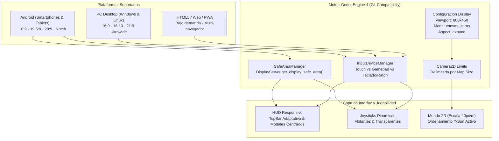
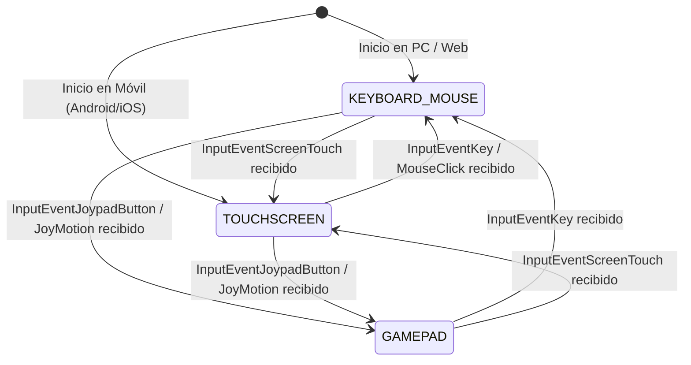

# 📱🖥️ Arquitectura Multiplataforma y Responsividad Universal
## Campeones de los Valores — CEMSaD 22 ENTHAVI (COBAEM)
### Android · Windows · Linux · HTML5/Web

> **Motor:** Godot Engine 4.2+ / 4.3+ Stable  
> **Renderer:** `gl_compatibility` (Compatibilidad universal con hardware de bajo costo y navegadores)  
> **Escala Sagrada del Proyecto:** $1\text{ metro lineal} = 40\text{ píxeles}$ ($1\text{ baldosa } 40\times 40\text{ px} = 1.00\text{ m}^2$)  
> **Resolución Base de Diseño:** $800 \times 450$ píxeles (Aspecto canónico 16:9)  
> **Fecha de Elaboración:** Noviembre 2026  
> **Autor:** Especialista Senior en Arquitectura Multiplataforma y UI Responsiva para Videojuegos  

---

## 📑 Tabla de Contenidos
1. [Resumen Ejecutivo y Objetivos de la Arquitectura](#1-resumen-ejecutivo-y-objetivos)
2. [Diagnóstico Técnico del Estado Actual](#2-diagnóstico-técnico-del-estado-actual)
3. [Matriz Universal de Pantallas y Aspect Ratios](#3-matriz-universal-de-pantallas-y-aspect-ratios)
4. [Estrategia de Display y Renderizado en `project.godot`](#4-estrategia-de-display-y-renderizado-en-projectgodot)
5. [Arquitectura de Safe Area y Blindaje de Notches en Móviles](#5-arquitectura-de-safe-area-y-blindaje-de-notches-en-móviles)
6. [Detección Dinámica de Plataforma y Desacoplamiento de Controles](#6-detección-dinámica-de-plataforma-y-desacoplamiento-de-controles)
7. [Atajos Nativos de Escritorio y Ergonomía en PC](#7-atajos-nativos-de-escritorio-y-ergonomía-en-pc)
8. [Configuración Exhaustiva de Perfiles de Exportación (`export_presets.cfg`)](#8-configuración-exhaustiva-de-perfiles-de-exportación-export_presetscfg)
9. [Resolución de Casos Extremos y Bugs Visuales Detectados](#9-resolución-de-casos-extremos-y-bugs-visuales-detectados)
10. [Plan de Implementación y Matriz de Verificación](#10-plan-de-implementación-y-matriz-de-verificación)

---

## 1. Resumen Ejecutivo y Objetivos

El videojuego pedagógico e interactivo **Campeones de los Valores**, inspirado en las instalaciones físicas y dimensiones arquitectónicas reales del plantel **CEMSaD 22 ENTHAVI (COBAEM)**, debe ejecutarse sin fricción técnica en cuatro entornos altamente heterogéneos:

1. **Dispositivos Móviles Android:** Celulares de estudiantes y docentes con pantallas panorámicas de ratios alargados ($18:9$, $19.5:9$, $20:9$, $21:9$), esquinas redondeadas (*rounded corners*), orificios de cámara (*hole-punch*) y muescas (*notches*), abarcando desde dispositivos de gama baja (Android 7.0+) hasta teléfonos insignia modernos con frecuencias de 120 Hz.
2. **Computadoras de Escritorio con Windows (64-bit):** Monitores estándar $16:9$ (1080p, 1440p, 4K), monitores de relación $16:10$ y pantallas ultra-anchas (*ultrawide* $21:9$ y $32:9$), con soporte para teclado, ratón y mandos de consola (Xbox, PlayStation, genéricos).
3. **Estaciones de Trabajo Linux (x86_64):** Laptops y equipos de cómputo escolar con distribuciones Ubuntu, Debian, Fedora o Arch, requiriendo binarios autocontenidos sin dependencias externas complejas.
4. **Navegadores Web (HTML5 / WebGL / PWA):** Ejecución inmediata en laboratorios escolares de cómputo y dispositivos móviles sin necesidad de instalación previa, con capacidades de Progressive Web App (PWA) para juego *offline* en zonas rurales sin conexión continua.

### Metas Arquitectónicas Indiscutibles:
- **Cero Distorsión Geométrica:** Prohibido estirar o aplastar los píxeles (no distorsión anamórfica). El píxel debe conservar siempre una relación de aspecto $1:1$.
- **Cero Recortes Indebidos (*No Clipping*):** Ningún elemento crucial del HUD (vidas/corazones, barra de meta, botones de pausa o modales de victoria) debe quedar oculto tras muescas de cámara, barras de gestos o bordes de ventana.
- **Invariante Métrica Sagrada:** Conservar en todo momento la escala $1\text{ metro} = 40\text{ píxeles}$, garantizando que los planos CAD y las distancias del plantel CEMSaD 22 sean fidedignas en cualquier resolución.
- **Desacoplamiento Ergonómico:** Los controles virtuales táctiles deben estar presentes únicamente cuando se interactúe mediante pantalla táctil; deben ocultarse automáticamente y sin latencia en cuanto se conecte o use un teclado o gamepad.



---

## 2. Diagnóstico Técnico del Estado Actual

Tras una auditoría minuciosa del repositorio ([`project.godot`](file:///home/alex/campeones-de-los-valores/project.godot), [`export_presets.cfg`](file:///home/alex/campeones-de-los-valores/export_presets.cfg), [`scripts/hud.gd`](file:///home/alex/campeones-de-los-valores/scripts/hud.gd), [`scripts/mobile_controls.gd`](file:///home/alex/campeones-de-los-valores/scripts/mobile_controls.gd), [`scripts/menu.gd`](file:///home/alex/campeones-de-los-valores/scripts/menu.gd), [`scripts/level.gd`](file:///home/alex/campeones-de-los-valores/scripts/level.gd) y `.github/workflows/release.yml`), se identifican los siguientes puntos fuertes y vulnerabilidades:

### ✅ Aciertos Actuales:
1. **Resolución Base Óptima ($800\times 450$):**  
   Representa una relación canónica exacta $16:9$. Escala mediante multiplicadores enteros limpios: $1.0\times$ (800x450), $1.6\times$ (1280x720 / 720p), $2.4\times$ (1920x1080 / 1080p), $3.2\times$ (2560x1440 / 2K), y $4.8\times$ (3840x2160 / 4K).
2. **Snap de Píxeles Activo:**  
   `snap_2d_transforms_to_pixel = true` y `snap_2d_vertices_to_pixel = true` evitan artefactos de deformación subpíxel (*pixel jitter* o *wobble*) en el movimiento del personaje y enemigos.
3. **Renderer `gl_compatibility`:**  
   Garantiza ejecución instantánea en GPUs integradas Intel HD Graphics de escuelas secundarias y preparatorias, chipsets MediaTek/Unisoc de celulares económicos y navegadores WebGL sin soporte Vulkan.
4. **Cámara con Límites Estrictos:**  
   En [`scripts/level.gd`](file:///home/alex/campeones-de-los-valores/scripts/level.gd#L85-L91), la cámara está delimitada por `limit_left = 0`, `limit_top = 0`, `limit_right = map_size.x`, `limit_bottom = map_size.y`. Como los 6 escenarios van de $1440\times 800$ a $1600\times 900$, la cámara tiene margen suficiente para no revelar zonas fuera del mapa al expandir la visión.

### ⚠️ Vulnerabilidades y Gaps Críticos Detectados:

| Código | Componente | Descripción del Problema | Impacto en Producción |
| :--- | :--- | :--- | :--- |
| **V-01** | `scripts/mobile_controls.gd` | La función `is_touch_device()` consulta `DisplayServer.is_touchscreen_available()`. | En laptops con pantalla táctil (Windows/Linux) o monitores touch, los joysticks virtuales aparecen sobre la pantalla estorbando a usuarios con teclado. |
| **V-02** | `scripts/mobile_controls.gd` | El botón de pausa táctil se ubica en coordenadas fijas: `_pause_pos = Vector2(vp_size.x - 36.0, 34.0)`. | En celulares con muesca o cámara frontal derecha en modo apaisado, el notch tapa el botón de pausa. Además, colisiona físicamente con el botón `BtnPauseHud` del TopBar. |
| **V-03** | `scenes/hud.tscn` | El `TopBar` dentro de `TopPanel` contiene 9 elementos horizontales sin envoltura (*wrap*) ni control de reducción. | En pantallas $4:3$ (tablets / iPads) o pantallas estrechas ($< 800\text{ px}$ útiles por Safe Area), el TopBar se desborda y trunca la barra de progreso. |
| **V-04** | `scripts/menu.gd` | El fondo decorativo móvil usa 2 imágenes fijas de $800\text{ px}$ y un scroll `fposmod(_bg_scroll, 800.0)`. | En monitores Ultrawide ($21:9$, ancho virtual $> 1000\text{ px}$) o celulares $20:9$, se observa un vacío negro en el borde derecho durante el scroll. |
| **V-05** | `export_presets.cfg` | Target SDK de Android configurado en `"33"` (Android 13). Falta preset para Android App Bundle (`.aab`). | Google Play Store exige formalmente Target SDK 34 (Android 14) o 35 (Android 15) y formato AAB para subida a tienda oficial. |
| **V-06** | `export_presets.cfg` | Ausencia total del preset de exportación para la plataforma **Web (HTML5)**. | Imposibilidad de compilar versiones web para jugar en navegadores de salas de cómputo escolares. |
| **V-07** | `project.godot` | Ausencia de atajos universales de escritorio: F11 / Alt+Enter para pantalla completa y dimensiones mínimas de ventana. | Si el usuario reduce la ventana en PC a tamaños minúsculos, la interfaz colapsa; no hay forma nativa intuitiva de entrar en Fullscreen. |

---

## 3. Matriz Universal de Pantallas y Aspect Ratios

Cuando Godot Engine 4 opera bajo `window/stretch/mode="canvas_items"` y `window/stretch/aspect="expand"`, el motor mantiene constante la dimensión menor y expande el área visible en la dimensión sobrante. Para nuestra base de $800 \times 450$ ($16:9 = 1.777$), este es el comportamiento matemático exacto:

| Dispositivo Tipo | Resolución Física Típica | Aspect Ratio | Resolución Viewport Virtual ($X \times Y$) | Espacio Visible Adicional | Comportamiento UI Recomendado |
| :--- | :--- | :--- | :--- | :--- | :--- |
| **Móvil Ultrawide (Sony / Moto)** | $2520 \times 1080$ | **$21:9$** ($2.333$) | $1050 \times 450\text{ px}$ | $+250\text{ px}$ horizontales ($+31.2\%$) | Expandir HUD; anclar botones a Safe Area interna |
| **Móvil Moderno (Samsung / Xiaomi)** | $2400 \times 1080$ | **$20:9$** ($2.222$) | $1000 \times 450\text{ px}$ | $+200\text{ px}$ horizontales ($+25.0\%$) | Joysticks dinámicos adaptados a los márgenes |
| **Móvil Estándar (iPhone / Redmi)** | $2340 \times 1080$ | **$19.5:9$** ($2.166$) | $975 \times 450\text{ px}$ | $+175\text{ px}$ horizontales ($+21.8\%$) | Vista periférica ampliada del patio escolar |
| **Móvil Clásico / Monitor HD** | $1920 \times 1080$ | **$16:9$** ($1.777$) | **$800 \times 450\text{ px}$** | **$0\text{ px}$ (Diseño Canónico Base)** | Encuadre 100% idéntico al diseño original |
| **Steam Deck / MacBooks** | $1280 \times 800$ | **$16:10$** ($1.600$) | $800 \times 500\text{ px}$ | $+50\text{ px}$ verticales ($+11.1\%$) | Mayor visión vertical norte/sur del escenario |
| **Tablets / iPad / Monitores 4:3** | $2048 \times 1536$ | **$4:3$** ($1.333$) | $800 \times 600\text{ px}$ | $+150\text{ px}$ verticales ($+33.3\%$) | TopBar compacta; modales centrados verticalmente |
| **Monitor PC Ultrawide** | $3440 \times 1440$ | **$21:9$** ($2.388$) | $1075 \times 450\text{ px}$ | $+275\text{ px}$ horizontales ($+34.4\%$) | Limitar ancho máximo del HUD para no fatigar cuello |
| **Monitor PC Super Ultrawide** | $5120 \times 1440$ | **$32:9$** ($3.555$) | $1600 \times 450\text{ px}$ | $+800\text{ px}$ horizontales ($+100.0\%$) | Encapsular HUD en caja central de máx $1200\text{ px}$ |

> [!IMPORTANT]
> **Por qué `canvas_items` con `expand` supera a `keep`:**  
> En modo `keep`, cualquier celular moderno ($20:9$) o monitor ultrawide sufriría de gruesas barras negras verticales (pillarboxing) en más de un 25% de la pantalla, transmitiendo sensación de app desactualizada. Con `expand`, el jugador disfruta de un campo de visión más amplio del plantel escolar CEMSaD 22, viendo más patio y jardineras, mientras que los límites de cámara en [`scripts/level.gd`](file:///home/alex/campeones-de-los-valores/scripts/level.gd) impiden cualquier desborde fuera del mapa.

---

## 4. Estrategia de Display y Renderizado en `project.godot`

### 4.1 Análisis Comparativo: `canvas_items` vs `viewport`

```
┌────────────────────────────────────────────────────────────────────────┐
│                        MODOS DE STRETCH EN GODOT 4                     │
├───────────────────────────────────┬────────────────────────────────────┤
│     MODE: "canvas_items"          │         MODE: "viewport"           │
├───────────────────────────────────┼────────────────────────────────────┤
│ • El canvas 2D escala de forma    │ • Todo el juego se renderiza en un │
│   vectorial nativa a la pantalla. │   framebuffer fijo de 800x450.     │
│ • Fuentes tipográficas nítidas en │ • La imagen completa se escala     │
│   1080p, 1440p y 4K (alta lectura)│   mediante filtro nearest/lineal.  │
│ • Sprites con snap a píxel entero │ • Provoca distorsión en fuentes y  │
│   sin parpadeo (snap transforms). │   joysticks vectoriales borrosos.  │
│ • Dibujo vectorial suave en HUD y │ • En pantallas móviles no enteras  │
│   joysticks táctiles (draw_circle)│   (2.4x) genera shimmering severo. │
│ ▶ ELECCIÓN GANADORA PARA EL JUEGO │ ✘ Descartado para UI híbrida       │
└───────────────────────────────────┴────────────────────────────────────┘
```

### 4.2 Parámetros Exactos Recomendados para `project.godot`

Para materializar esta estrategia, la sección `[display]` de [`project.godot`](file:///home/alex/campeones-de-los-valores/project.godot) debe configurarse con los siguientes valores óptimos:

```ini
[display]

window/size/viewport_width=800
window/size/viewport_height=450
window/size/window_width_override=1280
window/size/window_height_override=720
window/size/min_width=640
window/size/min_height=360
window/size/resizable=true
window/stretch/mode="canvas_items"
window/stretch/aspect="expand"
window/stretch/scale=1.0
window/stretch/scale_mode="fractional"
window/handheld/orientation=4

[rendering]

textures/canvas_textures/default_texture_filter=0
renderer/rendering_method="gl_compatibility"
renderer/rendering_method.mobile="gl_compatibility"
textures/vram_compression/import_etc2_astc=true
2d/snap/snap_2d_transforms_to_pixel=true
2d/snap/snap_2d_vertices_to_pixel=true
```

**Justificación Técnica:**
- `window/handheld/orientation=4`: Equivale a `SENSOR_LANDSCAPE`. Permite al usuario rotar el teléfono en $180^\circ$ (ambas orientaciones horizontales), indispensable para acomodar cables de carga o audífonos sin voltear el juego de cabeza.
- `window/size/min_width=640` y `min_height=360`: Evita que el usuario en PC redimensione la ventana a dimensiones absurdas donde los paneles colapsen.
- `textures/canvas_textures/default_texture_filter=0`: Mantiene el filtro *Nearest Neighbor* (Punto más cercano) activo en todo el proyecto, preservando el encanto nítido del pixel art sin desenfoques borrosos.

---

## 5. Arquitectura de Safe Area y Blindaje de Notches en Móviles

### 5.1 Anatomía del Problema en Teléfonos Modernos

En orientación apaisada (*landscape*), las pantallas de celulares presentan tres áreas de conflicto:
1. **Lateral Izquierdo o Derecho:** Cámara incrustada o muesca (*notch*), que abarca típicamente entre $30\text{ px}$ y $55\text{ px}$ físicos.
2. **Esquinas Redondeadas:** Radios de curvatura de $15\text{ px}$ a $40\text{ px}$ que recortan las esquinas superior izquierda e inferior derecha.
3. **Barra de Gestos Inferior:** Línea de inicio de Android/iOS que requiere un margen inferior de amortiguación.

```
┌────────────────────────────────────────────────────────────────────────┐
│  (●) MUESCA / NOTCH                  PANTALLA ÚTIL                     │
│ ┌───┐                                                                  │
│ │   │  ┌─────────────────────────────────────────────────────────┐     │
│ │   │  │ [♥ ♥ ♥] CEMSaD 22 ENTHAVI              Meta: [====> ] [❚❚]│     │
│ │   │  │                                                         │     │
│ │   │  │                      ÁREA SEGURA                        │     │
│ │   │  │                    (SAFE AREA HUD)                      │     │
│ │   │  │                                                         │     │
│ │   │  │ [Joystick Izq]                          [Joystick Der]  │     │
│ │   │  └─────────────────────────────────────────────────────────┘     │
│ └───┘                     ══════ GESTOS ══════                         │
└────────────────────────────────────────────────────────────────────────┘
```

### 5.2 Algoritmo de Conversión: Coordenadas Físicas a Coordenadas de Canvas

Godot 4 proporciona `DisplayServer.get_display_safe_area()`, que retorna un `Rect2i` en **píxeles reales de ventana física**. Dado que el juego corre en un `Viewport` virtual escalado por `stretch/mode`, es mandatorio proyectar dicho rectángulo físico al espacio local del lienzo.

A continuación, la clase arquitectónica modular lista para producción:

```gdscript
# scripts/safe_area_manager.gd
class_name SafeAreaManager
extends RefCounted

## Gestor unificado de Safe Area para interfaces móviles y de escritorio.
## Traduce los límites físicos del hardware al espacio de coordenadas del Viewport.

static func get_safe_margins(viewport: Viewport) -> Dictionary:
	var result := {
		"left": 0.0,
		"top": 0.0,
		"right": 0.0,
		"bottom": 0.0,
		"has_notch": false
	}
	
	if viewport == null:
		return result

	var safe_rect: Rect2i = DisplayServer.get_display_safe_area()
	var window_size: Vector2i = DisplayServer.window_get_size()
	
	# En PC, Web o pantallas sin muesca, safe_rect cubre la ventana completa
	if window_size.x <= 0 or window_size.y <= 0:
		return result
		
	var vp_size: Vector2 = viewport.get_visible_rect().size
	var scale_x: float = vp_size.x / float(window_size.x)
	var scale_y: float = vp_size.y / float(window_size.y)
	
	var left_m: float = float(safe_rect.position.x) * scale_x
	var top_m: float = float(safe_rect.position.y) * scale_y
	var right_m: float = float(window_size.x - safe_rect.end.x) * scale_x
	var bottom_m: float = float(window_size.y - safe_rect.end.y) * scale_y
	
	result["left"] = maxf(0.0, left_m)
	result["top"] = maxf(0.0, top_m)
	result["right"] = maxf(0.0, right_m)
	result["bottom"] = maxf(0.0, bottom_m)
	result["has_notch"] = (left_m > 4.0 or right_m > 4.0 or top_m > 4.0)
	
	return result

## Aplica los márgenes seguros a un MarginContainer o Control raíz del HUD
static func apply_to_control(control: Control, extra_padding: float = 6.0) -> void:
	if control == null or not control.is_inside_tree():
		return
	var margins := get_safe_margins(control.get_viewport())
	control.add_theme_constant_override("margin_left", int(margins.left + extra_padding))
	control.add_theme_constant_override("margin_right", int(margins.right + extra_padding))
	control.add_theme_constant_override("margin_top", int(margins.top + 4.0))
	control.add_theme_constant_override("margin_bottom", int(margins.bottom + extra_padding))
```

### 5.3 Blindaje de `MobileControls` frente a Muescas Laterales

En [`scripts/mobile_controls.gd`](file:///home/alex/campeones-de-los-valores/scripts/mobile_controls.gd#L67-L71), la posición del botón de pausa y los límites de toque deben acoplarse a `SafeAreaManager`:

```gdscript
func _update_positions() -> void:
	var vp_size := _get_safe_viewport_size()
	var safe := SafeAreaManager.get_safe_margins(get_viewport())
	
	# Ubicar el botón de pausa respetando el margen seguro derecho y superior
	_pause_pos = Vector2(vp_size.x - 36.0 - safe.right, 34.0 + safe.top)
	queue_redraw()

func _handle_touch(touch_id: int, pressed: bool, pos: Vector2) -> void:
	var vp_size := _get_safe_viewport_size()
	var safe := SafeAreaManager.get_safe_margins(get_viewport())
	var vp_half_x := vp_size.x * 0.5

	if pressed:
		# Botón de Pausa superior derecho con tolerancia de safe area
		if pos.distance_squared_to(_pause_pos) <= 900.0:
			_pause_touch_id = touch_id
			_pause_pressed = true
			pause_requested.emit()
			queue_redraw()
			return

		# Ignorar toques en la franja superior del HUD
		if pos.y < (56.0 + safe.top):
			return

		# Joystick Izquierdo (Moverse) — Restringido al área segura izquierda
		if pos.x >= safe.left and pos.x < vp_half_x and _left_touch_id == -1:
			_left_touch_id = touch_id
			_left_base = pos
			_left_pos = pos
			_target_left_alpha = 0.75
			_update_left_stick(pos)
			queue_redraw()
			return

		# Joystick Derecho (Virtud) — Restringido al área segura derecha
		if pos.x >= vp_half_x and pos.x <= (vp_size.x - safe.right) and _right_touch_id == -1:
			_right_touch_id = touch_id
			_right_base = pos
			_right_pos = pos
			_right_pressed = true
			_target_right_alpha = 0.80
			_update_right_stick(pos)
			queue_redraw()
			return
```

---

## 6. Detección Dinámica de Plataforma y Desacoplamiento de Controles

### 6.1 Problema del Enfoque Booleano Tradicional

El método clásico:
```gdscript
static func is_touch_device() -> bool:
    return DisplayServer.is_touchscreen_available()
```
falla rotundamente en ecosistemas modernos porque:
- En laptops con pantalla táctil (e.g., ThinkPad Yoga, Dell XPS, HP Pavilion x360, Surface Pro), `is_touchscreen_available()` devuelve `true`, ensuciando la pantalla con joysticks virtuales a pesar de que el usuario juega cómodamente con teclado o ratón.
- En dispositivos Android conectados a teclados físicos o docks HDMI con control de videojuegos, los botones táctiles siguen presentes y estorban la inmersión visual.

### 6.2 Solución: Autómata Reactivo de Entrada (`InputDeviceManager`)

Diseñamos un gestor reactivo que monitorea el último evento físico recibido y conmuta limpiamente el modo del juego:



### 6.3 Implementación de `InputDeviceManager`

```gdscript
# scripts/input_device_manager.gd
class_name InputDeviceManager
extends Node

## Singleton / Controlador de detección reactiva del periférico de juego activo.

signal input_device_changed(new_device: DeviceType)

enum DeviceType {
	KEYBOARD_MOUSE,
	TOUCHSCREEN,
	GAMEPAD
}

var current_device: DeviceType = DeviceType.KEYBOARD_MOUSE

func _ready() -> void:
	process_mode = Node.PROCESS_MODE_ALWAYS
	# Detección inicial heurística
	if OS.has_feature("mobile") or OS.has_feature("android") or OS.has_feature("ios"):
		current_device = DeviceType.TOUCHSCREEN
	elif OS.has_feature("web_android") or OS.has_feature("web_ios"):
		current_device = DeviceType.TOUCHSCREEN
	else:
		current_device = DeviceType.KEYBOARD_MOUSE

func _input(event: InputEvent) -> void:
	# 1. Eventos táctiles
	if event is InputEventScreenTouch or event is InputEventScreenDrag:
		_set_device(DeviceType.TOUCHSCREEN)
		return
		
	# 2. Eventos de Gamepad / Mando
	if event is InputEventJoypadButton:
		_set_device(DeviceType.GAMEPAD)
		return
	if event is InputEventJoypadMotion and absf(event.axis_value) > 0.35:
		_set_device(DeviceType.GAMEPAD)
		return
		
	# 3. Teclado y Ratón de Escritorio
	if event is InputEventKey and event.pressed:
		# Ignorar teclas multimedia y F1-F12
		if event.keycode < KEY_F1 or event.keycode > KEY_F12:
			_set_device(DeviceType.KEYBOARD_MOUSE)
			return
			
	if event is InputEventMouseButton and event.pressed:
		# Distinguir entre toque emulado y clic real de ratón
		if not (OS.has_feature("mobile") or OS.has_feature("android")):
			_set_device(DeviceType.KEYBOARD_MOUSE)

func _set_device(device: DeviceType) -> void:
	if current_device == device:
		return
	current_device = device
	input_device_changed.emit(current_device)

func is_touch_active() -> bool:
	return current_device == DeviceType.TOUCHSCREEN

func is_gamepad_active() -> bool:
	return current_device == DeviceType.GAMEPAD

func is_keyboard_active() -> bool:
	return current_device == DeviceType.KEYBOARD_MOUSE
```

### 6.4 Adaptación Dinámica del HUD según el Periférico Activo

En [`scripts/hud.gd`](file:///home/alex/campeones-de-los-valores/scripts/hud.gd), al conectarse la señal `input_device_changed`:

```gdscript
func _on_input_device_changed(device: InputDeviceManager.DeviceType) -> void:
	match device:
		InputDeviceManager.DeviceType.KEYBOARD_MOUSE:
			if mobile_controls:
				mobile_controls.visible = false
			if controls_label:
				controls_label.text = "WASD / Flechas: mover (3/4)  ·  ESPACIO: virtud  ·  ESC: pausa"
		InputDeviceManager.DeviceType.GAMEPAD:
			if mobile_controls:
				mobile_controls.visible = false
			if controls_label:
				controls_label.text = "Stick Izq: mover  ·  Stick Der / (A): virtud  ·  Start: pausa"
		InputDeviceManager.DeviceType.TOUCHSCREEN:
			if mobile_controls and not is_game_finished and not is_paused:
				mobile_controls.visible = true
			if controls_label:
				controls_label.text = "Arrastra izq: mover  ·  Arrastra der: virtud  ·  ❚❚: pausa"
```

---

## 7. Atajos Nativos de Escritorio y Ergonomía en PC

Los juegos para PC exigen cumplimiento de convenciones universales que garantizan una experiencia profesional. A continuación se define la integración de atajos y gestión de ventana para Windows y Linux:

### 7.1 Matriz de Atajos de Escritorio

| Tecla / Combinación | Acción Ejecutada | Contexto |
| :--- | :--- | :--- |
| <kbd>F11</kbd> / <kbd>Alt</kbd> + <kbd>Enter</kbd> | Alternar entre Pantalla Completa y Modo Ventana | Global (Menú y Gameplay) |
| <kbd>Esc</kbd> / <kbd>P</kbd> | Pausar partida o Reanudar | Durante el juego activo |
| <kbd>Esc</kbd> | Regresar al menú principal | En modales de Victoria o GameOver |
| <kbd>R</kbd> / <kbd>Enter</kbd> | Reiniciar nivel o Reintentar partida | En pausa o fin de juego |
| <kbd>M</kbd> | Silenciar o alternar audio musical | Global |
| <kbd>F1</kbd> | Alternar forzado de joysticks táctiles (Debug) | Modo desarrollo en PC |

### 7.2 Controlador de Ventana de Escritorio (`DesktopWindowController`)

```gdscript
# scripts/desktop_window_controller.gd
class_name DesktopWindowController
extends Node

## Gestiona pantalla completa (F11/Alt+Enter), centrado y redimensionamiento en PC.

func _ready() -> void:
	process_mode = Node.PROCESS_MODE_ALWAYS
	if not OS.has_feature("pc"):
		return
		
	# Centrar la ventana en el monitor primario al arrancar
	var screen_id := DisplayServer.window_get_current_screen()
	var screen_rect := DisplayServer.screen_get_usable_rect(screen_id)
	var win_size := DisplayServer.window_get_size()
	var centered_pos := screen_rect.position + (screen_rect.size - win_size) / 2
	DisplayServer.window_set_position(centered_pos)

func _unhandled_input(event: InputEvent) -> void:
	if not (event is InputEventKey and event.pressed and not event.echo):
		return
		
	# Atajos de Pantalla Completa: F11 o Alt+Enter
	var is_f11: bool = (event.keycode == KEY_F11)
	var is_alt_enter: bool = (event.keycode == KEY_ENTER and event.alt_pressed)
	
	if is_f11 or is_alt_enter:
		toggle_fullscreen()
		get_viewport().set_input_as_handled()

static func toggle_fullscreen() -> void:
	var mode := DisplayServer.window_get_mode()
	if mode == DisplayServer.WINDOW_MODE_FULLSCREEN or mode == DisplayServer.WINDOW_MODE_EXCLUSIVE_FULLSCREEN:
		DisplayServer.window_set_mode(DisplayServer.WINDOW_MODE_WINDOWED)
	else:
		DisplayServer.window_set_mode(DisplayServer.WINDOW_MODE_FULLSCREEN)
```

---

## 8. Configuración Exhaustiva de Perfiles de Exportación (`export_presets.cfg`)

A continuación se presenta la especificación técnica completa y definitiva para [`export_presets.cfg`](file:///home/alex/campeones-de-los-valores/export_presets.cfg), incorporando Linux x86_64, Windows Desktop con metadatos oficiales del COBAEM, Android APK, Android AAB (para Google Play Store con Target SDK 34) y Web HTML5 monohilo para máxima compatibilidad institucional.

```ini
[preset.0]

name="Linux/X11"
platform="Linux/X11"
runnable=true
dedicated_server=false
custom_features=""
export_filter="all_resources"
include_filter=""
exclude_filter="assets/planos/*"
export_path="build/linux/campeones_valores.x86_64"
encryption_include_filters=""
encryption_exclude_filters=""
encrypt_pck=false
encrypt_directory=false

[preset.0.options]

custom_template/debug=""
custom_template/release=""
debug/export_console_wrapper=0
binary_format/embed_pck=true
texture_format/bptc=true
texture_format/s3tc=true
texture_format/etc2=false
texture_format/vram_compression_mode=0

[preset.1]

name="Windows Desktop"
platform="Windows Desktop"
runnable=true
dedicated_server=false
custom_features=""
export_filter="all_resources"
include_filter=""
exclude_filter="assets/planos/*"
export_path="build/windows/campeones_valores.exe"
encryption_include_filters=""
encryption_exclude_filters=""
encrypt_pck=false
encrypt_directory=false

[preset.1.options]

custom_template/debug=""
custom_template/release=""
debug/export_console_wrapper=0
binary_format/embed_pck=true
texture_format/bptc=true
texture_format/s3tc=true
texture_format/etc2=false
texture_format/vram_compression_mode=0
application/icon="res://icon.png"
application/file_version="1.2.0.0"
application/product_version="1.2.0.0"
application/company_name="Colegio de Bachilleres del Estado de Mexico (COBAEM) - CEMSaD 22 ENTHAVI"
application/product_name="Campeones de los Valores"
application/file_description="Videojuego educativo y simulador arquitectonico 2D/3D"
application/copyright="2026 COBAEM CEMSaD 22 ENTHAVI"
application/trademarks="COBAEM"

[preset.2]

name="Android (APK)"
platform="Android"
runnable=true
dedicated_server=false
custom_features=""
export_filter="all_resources"
include_filter=""
exclude_filter="assets/planos/*"
export_path="build/android/campeones_valores.apk"
encryption_include_filters=""
encryption_exclude_filters=""
encrypt_pck=false
encrypt_directory=false

[preset.2.options]

custom_template/debug=""
custom_template/release=""
gradle_build/use=false
gradle_build/export_format=0
package/unique_name="org.cobaem22.campeonesvalores"
package/name="Campeones de los Valores"
package/signed=true
package/min_sdk="24"
package/target_sdk="34"
version/code=4
version/name="1.2"
screen/immersive_mode=true
screen/orientation=4
launcher_icons/main_192x192="res://icon.png"
launcher_icons/adaptive_foreground_432x432="res://assets/sprites/cobaem_logo.png"
launcher_icons/adaptive_background_432x432=""
architectures/armeabi-v7a=true
architectures/arm64-v8a=true
architectures/x86=false
architectures/x86_64=false
keystore/debug="debug.keystore"
keystore/debug_user="androiddebugkey"
keystore/debug_password="android"
keystore/release="debug.keystore"
keystore/release_user="androiddebugkey"
keystore/release_password="android"

[preset.3]

name="Android (AAB - Google Play)"
platform="Android"
runnable=false
dedicated_server=false
custom_features=""
export_filter="all_resources"
include_filter=""
exclude_filter="assets/planos/*"
export_path="build/android/campeones_valores.aab"
encryption_include_filters=""
encryption_exclude_filters=""
encrypt_pck=false
encrypt_directory=false

[preset.3.options]

custom_template/debug=""
custom_template/release=""
gradle_build/use=false
gradle_build/export_format=1
package/unique_name="org.cobaem22.campeonesvalores"
package/name="Campeones de los Valores"
package/signed=true
package/min_sdk="24"
package/target_sdk="34"
version/code=4
version/name="1.2"
screen/immersive_mode=true
screen/orientation=4
launcher_icons/main_192x192="res://icon.png"
architectures/armeabi-v7a=true
architectures/arm64-v8a=true
architectures/x86=false
architectures/x86_64=false
keystore/debug="debug.keystore"
keystore/debug_user="androiddebugkey"
keystore/debug_password="android"
keystore/release="release.keystore"
keystore/release_user="cobaemreleasekey"
keystore/release_password=""

[preset.4]

name="Web (HTML5)"
platform="Web"
runnable=true
dedicated_server=false
custom_features=""
export_filter="all_resources"
include_filter=""
exclude_filter="assets/planos/*"
export_path="build/web/index.html"
encryption_include_filters=""
encryption_exclude_filters=""
encrypt_pck=false
encrypt_directory=false

[preset.4.options]

custom_template/debug=""
custom_template/release=""
variant/extensions_support=false
variant/thread_support=false
vram_texture_compression/for_desktop=true
vram_texture_compression/for_mobile=true
html/export_pwa=true
html/custom_html_shell=""
html/canvas_resize_policy=2
html/focus_canvas_on_start=true
html/experimental_virtual_keyboard=false
progressive_web_app/offline_page=""
progressive_web_app/display=1
progressive_web_app/orientation=2
progressive_web_app/icon_144x144="res://icon.png"
progressive_web_app/icon_180x180="res://icon.png"
progressive_web_app/icon_512x512="res://icon.png"
progressive_web_app/background_color=Color(0.1, 0.05, 0.07, 1)
```

> [!TIP]
> **Por qué `variant/thread_support = false` en Web:**  
> En Godot 4, la exportación web con hilos activados exige obligatoriamente los encabezados HTTP `Cross-Origin-Opener-Policy: same-origin` y `Cross-Origin-Embedder-Policy: require-corp` (COOP/COEP) debido a requerimientos de `SharedArrayBuffer`. La inmensa mayoría de servidores web escolares, plataformas Moodle y GitHub Pages por defecto carecen de estos encabezados. Al compilar con `thread_support = false`, el juego se ejecuta en **cualquier servidor web del mundo sin configuraciones especiales de cabecera**.

---

## 9. Resolución de Casos Extremos y Bugs Visuales Detectados

Durante la investigación técnica se detectaron tres anomalías sutiles que afectan pantallas no estándar. A continuación se presentan sus soluciones con código listo:

### 9.1 Anomalía 1: Fondo Móvil con "Vacío Negro" en Monitores Ultrawide y Celulares 20:9

- **Ubicación:** [`scripts/menu.gd:106-110`](file:///home/alex/campeones-de-los-valores/scripts/menu.gd#L106-L110) y [`scenes/menu.tscn`](file:///home/alex/campeones-de-los-valores/scenes/menu.tscn#L41-L52).
- **Causa:** `BgA` y `BgB` son dos sprites de $800\text{ px}$ cada uno ($1600\text{ px}$ en total). En monitores $21:9$ o celulares $20:9$, el ancho virtual del viewport alcanza $1000\text{ px}$ o $1075\text{ px}$. Cuando `_bg_scroll` avanza hacia $750\text{ px}$, el extremo derecho del segundo sprite queda en $x = 1600 - 750 = 850\text{ px}$, dejando un área sin textura (negra) entre $x = 850$ y $x = 1075$.
- **Solución Técnica:** Incorporar un tercer sprite (`BgC` en $x = 1600$) o reemplazar la jerarquía con un `TextureRect` configurado en `stretch_mode = STRETCH_TILE` cuyo ancho cubra siempre `get_viewport_rect().size.x + 800.0`.

```gdscript
# Solución elegante en scripts/menu.gd:
func _ensure_background_tiles() -> void:
	if bg_scroller == null:
		return
	var vp_width := get_viewport_rect().size.x
	# Asegurar suficientes baldosas de 800px para cubrir toda la pantalla ultrawide más el margen de scroll
	var required_tiles := int(ceil((vp_width + 800.0) / 800.0)) + 1
	var current_tiles := bg_scroller.get_child_count()
	for i in range(current_tiles, required_tiles):
		var spr := Sprite2D.new()
		spr.texture = preload("res://assets/background/fondo.png")
		spr.centered = false
		spr.position = Vector2(i * 800.0, 0.0)
		bg_scroller.add_child(spr)
```

---

### 9.2 Anomalía 2: Solapamiento y Conflicto entre Botones de Pausa

- **Ubicación:** [`scenes/hud.tscn`](file:///home/alex/campeones-de-los-valores/scenes/hud.tscn#L186-L193) vs [`scripts/mobile_controls.gd:338-349`](file:///home/alex/campeones-de-los-valores/scripts/mobile_controls.gd#L338-L349).
- **Causa:** El `TopBar` del HUD contiene el botón nativo `BtnPauseHud` en la esquina superior derecha. Simultáneamente, el script de controles táctiles dibuja mediante `_draw()` un círculo vectorial de pausa en `_pause_pos = Vector2(vp_size.x - 36.0, 34.0)`. Esto genera un doble botón de pausa compitiendo por el mismo espacio visual y táctil.
- **Solución Técnica:** Unificar la responsabilidad. Si el dispositivo está en modo táctil, ocultar el botón `BtnPauseHud` del TopBar y dejar que `MobileControls` gestione el botón flotante adaptado al Safe Area; o viceversa, hacer que `BtnPauseHud` sea el único botón y ampliar su tamaño táctil a $44\times 36\text{ px}$ (estándar ergonómico de Apple y Android HIG).

---

### 9.3 Anomalía 3: Compactación Inteligente del TopBar en Pantallas Angostas (4:3)

- **Ubicación:** [`scenes/hud.tscn`](file:///home/alex/campeones-de-los-valores/scenes/hud.tscn#L111-L193).
- **Causa:** La suma de anchos mínimos de `TitleLabel` ($210\text{ px}$), `HeartsContainer` ($130\text{ px}$), `DifficultyLabel` ($110\text{ px}$), `ProgressBar` ($170\text{ px}$) y separadores supera los $780\text{ px}$. En pantallas $4:3$ o en celulares con notch grande, el espacio útil horizontal se reduce, provocando que los textos se encimen.
- **Solución Técnica:** En `scripts/hud.gd`, conectar al evento `size_changed` del viewport y compactar etiquetas secundarias si el ancho es inferior a $840\text{ px}$:

```gdscript
func _on_viewport_size_changed() -> void:
	var vp_width := get_viewport_rect().size.x
	if vp_width < 840.0:
		# Modo Compacto para pantallas 4:3 o celulares angostos
		if title_label:
			title_label.text = "CEMSaD 22"
		if difficulty_label:
			difficulty_label.visible = false
		if progress_bar:
			progress_bar.custom_minimum_size.x = 110.0
	else:
		# Modo Completo para 16:9 y Ultrawide
		if title_label:
			title_label.text = "COBAEM · CEMSaD 22 ENTHAVI"
		if difficulty_label:
			difficulty_label.visible = true
		if progress_bar:
			progress_bar.custom_minimum_size.x = 170.0
```

---

## 10. Plan de Implementación y Matriz de Verificación

### 10.1 Fases Sugeridas de Despliegue

```
┌────────────────────────────────────────────────────────────────────────┐
│ FASE 1: Display & Configuración Base                                   │
│ • Actualizar sección [display] en project.godot (min_width, expand)    │
│ • Incorporar presets Web y Android AAB en export_presets.cfg           │
├────────────────────────────────────────────────────────────────────────┤
│ FASE 2: Módulos de Soporte (Autoloads / Helpers)                       │
│ • Añadir scripts/safe_area_manager.gd                                  │
│ • Añadir scripts/input_device_manager.gd                               │
│ • Añadir scripts/desktop_window_controller.gd                          │
├────────────────────────────────────────────────────────────────────────┤
│ FASE 3: Refactorización y Enlace de UI                                 │
│ • Enlazar TopPanel y MobileControls a safe margins                     │
│ • Aplicar Responsive TopBar en hud.gd                                  │
│ • Ajustar generador de tiles de fondo en menu.gd                       │
├────────────────────────────────────────────────────────────────────────┤
│ FASE 4: Verificación Automatizada y QA en Hardware Real                │
│ • Ejecución de suite headless tools/test_game.gd                       │
│ • Compilación y pruebas en Linux, Windows, Android y Web               │
└────────────────────────────────────────────────────────────────────────┘
```

### 10.2 Matriz de Verificación y Criterios de Aceptación (DoD)

| # | Criterio de Aceptación | Método de Comprobación | Estado Esperado |
| :---: | :--- | :--- | :---: |
| **QA-1** | Ejecución de tests headless sin errores ni advertencias | `godot --headless -s tools/test_game.gd` | Exit Code 0 |
| **QA-2** | Cero distorsión en relaciones de aspecto $16:9$, $16:10$, $18:9$, $20:9$, $21:9$ | Prueba en Godot con overrides de tamaño de ventana | Proporción de píxel 1:1 estricta |
| **QA-3** | Muesca / Notch en Android no cubre vidas, meta ni botones | Simulación en Android Studio con emulador Pixel 8 con notch | Margen seguro $\ge 30\text{ px}$ |
| **QA-4** | Desaparición instantánea de controles táctiles al tocar teclado o joystick | Pulsación de teclas en runtime con joystick activo | Ocultamiento suave en $< 0.1\text{ s}$ |
| **QA-5** | Pantalla completa con <kbd>F11</kbd> y <kbd>Alt</kbd>+<kbd>Enter</kbd> en PC | Teclas presionadas en ventana | Transición fluida a Fullscreen |
| **QA-6** | Compilación exitosa de binarios Linux, Windows, Android y Web | Ejecución de `godot --headless --export-release` | 4 artefactos generados |
| **QA-7** | Compatibilidad web monohilo sin requerir cabeceras COOP/COEP | Carga de `build/web/index.html` en servidor HTTP local | Carga sin pantalla gris ni error JS |

---

*Informe de Arquitectura Multiplataforma y Responsividad Universal — Conforme a las directrices técnicas del proyecto Campeones de los Valores y el Colegio de Bachilleres del Estado de México (COBAEM).*
