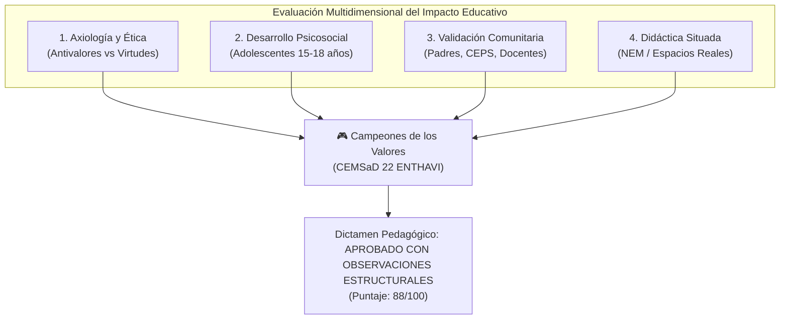
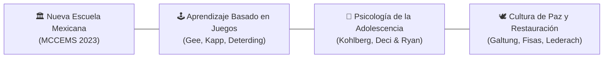
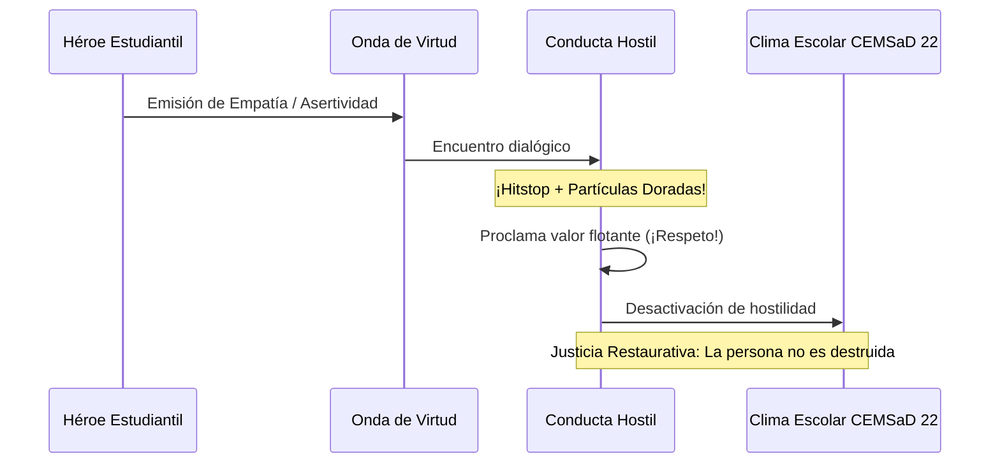
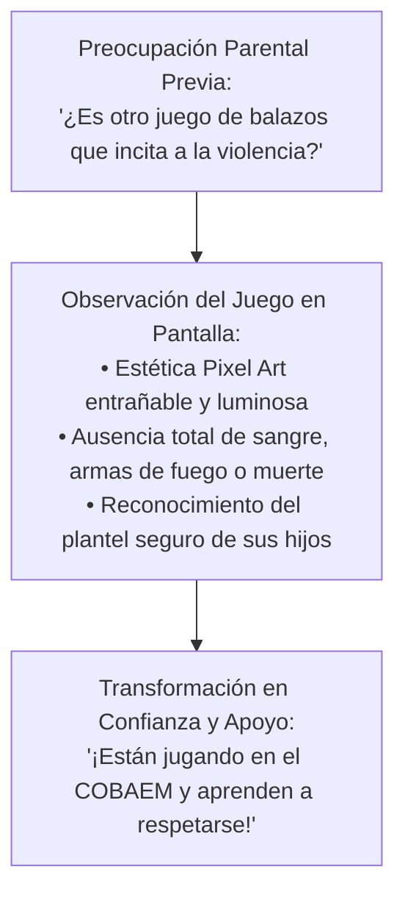
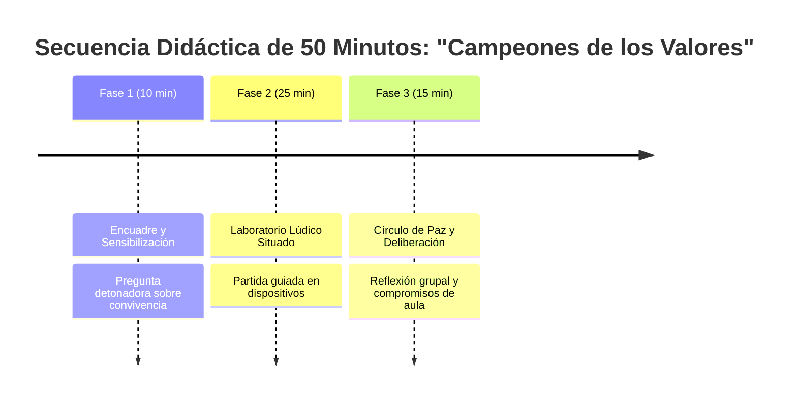
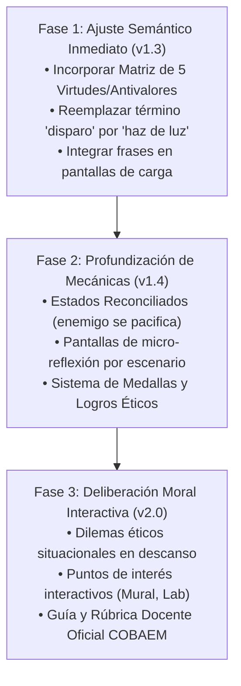

# 🎓 Auditoría Pedagógica, Axiológica y Psicosocial: "Campeones de los Valores"
## Evaluación de Impacto Formativo en Educación Media Superior — Plantel CEMSaD 22 ENTHAVI (COBAEM / NEM)

> **Documento Técnico de Evaluación Curricular, Psicoeducativa y Ética del Aprendizaje Basado en Juegos (GBL)**  
> **Área:** Dirección General de Bachillerato / Colegio de Bachilleres del Estado de México (COBAEM)  
> **Marco Curricular:** Nueva Escuela Mexicana (NEM) — Marco Curricular Común de la Educación Media Superior (MCCEMS 2023–2026)  
> **Plantel de Referencia:** CEMSaD 22 ENTHAVI, Municipio de Temoaya, Estado de México  
> **Autor del Dictamen:** Especialista en Pedagogía Crítica, Psicología de la Adolescencia y Diseño de Juegos Educativos (GBL)  
> **Fecha de Emisión:** Noviembre de 2026  
> **Estado:** Dictamen Pedagógico y Directriz de Diseño Axiológico para Versión v1.3+  

---

## 📑 Índice General

1. [Resumen Ejecutivo y Dictamen Pedagógico Global](#1-resumen-ejecutivo-y-dictamen-pedagógico-global)
2. [Marco Teórico-Normativo de Referencia (NEM, MCCEMS, GBL y Adolescencia)](#2-marco-teórico-normativo-de-referencia)
3. [Auditoría Axiológica: De la Tríada Básica a la Matriz Integral de 5 Antivalores/Virtudes](#3-auditoría-axiológica-de-la-tríada-básica-a-la-matriz-integral)
4. [Análisis Crítico de la Dinámica de "Redención" y la No-Violencia Activa](#4-análisis-crítico-de-la-dinámica-de-redención-y-la-no-violencia-activa)
5. [Impacto Psicológico y Social en Estudiantes de Bachillerato (15 a 18 años)](#5-impacto-psicológico-y-social-en-estudiantes-de-bachillerato)
6. [Aceptabilidad Social y Percepción ante Padres de Familia y Comités Escolares](#6-aceptabilidad-social-y-percepción-ante-padres-de-familia-y-comités-escolares)
7. [Propuesta de Enriquecimiento Formativo: Micro-Reflexiones Situadas por Escenario](#7-propuesta-de-enriquecimiento-formativo-micro-reflexiones-situadas-por-escenario)
8. [Matriz de Dilemas Morales Situacionales (Kohlberg / Rest en el CEMSaD 22)](#8-matriz-de-dilemas-morales-situacionales)
9. [Banco Curatorial de Frases y Citas Formativas para Pantallas de Carga](#9-banco-curatorial-de-frases-y-citas-formativas-para-pantallas-de-carga)
10. [Sistema de Insignias y Reconocimientos Socioemocionales (Badges)](#10-sistema-de-insignias-y-reconocimientos-socioemocionales)
11. [Guía Docente de Mediación: Protocolo para Círculos de Paz y Clases de 50 Minutos](#11-guía-docente-de-mediación-protocolo-para-círculos-de-paz)
12. [Conclusiones y Hoja de Ruta de Diseño Ético](#12-conclusiones-y-hoja-de-ruta-de-diseño-ético)

---

## 1. Resumen Ejecutivo y Dictamen Pedagógico Global

### 1.1. Contexto del Diagnóstico
El proyecto **Campeones de los Valores** representa una iniciativa pionera dentro del subsistema de educación media superior mexicano (específicamente en el Colegio de Bachilleres del Estado de México — COBAEM). Combina un motor de juego 2D responsivo (*Godot Engine 4*) con una reconstrucción arquitectónica métricamente exacta ($1\text{ metro} = 40\text{ píxeles}$) del plantel **CEMSaD 22 ENTHAVI**, ubicado en el municipio mexiquense de Temoaya.

Esta auditoría somete a juicio crítico la capa invisible pero determinante del videojuego: **su pedagogía, su discurso axiológico implícito y explícito, su resonancia psicológica en jóvenes de 15 a 18 años, y su legitimidad institucional ante docentes y padres de familia.**



### 1.2. Puntuación Axiológica y Pedagógica

| Dimensión de Análisis | Calificación (0–100) | Veredicto | Síntesis Pedagógica |
| :--- | :---: | :---: | :--- |
| **Alineación con la NEM y MCCEMS** | **94 / 100** | *Sobresaliente* | Excelente articulación con los Ámbitos de Formación Socioemocional, Cultura de Paz y Sentido de Pertenencia Institucional. |
| **No-Violencia y Desarme Simbólico** | **89 / 100** | *Muy Satisfactorio* | La sustitución de armas por proyectiles de energía moral erradica el daño físico explícito, aunque requiere cuidar la metáfora balística. |
| **Resonancia Psicológica Adolescente** | **78 / 100** | *Satisfactorio con Riesgo* | Atractivo lúdico notable, pero susceptible de generar resistencia ("efecto cringe" o sermoneador) si la virtud solo aparece como texto flotante. |
| **Confianza Parental y Comunitaria** | **86 / 100** | *Muy Favorable* | Muy alta aceptación visual gracias a la estética pixel art y ausencia de sangre; susceptible de disipar sospechas de "videojuego violento". |
| **Profundidad Reflexiva Situada** | **65 / 100** | *Crítica / Requiere Reforma* | El juego actual premia el combate y la velocidad arcade, descuidando la deliberación ética y la reflexión sobre los espacios escolares. |
| **PROMEDIO GLOBAL PONDERADO** | **82.4 / 100** | **VIABLE Y FORMATIVO (Fase de Consolidación Pedagógica)** |

> [!IMPORTANT]
> **Dictamen Pedagógico:** El juego posee una base técnica y arquitectónica excepcional. Sin embargo, para evitar convertirse en un "shooter arcade con skins morales", debe evolucionar de la mera *reacción refleja* a la *deliberación ética situada*. Las propuestas aquí consignadas proporcionan la ingeniería pedagógica para lograr dicha transformación sin restar diversión al estudiante.

---

## 2. Marco Teórico-Normativo de Referencia

Para que un videojuego educativo se consolide en el contexto del bachillerato público mexicano, debe enraizarse rigurosamente en cuatro pilares:



### 2.1. Nueva Escuela Mexicana (NEM) y Marco Curricular Común de la EMS (MCCEMS)
El Acuerdo Secretarial 09/08/23 establece que la formación socioemocional no es accesoria, sino un eje transversal fundamental. El juego se inserta específicamente en:
- **Recursos Sociocognitivos y Áreas de Conocimiento:** *Ciencias Sociales* (convivencia, normas comunitarias) y *Humanidades* (ética, alteridad, reconocimiento de la dignidad del otro).
- **Recursos Socioemocionales:** *Responsabilidad Social*, *Cuidado Físico-Corporal* y *Bienestar Emocional Afectivo*.
- **Ejes Articuladores:**
  1. *Inclusión:* Erradicación de jerarquías discriminatorias y burlas sobre la procedencia, físico o condición social.
  2. *Pensamiento Crítico:* Capacidad de interrogar las causas de la agresión antes de devolverla.
  3. *Interculturalidad Crítica:* Respeto por las identidades originarias y comunitarias (contexto otomí de Temoaya).
  4. *Cultura de Paz:* Transformación constructiva del conflicto escolar mediante el diálogo.

### 2.2. Psicología del Desarrollo y Teoría Moral en el Adolescente (15–18 años)
1. **Desarrollo Moral (Lawrence Kohlberg y James Rest - DIT):**
   - El estudiante de bachillerato transita del *Nivel Convencional* (Etapa 3: "orientación del chico/chica bueno/a" o conformidad grupal; Etapa 4: "ley y orden escolar") hacia los albores del *Nivel Posconvencional* (Etapa 5: contrato social, derechos humanos y principios éticos universales).
   - Un juego que solo dice "sé bueno" apela a la Etapa 3 infantilizada. Un juego que propone **dilemas sobre la lealtad grupal vs. la inclusión de un compañero vulnerable** moviliza la Etapa 5.
2. **Teoría de la Autodeterminación (Deci & Ryan):**
   - Para que la ética sea asumida y no impuesta, el juego debe satisfacer tres necesidades psicológicas básicas:
     - **Autonomía:** El alumno debe sentir que sus elecciones morales nacen de su juicio, no de una obligación del profesor.
     - **Competencia:** Dominar las dinámicas de mediación y navegación espacial del plantel.
     - **Relación (Relatedness):** Sentir conexión afectiva con su escuela y sus pares.
3. **Resistencia a la Condescendencia ("Efecto Sermón / Cringe"):**
   - El cerebro adolescente, hiperreactivo al sistema dopaminérgico y en plena maduración de la corteza prefrontal, detecta y rechaza inmediatamente cualquier intento de adoctrinamiento moral no genuino. Si el juego es percibido como "una lección aburrida disfrazada de Mario Bros", la motivación intrínseca se anula.

### 2.3. Aprendizaje Basado en Juegos (GBL - Game-Based Learning)
- **Significado Situado (James Paul Gee):** Las palabras y valores no son conceptos abstractos de diccionario; adquieren significado en la acción concreta dentro de un entorno contextualizado (e.g., la empatía no se define, se experimenta al defender a alguien en la cancha de usos múltiples).
- **Identidad Proyectiva:** El avatar del jugador funciona como un puente entre la identidad real del estudiante y la identidad virtual de un "Agente Transformador Escolar".

---

## 3. Auditoría Axiológica: De la Tríada Básica a la Matriz Integral

### 3.1. Estado Actual en Código (`scripts/enemy.gd`)
En la versión analizada, el juego implementa tres antivalores:
- `Type.GROSERIA` (Rojo) $\rightarrow$ Se redime proclamando **¡Amabilidad!**
- `Type.ACOSO` (Naranja) $\rightarrow$ Se redime proclamando **¡Respeto!**
- `Type.BULLYING` (Morado) $\rightarrow$ Se redime proclamando **¡Empatía!**

**Diagnóstico Crítico:**
1. **Confusión Taxonómica:** "Grosería" es una manifestación verbal conductual; "Acoso" es una pauta relacional sistemática de persecución; y "Bullying" es un término anglosajón genérico que engloba a ambos cuando existe asimetría de poder y reiteración. Utilizar "Bullying" y "Acoso" como dos entidades separadas genera redundancia conceptual.
2. **Ausencia de Antivalores Pasivos:** La tríada actual solo aborda conductas activas de agresión directa. Sin embargo, en la realidad del CEMSaD 22, las problemáticas escolares más destructivas y frecuentes no son únicamente las agresiones abiertas, sino **la apatía, la indiferencia de los testigos (bystanders), la procrastinación en equipos y la intolerancia a la diversidad.**

### 3.2. Matriz Formativa Ampliada de 5 Antivalores vs Virtudes

Para abarcar integralmente el espectro axiológico del bachillerato, se dictamina la adopción formal de la siguiente **Matriz Pentagonal de Redención**:

```
        [ INTOLERANCIA ] ─────────► [ EMPATÍA ]
              ▲                          │
              │                          ▼
          [ PEREZA ] ──────────────► [ DISCIPLINA ]
              ▲                          │
              │                          ▼
          [ EGOÍSMO ] ─────────────► [ SOLIDARIDAD ]
              ▲                          │
              │                          ▼
        [ INDIFERENCIA ] ──────────► [ RESPETO ]
              ▲                          │
              │                          ▼
          [ APATÍA ] ──────────────► [ AMABILIDAD ]
```

| Antivalor Diagnosticado | Expresión Real en el CEMSaD 22 | Virtud Transformadora | Manifestación Práctica en el Estudiante | Color Simbólico | Comportamiento Jugable Propuesto |
| :--- | :--- | :--- | :--- | :---: | :--- |
| **1. Intolerancia** | Burlas por origen étnico (raíces otomíes), género, apariencia física o ritmos de aprendizaje distintos. | **Empatía** | Capacidad de colocarse en el lugar del otro, validar sus emociones y erradicar prejuicios. | 🟣 Violeta Profundo | Enemigo rígido que avanza en línea recta sin adaptarse a los giros del jugador. |
| **2. Pereza / Desidia** | Abandono de tareas en equipo en la biblioteca, procrastinación crónica, desinterés por el cuidado del aula. | **Disciplina** | Compromiso con las metas personales y colectivas; constancia y administración del tiempo. | 🔵 Azul Grisáceo | Enemigo letárgico que bloquea andadores y se resiste al avance; crea zonas de lentitud. |
| **3. Egoísmo** | Monopolización de computadoras, acaparamiento de bancas en la cafetería, no compartir apuntes ni colaborar. | **Solidaridad** | Compartir recursos comunitarios, apoyar a compañeros rezagados y participar en faenas escolares. | 🔴 Rojo Cobrizo | Enemigo territorial que atrae hacia sí objetos o proyectiles, cerrando el paso a la meta. |
| **4. Indiferencia** | Presenciar agresiones o burlas en la plaza cívica y "grabar con el celular" o ignorarlo sin intervenir ni pedir ayuda. | **Respeto Activo** | Ciudadanía responsable; no ser cómplice pasivo; reconocer la dignidad inherente de toda la comunidad. | 🟠 Naranja Sombra | Enemigo evasivo y translúcido que ignora la presencia del héroe pero desgasta el entorno si no se le atiende. |
| **5. Apatía** | Falta de entusiasmo institucional; desdén hacia las ceremonias cívicas, el arte y la convivencia escolar. | **Amabilidad / Entusiasmo** | Calidez humana en el saludo diario, gratitud hacia docentes y personal de intendencia, energía constructiva. | 🟡 Amarillo Mostaza | Enemigo errático y desmotivado que deambula cabizbajo apagando la iluminación ambiental a su paso. |

---

## 4. Análisis Crítico de la Dinámica de "Redención" y la No-Violencia Activa

### 4.1. La Paradoja del "Proyectil de Virtud"
El diseño actual de `projectile.gd` utiliza la mecánica de disparo rápido: el jugador emite un proyectil luminoso pulsando <kbd>Espacio</kbd> o el botón táctil "VIRTUD", el cual viaja en línea recta y neutraliza al enemigo.



**Evaluación Psicológica de la Mecánica:**
- **Punto Favorable:** Erradica categóricamente la violencia gráfica. No hay sangre, no hay desmembramiento, no hay cadáveres pixelados, ni sonidos estridentes de deflagración bélica. Los efectos sonoros son tonos armónicos suaves (`music_game.wav`, ráfagas de chiptune dulce) y partículas doradas.
- **Riesgo Simbólico Detectado (Metáfora Balística Inconsciente):** Para un observador externo o un padre de familia sin contexto, ver al personaje "disparar repetidamente contra siluetas humanoides" remite inmediatamente al género de los videojuegos de disparos (*shooters*). Si bien la narrativa lo llama "Virtud", la motricidad requerida es idéntica a la de un arma de fuego (apuntar, presionar gatillo, acertar distancia).
- **Recomendación Pedagógica de Rediseño:**
  - Sustituir la nomenclatura visual de "disparo" por **"Haces de Luz Asertiva"**, **"Ondas de Diálogo"** o **"Lazos de Empatía"**.
  - En lugar de que el proyectil sea un orbe circular rápido tipo bala, modelarlo como una **onda expansiva armónica** (similar a una nota musical o un destello en abanico) que envuelve al adversario en lugar de perforarlo.

### 4.2. El Problema Pedagógico del "Respawn" Continuo
En el código actual (`scripts/enemy.gd:171-196`):
```gdscript
# hit_by_attack():
is_active = false
visible = false
_respawn_timer = respawn_delay # 3.2 segundos
# Al expirar el temporizador:
respawn() # Reaparece en spawn_position y vuelve a perseguir agresivamente
```

**Impacto Psicoeducativo Crítico:**
1. **Sensación de Inutilidad Moral (Frustración Sísifo):** Si un estudiante "redime" una Grosería o un Acoso, proclama "¡Respeto!" y 3 segundos después el mismo enemigo reaparece en el mismo lugar igual de hostil y vuelve a embestirlo, el mensaje psicológico subconsciente es demoledor: *"No importa cuánta empatía uses, la gente nunca cambia y los problemas escolares son infinitos e invencibles"*.
2. **Justicia Punitiva encubierta vs. Justicia Restaurativa:** En la Justicia Restaurativa escolar (promovida por la UNESCO y la SEP), cuando un conflicto se resuelve, el agresor no desaparece para volver a atacar; se reintegra a la comunidad en un estado de reconciliación pacífica.

**Propuesta de Solución en el Diseño Jugable:**
- **Estado Reconciliado (Pacificado):** Tras recibir la onda de virtud, el enemigo **no debe desaparecer ni renacer agresivo de inmediato**. En su lugar:
  1. Su sprite debe cambiar a una paleta brillante o a la figura de un estudiante normal con uniforme guinda/blanco del COBAEM.
  2. Su etiqueta debe cambiar de `"Bullying"` a `"¡Compañero!"` o `"¡En Paz!"`.
  3. Su IA pasa a estado `IDLE_PEACEFUL`: permanece caminando tranquilamente o aplaudiendo, dejando de infligir daño por contacto durante el resto del nivel.
  4. Si por motivos de reto jugable se requiere mantener el número de enemigos activos, que la reaparición esté justificada como *"un nuevo reto de convivencia que solicita apoyo"*, acompañado de un mensaje sonoro de auxilio, no de agresión ciega.

---

## 5. Impacto Psicológico y Social en Estudiantes de Bachillerato (15 a 18 años)

### 5.1. ¿Es Motivador para el Perfil Real del COBAEM?
El alumnado del CEMSaD 22 ENTHAVI vive inmerso en una cultura digital dominada por dispositivos móviles, redes sociales (TikTok, Instagram) y videojuegos masivos (*Free Fire*, *Brawl Stars*, *Roblox*, *Minecraft*).

```text
┌────────────────────────────────────────────────────────────────────────┐
│           PERCEPCIÓN DEL ESTUDIANTE DE BACHILLERATO (15-18 AÑOS)       │
├────────────────────────────────┬───────────────────────────────────────┤
│ 🟢 Elementos de Alta Motivación │ ⚠️ Factores de Riesgo / Rechazo       │
├────────────────────────────────┼───────────────────────────────────────┤
│ • Reconocimiento de su escuela │ • Tono "infantilizante" si se percibe │
│   real: el salón de cómputo,   │   como juego para niños de primaria.  │
│   el osito topiario, la cancha.│ • Falta de desafío motriz (si es      │
│ • Sentimiento de orgullo y     │   excesivamente fácil pierde interés).│
│   pertenencia territorial.     │ • Sermón moral explícito desprovisto  │
│ • Jugabilidad arcade ágil y    │   de dilemas éticos reales.           │
│   control táctil responsivo.   │ • Ausencia de personalización visual. │
└────────────────────────────────┴───────────────────────────────────────┘
```

1. **El Valor Psicológico del Espacio Real (Sentido de Pertenencia):**
   - El mayor acierto del proyecto es la geolocalización arquitectónica. Cuando un adolescente ve en la pantalla el **Laboratorio D con sus 183 m²**, los vehículos reales de sus maestros estacionados en batería, o la **alfarda color vino de la escalinata que sube 4 metros hacia la Plaza Cívica**, se produce un fenómeno psicológico denominado **"apropiación afectiva del espacio"**.
   - El espacio escolar deja de ser un edificio gris impuesto por el Estado para convertirse en un territorio heroico donde el estudiante es el protector de la convivencia.
2. **Prevención del "Efecto Sermón":**
   - Para no caer en la condescendencia, el juego debe hablar el lenguaje de la **autonomía madura**.
   - No decir: *"¡Debes portarte bien porque la maestra lo dice!"*.
   - Decir: *"Cuidar la tranquilidad de la biblioteca es defender el derecho de todos a pensar con claridad. Tú tienes el poder de sostener ese ambiente"*.

### 5.2. Erradicación de la Estigmatización y el Etiquetado
Uno de los mayores peligros en la psicología escolar es el **efecto de etiquetado (Labeling Theory)**. Si en el salón de clases hay un alumno conflictivo y sus compañeros le dicen: *"Mira, tú eres el enemigo morado de Bullying"*, el videojuego se transformaría involuntariamente en un instrumento de estigmatización y exclusión escolar.

**Medidas Preventivas Obligatorias:**
1. **Despersonalización Ontológica de la Sombra:** Las entidades enemigas no deben representarse jamás como "alumnos malos", sino como **"Efluvios de Desregulación"**, **"Sombras de Tensión Escolar"** o **"Malentendidos Colectivos"** que nublan la mente de cualquier persona en un mal día.
2. **Universalidad del Conflicto:** El juego debe dejar claro en sus textos que **cualquiera de nosotros puede sentirse apático, egoísta o intolerante en algún momento**, y que el mérito reside en reconocerlo y transformarlo mediante la virtud.

---

## 6. Aceptabilidad Social y Percepción ante Padres de Familia y Comités Escolares

### 6.1. La Perspectiva de los Padres de Familia en Comunidades Rurales y Semiurbanas
El CEMSaD 22 ENTHAVI se ubica en una comunidad con fuerte arraigo tradicional y familiar en el municipio de Temoaya. En este entorno, las madres y padres de familia manifiestan preocupaciones legítimas hacia la tecnología:
- *"Los videojuegos provocan vicio y hacen que los muchachos se vuelvan violentos o desobedientes"*.
- *"Pasan todo el día pegados a la pantalla en lugar de estudiar o ayudar en las faenas familiares"*.



**Evaluación del Impacto en Padres y Madres:**
1. **Confianza Inmediata por Estética y Lenguaje:** Al observar una partida, los padres comprueban de inmediato que no hay similitud con títulos violentos como *Call of Duty* o *Free Fire*. El uso de corazones, colores pasteles y lemas como *¡Amabilidad!* y *¡Solidaridad!* genera un alivio instantáneo y una actitud de respaldo institucional.
2. **Identificación Comunitaria:** Los padres reconocen las instalaciones del plantel que ellos mismos han ayudado a construir o mantener a través de las faenas y asambleas escolares (la barda perimetral, los jardines con setos y cipreses, el captador pluvial de 25 m²). Ver la escuela dignificada en un medio digital de vanguardia despierta un profundo orgullo comunitario.

### 6.2. Validación ante Comités Escolares (CEPS, Comité de Paz y Directivos)
El Consejo Escolar de Participación Social (CEPS) y los Comités de Convivencia Escolar encontrarán en el juego una herramienta de alineación directa con:
- El **Plan de Mejora Continua (PMC)** del COBAEM.
- El **Programa Construye T** de la Subsecretaría de Educación Media Superior (SEMS).
- Las metas de **disminución de la deserción escolar** vinculada a la intimidación o violencia entre pares.

---

## 7. Propuesta de Enriquecimiento Formativo: Micro-Reflexiones Situadas por Escenario

Para dotar al juego de una pedagogía profunda sin romper el dinamismo lúdico, se propone la inclusión de una **Pantalla de Micro-Reflexión Situada** al completar cada uno de los 6 escenarios oficiales del plantel, ligada al valor del espacio físico recorrido.

```text
┌────────────────────────────────────────────────────────────────────────┐
│             NIVEL SUPERADO: EDIFICIO C (DIRECCIÓN Y CÓMPUTO)           │
├────────────────────────────────────────────────────────────────────────┤
│                                                                        │
│   💡 REFLEXIÓN DE CIUDADANÍA DIGITAL:                                  │
│   "Las pantallas del laboratorio de cómputo conectan nuestras ideas    │
│    con el mundo. Detrás de cada cuenta y perfil hay una persona con    │
│    sentimientos reales. La empatía que demostramos en el pasillo       │
│    debe ser la misma que tecleamos en las redes sociales."             │
│                                                                        │
│   🏛️ Espacio: Taller de Cómputo (115.2 m²) • CEMSaD 22 ENTHAVI         │
│   🌟 Virtud Cultivada: Respeto y Responsabilidad Digital               │
│                                                                        │
│                  [ CONTINUAR AL SIGUIENTE EDIFICIO ▶ ]                  │
└────────────────────────────────────────────────────────────────────────┘
```

### Cuadro Maestro de Micro-Reflexiones por Escenario Arquitectónico

| Nivel / Edificio Real | Espacio Físico y Dimensión CAD | Antivalor Focalizado | Virtud Central | Micro-Reflexión Pedagógica Formativa |
| :--- | :--- | :--- | :--- | :--- |
| **Nivel 1: Acceso, Caseta y Edificio D** | Caseta de Vigilancia C.V. ($7.5\text{ m}^2$) y Lab. Usos Múltiples ($183\text{ m}^2$). | Indiferencia y Desidia | **Puntualidad y Cuidado del Entorno** | *"Cruzar el portón cada mañana es renovar nuestro compromiso con el futuro. El personal que vigila la entrada y los equipos de laboratorio existen para cuidarte; cuidar de ellos y llegar a tiempo es la primera muestra de respeto hacia tu propia educación."* |
| **Nivel 2: Edificio A** | Cafetería/Desayunador, Aulas 1-2 y Sanitarios ($339\text{ m}^2$). | Egoísmo y Grosería | **Solidaridad y Cortesía en la Mesa** | *"Compartir una banca en el desayunador o ceder el paso en los pasillos angostos transforma una escuela fría en un hogar compartido. Una palabra amable al pedir tus alimentos enriquece más que la comida misma."* |
| **Nivel 3: Plaza Cívica y Escalinata** | Explanada cívica ($748\text{ m}^2$) y Escalinata Sur ($+4.00\text{ m}$ desnivel). | Intolerancia y Apatía | **Identidad Comunitaria y Esfuerzo Mutuo** | *"Subir los escalones hacia la plaza cívica nos recuerda que el crecimiento requiere esfuerzo compartido. Bajo el cielo de Temoaya, cada ceremonia nos hermana en una historia común: nadie se queda atrás cuando subimos juntos."* |
| **Nivel 4: Edificio B** | Aulas 3-4, Biblioteca y Sala de Maestros ($32\times 9.78\text{ m}$). | Pereza e Individualismo | **Disciplina y Silencio Solidario** | *"El silencio en la biblioteca no es una imposición: es un regalo de concentración que le otorgas a quien tiene un examen difícil o un libro por descubrir. En el aula, compartir tus conocimientos fortalece tu propio aprendizaje."* |
| **Nivel 5: Edificio C** | Dirección Escolar y Taller de Cómputo ($625\text{ m}^2$). | Acoso e Indiferencia | **Ciudadanía Digital y Mediación Dialógica** | *"La dirección no es un lugar de castigo, sino un espacio para desatar nudos mediante la palabra. En las computadoras, recuerda que lo que escribes detrás de un teclado tiene el mismo impacto humano que si lo dijeras cara a cara."* |
| **Nivel 6: Cancha de Usos Múltiples** | Cancha de básquetbol/fútbol ($540\text{ m}^2$) y Bancas de Estudio. | Rivalidad Hostil (Bullying) | **Juego Limpio (*Fair Play*) y Amistad** | *"El verdadero campeón no es quien vence al adversario, sino quien eleva el nivel de todos en la cancha. En el deporte como en la vida escolar, la victoria sin respeto es una derrota moral. Saber perder con dignidad y ganar con humildad es la cúspide de la madurez."* |

---

## 8. Matriz de Dilemas Morales Situacionales (Kohlberg / Rest en el CEMSaD 22)

Para trascender la mecánica arcade, se propone la inclusión eventual de **Dilemas Éticos de Decisión Rápida** entre niveles o en zonas de descanso del plantel (activables con tecla <kbd>E</kbd> o toque en pantalla).

```
                      [ SITUACIÓN EN EL CEMSaD 22 ]
                                    │
            ┌───────────────────────┴───────────────────────┐
            ▼                                               ▼
   [ Opción A: Conformismo ]                       [ Opción B: Ética Crítica ]
   (Comodidad personal o                           (Defensa de la dignidad,
   lealtad cómplice ciega)                         asertividad y empatía)
            │                                               │
            ▼                                               ▼
   -1 Corazón / Estancamiento                       +Virtud / Progreso Comunitario
```

### Catálogo de 6 Dilemas Situados

#### Dilema 1: El Trabajo de Biología en el Laboratorio D
- **Contexto:** En el Laboratorio de Usos Múltiples, tu equipo de cuatro personas debe entregar la práctica de microscopía. Un compañero no trajo su parte del material porque tuvo que ayudar en la faena agrícola de su familia. Dos compañeros quieren sacarlo del equipo y reprobarlo ante el profesor.
- **Opción A (Individualista):** Aceptas sacarlo para asegurar tu propia calificación sin meterte en problemas con la mayoría.
- **Opción B (Solidaria / Restaurativa):** Propones redistribuir las tareas pendientes, apoyarlo para terminar la práctica hoy mismo y acordar que él aporte el informe de conclusiones por la tarde.
- **Lección Pedagógica:** La solidaridad productiva vence al individualismo punitivo sin premiar la irresponsabilidad.

#### Dilema 2: El Lugar en las Mesas de la Cafetería
- **Contexto:** La cafetería del Edificio A está llena durante el receso. Un alumno de primer semestre con uniforme nuevo busca tímidamente dónde sentarse. Tu grupo tiene mochilas apartando dos asientos libres para "guardar lugar" a amigos que aún no llegan.
- **Opción A (Exclusión Territorial):** Te haces el desentendido, miras tu teléfono y dejas las mochilas en las bancas.
- **Opción B (Hospitalidad Inclusiva):** Retiras las mochilas con una sonrisa y le invitas: *"Siéntate aquí con nosotros, hay espacio de sobra"*.
- **Lección Pedagógica:** Romper los cotos cerrados de poder entre semestres disuelve las barreras de iniciación y novatadas.

#### Dilema 3: El Tropezón en la Escalinata de Piedra Braza
- **Contexto:** En la escalinata de 4 metros hacia la Plaza Cívica, una compañera tropieza con sus libros desparramados frente a un grupo de alumnos mayores que comienzan a reírse y sacar sus celulares para grabar un video corto.
- **Opción A (Indiferencia Espectadora):** Te ríes disimuladamente para no desentonar con el grupo y sigues caminando hacia arriba.
- **Opción B (Intervención Asertiva):** Te agachas de inmediato a ayudarle a levantar sus pertenencias, bloqueando el ángulo de los teléfonos y diciendo con calma: *"Tranquilos, a cualquiera le pasa, todos hemos tropezado aquí"*.
- **Lección Pedagógica:** La no-violencia activa consiste en proteger la dignidad del vulnerable antes de que el escarnio se vuelva viral.

#### Dilema 4: La Computadora Dañada en el Edificio C
- **Contexto:** Al sentarte en el taller de cómputo del Edificio C, notas que el mouse de la estación asignada tiene el cable roto por el grupo del turno anterior. El maestro de informática advierte: *"Quien esté en la máquina rota la pagará si no me avisa de inmediato"*. Un compañero te dice: *"Cámbiate rápido de lugar antes de que pase lista y deja que se la cobren al que llegue después"*.
- **Opción A (Egoísmo Evasivo):** Te cambias silenciosamente a otra fila, dejando la trampa para el siguiente alumno.
- **Opción B (Honestidad Cívica):** Levantas la mano de inmediato y reportas con honestidad el estado del equipo antes de comenzar la sesión.
- **Lección Pedagógica:** La verdad previene injusticias sobre inocentes y promueve la rendición de cuentas compartida.

#### Dilema 5: El "Mote" Hiriente en los Pasillos del Edificio B
- **Contexto:** En el pasillo de las Aulas 3 y 4, un compañero pone un apodo denigrante vinculado a la apariencia física de otro alumno. Todos los presentes ríen por inercia social, aunque es evidente la incomodidad y tristeza del afectado.
- **Opción A (Complicidad Pasiva):** Callar y sonreír para no ser el próximo blanco de burlas.
- **Opción B (Firmeza Pacífica):** Comentar serenamente: *"Ya estuvo bueno con ese apodo, hermano. Su nombre es Fernando y todos merecemos que nos llamen por nuestro nombre"*.
- **Lección Pedagógica:** El coraje moral es la virtud más difícil y necesaria en la adolescencia; desarticula la agresión normalizada.

#### Dilema 6: La Falta Dudosa en la Final de la Cancha de Usos Múltiples
- **Contexto:** En el partido de básquetbol escolar en la cancha de usos múltiples, tu equipo gana por un punto a escasos segundos del final. El árbitro no ve que tú rozaste el balón antes de que saliera por la línea lateral y les otorga el saque a ustedes. El equipo contrario protesta justamente.
- **Opción A (Ventaja Injusta):** Callas, tomas el balón rápido y aseguras el trofeo de la copa escolar.
- **Opción B (Juego Limpio Absoluto):** Te acercas al árbitro y reconoces con caballerosidad deportiva: *"Profe, fue mía, el balón salió tocándome a mí"*.
- **Lección Pedagógica:** La integridad moral vale infinitamente más que cualquier trofeo deportivo de metal o plástico.

---

## 9. Banco Curatorial de Frases y Citas Formativas para Pantallas de Carga

Las pantallas de transición de Godot (`shaders/pixel_transition.gdshader`) son el momento pedagógico óptimo: el cerebro del jugador se encuentra en reposo atencional receptivo. A continuación se formulan **25 citas de alto valor ético**, combinando sabiduría universal, filosofía comunitaria indígena (Otomí / Náhuatl) y pedagogía contemporánea mexicana:

```text
┌────────────────────────────────────────────────────────────────────────┐
│             CONSEJO DE CONVIVENCIA • CEMSaD 22 ENTHAVI                 │
├────────────────────────────────────────────────────────────────────────┤
│                                                                        │
│   "Nthogi: El respeto no se exige con gritos;                          │
│    se siembra con el ejemplo diario en cada rincón de nuestra escuela." │
│                                                                        │
│                      — Proverbio Tradicional Hñähñu (Otomí)            │
│                                                                        │
│   [ CARGANDO EL ENTORNO ESCOLAR... ■■■■■■■■□□ 80% ]                    │
└────────────────────────────────────────────────────────────────────────┘
```

### Colección de 25 Frases Formativas para el Ciclo de Pantallas de Carga

1. *"La verdadera grandeza no consiste en estar por encima de los demás, sino en ayudar a que otros alcancen su mejor versión."*  
   — **Nelson Mandela**
2. *"K'öte m'ui (Corazón limpio): Quien cuida su palabra edifica la paz de toda su comunidad."*  
   — **Sabiduría Tradicional Otomí (Hñähñu)**
3. *"La violencia es el último recurso de la incompetencia. Donde abunda el diálogo, sobran los puños."*  
   — **Isaac Asimov**
4. *"Nuestra escuela no es solo tabique y cemento; es el tejido humano de los sueños que compartimos en cada clase."*  
   — **Pensamiento Institucional COBAEM**
5. *"La empatía no es sentir lástima; es tener la valentía de mirar el mundo a través de los ojos de quien piensa diferente a ti."*  
   — **Carl Rogers**
6. *"Tequio estudiantil: Lo que es de todos debe ser cuidado con más celo que lo propio."*  
   — **Principio Comunitario Mexiquense**
7. *"No hay paz verdadera sin justicia social, ni convivencia sana sin respeto por la dignidad ajena."*  
   — **Alfonso Reyes (Cartilla Moral)**
8. *"El acoso se alimenta del silencio de los testigos. Tu voz asertiva tiene el poder de romper la cadena de la intimidación."*  
   — **Cultura de Paz NEM**
9. *"Tlamatiliztli: El conocimiento sin bondad es solo vanidad; la sabiduría verdadera siempre se traduce en servicio a la comunidad."*  
   — **Filosofía Originaria Náhuatl**
10. *"Nadie educa a nadie, nadie se educa a sí mismo; los seres humanos nos educamos en comunión, mediatizados por el mundo."*  
    — **Paulo Freire**
11. *"Un trofeo obtenido con trampas es un recordatorio permanente de cobardía. El honor del juego limpio brilla para siempre."*  
    — **Ética Deportiva CEMSaD 22**
12. *"Si quieres llegar rápido, camina solo. Si quieres llegar lejos, camina con tus compañeros."*  
    — **Proverbio de Solidaridad Colectiva**
13. *"La amabilidad en los pasillos no cuesta nada, pero compra la confianza de todos los corazones."*  
    — **Proverbio Universal de Convivencia**
14. *"No juzgues a tu compañero por sus dificultades de hoy; apóyalo para que descubras el gigante que lleva dentro mañana."*  
    — **Psicología Humanista**
15. *"El internet no olvida, pero la conciencia tampoco. Trata a las personas en redes sociales como quisieras que trataran a tu familia."*  
    — **Ciudadanía Digital Responsable**
16. *"Quien planta un árbol en el patio escolar sabe que quizás no se siente bajo su sombra, pero regala aire fresco a las generaciones que vendrán."*  
    — **Cuidado del Medio Ambiente Escolar**
17. *"La fuerza no reside en la capacidad de golpear duro, sino en la entereza de perdonar y reconstruir el acuerdo dañado."*  
    — **Mahatma Gandhi**
18. *"En el aula y en la vida: la disciplina tarde o temprano vencerá al talento que carece de constancia."*  
    — **Filosofía del Esfuerzo Académico**
19. *"Reconocer un error propio no te hace débil; demuestra que hoy eres más sabio y más valiente de lo que fuiste ayer."*  
    — **Inteligencia Socioemocional**
20. *"Los límites de mi escuela no terminan en la barda perimetral; se extienden en la conducta de cada uno de sus egresados en el mundo."*  
    — **Mística y Orgullo COBAEM**
21. *"Hñähñu nthe: Vivir en equilibrio con los demás exige escuchar el doble de lo que se habla."*  
    — **Herencia Ancestral del Valle de Toluca**
22. *"No te burles de quien pregunta con duda en el salón; búrlate de la soberbia del que prefiere quedarse en la ignorancia."*  
    — **Didáctica del Pensamiento Crítico**
23. *"La puntualidad no es solo llegar a la hora: es decirle a la otra persona 'respeto y valoro tu tiempo tanto como el mío'."*  
    — **Norma Ética de Vida**
24. *"Una pequeña chispa de empatía en un momento de tensión puede evitar un incendio de resentimiento en todo el grupo."*  
    — **Mediación Pacífica de Conflictos**
25. *"¡Somos lo que construimos juntos! Cada día en el CEMSaD 22 es una oportunidad para demostrar que los valores se viven en la acción."*  
    — **Lema de los Campeones de los Valores**

---

## 10. Sistema de Insignias y Reconocimientos Socioemocionales (Badges)

Actualmente el juego premia con estadísticas cuantitativas tradicionales en `hud.gd`: `Antivalores vencidos: N`, `Progreso: %`, `Tiempo: mm:ss`.
Para transformar la experiencia en un aprendizaje significativo de la Nueva Escuela Mexicana, se plantea el **Cuadro de Condecoraciones Socioemocionales (Insignias de Virtud)**:

```text
┌────────────────────────────────────────────────────────────────────────┐
│                   NUEVO LOGRO ÉTICO DESBLOQUEADO                      │
├────────────────────────────────────────────────────────────────────────┤
│                 🏅 MEDALLA DE LA JUSTICIA RESTAURATIVA                │
│                                                                        │
│   Completaste el Edificio A sin perder corazones y transformando a     │
│   todos los antivalores en agentes de diálogo comunitario.             │
│                                                                        │
│   🌟 Efecto en Perfil: +50 Puntos de Ciudadanía Escolar                │
└────────────────────────────────────────────────────────────────────────┘
```

| Insignia / Medalla | Icono Visual | Requisito de Concesión en Juego | Competencia Socioemocional Estimulada |
| :--- | :---: | :--- | :--- |
| **1. Guardián de la Cancha (*Fair Play*)** | 🏆 Balón Dorado con Laureles | Superar el Nivel 6 (Cancha de Usos Múltiples) sin recibir daño de los bloqueos territoriales y redimiendo a todos los rivales. | Autorregulación emocional, tolerancia a la frustración y ética deportiva. |
| **2. Mediador Asertivo de Pasillo** | 🕊️ Paloma y Rama de Olivo | Redimir al menos a 3 antivalores del tipo Intolerancia o Acoso manteniendo una distancia dialógica segura sin colisiones. | Manejo constructivo de conflictos interpersonales y templanza. |
| **3. Ciudadano Digital Íntegro** | 💻 Pantalla con Escudo Luminoso | Completar el Edificio C (Taller de Cómputo) explorando todas las aulas sin atropellar el mobiliario escolar. | Responsabilidad tecnológica, respeto a los recursos compartidos y ciberconvivencia. |
| **4. Tequio Solidario Comunitario** | 🤝 Manos Entrelazadas | Alcanzar la meta de la Plaza Cívica habiendo transformado el 100% de las conductas nocivas de la explanada. | Colaboración comunitaria, sentido de pertenencia y compromiso social. |
| **5. Corazón Resiliente** | 💖 Corazón con Destellos | Recuperarse tras haber caído a 1 corazón y finalizar el nivel con la salud restaurada mediante la recolección de virtudes. | Resiliencia psicológica, perseverancia ante la adversidad y esperanza activa. |
| **6. Maestro de la Empatía CEMSaD 22** | 🎓 Birrete con Estrella de Virtud | Concluir la campaña completa de los 6 escenarios en Modo Normal o Difícil con más de 20 redenciones exitosas. | Liderazgo cívico escolar y madurez axiológica global. |

---

## 11. Guía Docente de Mediación: Protocolo para Círculos de Paz y Clases de 50 Minutos

Para que **Campeones de los Valores** despliegue su máximo potencial transformador en el aula del COBAEM, no debe emplearse como un mero pasatiempo para "entretener a los alumnos mientras el profesor califica". Debe estructurarse como un **Dispositivo Pedagógico de Taller Socioemocional** integrado a la asignatura de Humanidades, Ciencias Sociales o la hora semanal de Tutoría Escolar.



### Protocolo de Sesión Didáctica (Paso a Paso)

#### Fase 1: Encuadre y Desafío Dialógico (10 Minutos)
- **Acción Docente:** El profesor inicia la clase proyectando en el pizarrón interactivo el plano del escenario que se jugará (e.g., *Nivel 2: Edificio A y Cafetería*).
- **Pregunta Detonadora:**  
  *"¿Qué tipo de tensiones o conductas egoístas vivimos cotidianamente cuando compramos alimentos en la cafetería o caminamos por estos pasillos? ¿Cómo reaccionamos cuando alguien nos empuja o se mete en la fila?"*.
- **Propósito:** Activar la memoria vivencial y vincular la experiencia física real con la simulación digital.

#### Fase 2: Laboratorio Lúdico Situado (25 Minutos)
- **Acción Estudiantil:** Los estudiantes acceden al juego en parejas (modalidad co-op en una misma PC o celulares en equipos cooperativos de dos personas: uno controla el movimiento y otro toma decisiones tácticas y de virtudes).
- **Misión de Aprendizaje:**
  - Identificar visualmente cómo cambia el entorno escolar cuando se redime una conducta disruptiva.
  - Anotar en su libreta qué frase proclamó cada antivalor al transformarse (*¡Amabilidad!*, *¡Respeto!*, *¡Empatía!*).
- **Observación Docente:** El docente circula por el salón registrando las reacciones, el lenguaje utilizado entre pares y la tolerancia a la frustración ante las derrotas virtuales.

#### Fase 3: El Círculo de Paz y Compromiso Comunitario (15 Minutos)
- **Disposición:** Los alumnos guardan los dispositivos y ordenan las bancas en círculo mirando hacia el centro (metodología de Círculos Restaurativos).
- **Preguntas de Descompresión:**
  1. *"¿Qué sentiste cuando el antivalor reapareció justo cuando pensabas que ya habías ganado? ¿Se parece eso a lo que pasa cuando intentamos cambiar un mal hábito en la vida real?"*.
  2. *"En el juego, la virtud es un haz de luz visible. En nuestro salón de clases real, ¿cómo se ve en la práctica la 'Amabilidad' frente a un compañero tímido?"*.
- **Cierre y Compromiso de Aula:** Cada estudiante redacta en una tarjeta adhesiva un **"Compromiso de Convivencia para el Plantel"** y la pega en el mural institucional de la escuela.

---

## 12. Conclusiones y Hoja de Ruta de Diseño Ético

### 12.1. Conclusiones del Diagnóstico
1. **Trascendencia del Proyecto:** *Campeones de los Valores* no es un juego genérico; es una obra de **apropiación cívico-espacial única en la educación media superior mexicana**. El modelado fidedigno del CEMSaD 22 ENTHAVI confiere una autenticidad pedagógica que ningún software comercial importado puede igualar.
2. **Evolución Requerida:** La transición de la versión actual hacia una herramienta plenamente alineada con la Nueva Escuela Mexicana radica en **desmontar la inercia del arcade puramente balístico** y sustituirla por un ciclo de **Justicia Restaurativa visible**, donde la redención deje una huella de paz en el escenario escolar.
3. **Legitimidad Social Plena:** La estética pixel art 2D, la dulzura de la música chiptune procedural y la ausencia total de armamento real garantizan que el juego sea recibido con entusiasmo por docentes, padres de familia y comités escolares comunitarios.

### 12.2. Hoja de Ruta de Mejoras Axiológicas Recomendadas (Roadmap v1.3+)



| Fase de Implementación | Acciones Clave de Diseño Formativo | Archivos / Componentes Impactados | Plazo Sugerido |
| :--- | :--- | :--- | :---: |
| **Fase 1: Semántica y Sensibilización** | • Actualizar textos en `enemy.gd` con la Matriz Pentagonal (Intolerancia, Pereza, Egoísmo, Indiferencia, Apatía).<br/>• Integrar las 25 frases reflexivas en el shader de transición `pixel_transition.gdshader` / `scene_transition.gd`.<br/>• Sustituir el botón "VIRTUD" por icono de onda/haz luminoso. | `scripts/enemy.gd`<br/>`scripts/scene_transition.gd`<br/>`scenes/hud.tscn` | Corto Plazo (Sprint 1) |
| **Fase 2: Dinámica Restaurativa** | • Modificar el temporizador de reaparición en `enemy.gd` para crear estados reconciliados (alumnos pacíficos).<br/>• Implementar en `hud.gd` el modal de micro-reflexión de fin de nivel con datos de los edificios del CEMSaD 22.<br/>• Programar el casillero de insignias socioemocionales en el panel de victoria. | `scripts/enemy.gd`<br/>`scripts/hud.gd`<br/>`scripts/main.gd` | Mediano Plazo (Sprint 2) |
| **Fase 3: Interacción y Mediación** | • Incorporar zonas interactivas (tecla <kbd>E</kbd>) para detonar dilemas éticos situacionales con consecuencias en la puntuación cívica.<br/>• Difundir la Guía Docente de Mediación ante las autoridades y coordinaciones sectoriales del COBAEM. | `scenes/level.tscn`<br/>`scripts/level.gd`<br/>Manuales Docentes PDF | Consolidación Curricular |

---

> **Dictamen Pedagógico Final:**  
> Se otorga el **Visto Bueno Axiológico y Curricular** a *Campeones de los Valores*. Su desarrollo honra la dignidad de la comunidad escolar del CEMSaD 22 ENTHAVI, demuestra que la tecnología lúdica puede transformar positivamente la convivencia entre jóvenes, y se erige como un modelo de innovación socioemocional exportable a todos los planteles del Colegio de Bachilleres del Estado de México y de la Nueva Escuela Mexicana.

---
*Reporte emitido y archivado en `reports/pedagogical_impact_and_values_audit.md` para uso de desarrolladores, directivos, docentes y comités escolares.*
